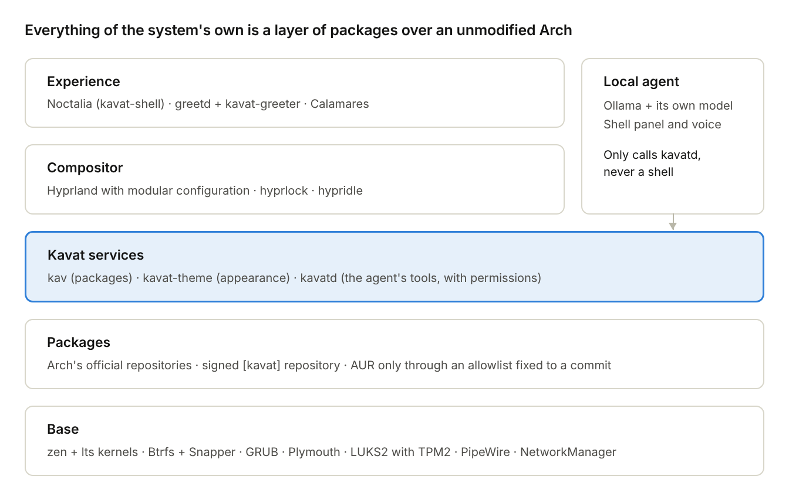
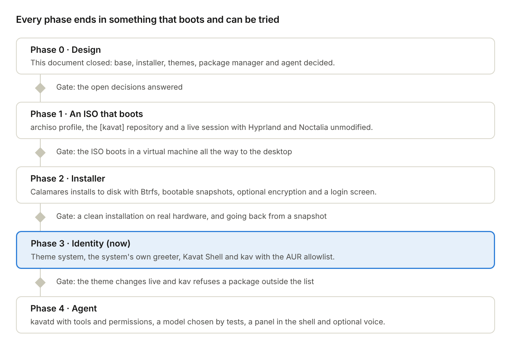

# Willwitcher-OS Kavat Edition — Design document

Updated on 16 November 2026 · [Interactive mockup](mockup/index.html) · [Screenshots](screenshots/) · [README](../README.md)

## Vision

Willwitcher-OS Kavat Edition is an opinionated Arch: it installs in 10 minutes, boots already configured the way you work, and is driven by talking to a local agent that knows the system from the inside.

Five principles decide every proposal in this document:

1. **Arch underneath, no magic.** Everything is a pacman package. No scripts that patch `~/.config` blindly; whatever the system installs, pacman can remove.
2. **Curated, not open.** The official repos are free to use; the AUR only comes in through a reviewed list pinned to a commit.
3. **A single source of truth for appearance.** A theme is tokens; each app receives its generated config. Switching from light to dark takes less than 1 second and restarts nothing.
4. **Always reversible.** Every package change creates a bootable snapshot. Breaking the system costs a reboot, not a reinstall.
5. **The agent is part of the system, not an app.** It runs locally, without network, with tiered permissions and a log of everything it does.

The working name for the project's own pieces is `kavat`: the package repo `[kavat]`, the manager `kav` and the `kavat-*` packages.



The highlighted layer is the only one that is our own code from scratch; what is above it is forks and configuration, what is below it is Arch.

## System base

The ISO is built with `archiso` from the `releng` profile, and everything of our own arrives as signed packages from a pacman repo, `[kavat]`. Arch only exists for x86\_64, so that is the target.

| Piece | Proposal | Alternative | Why |
| --- | --- | --- | --- |
| ISO build | `archiso` with its own profile in `iso/` | Start from EndeavourOS or CachyOS | Full control and no inherited decisions from others; it is built on your desktop PC |
| Kernel | `linux-zen` + `linux-lts` as fallback | Standard `linux` | Zen is more responsive on the desktop; LTS rescues a broken boot |
| Boot loader | GRUB with its own menu (decided) | systemd-boot | Supports a graphical theme and submenus: background, own entries, safe mode and a list of snapshots, each with its own kernel |
| File system | Btrfs with subvolumes `@`, `@home`, `@games`, `@log`, `@pkg`, `@snapshots` | ext4 | Cheap snapshots and zstd compression |
| Snapshots | Snapper + a pacman hook before and after each transaction | Timeshift | It integrates with the boot and with `kav` |
| Encryption | LUKS2, optional and off by default; GRUB opens it with the TPM2 | Password only | Encrypted disk without typing any password |
| Memory | zram with zstd, no swap partition | Swapfile | Fewer writes to disk; hibernation stays as an installer option |
| Audio and network | PipeWire + WirePlumber; NetworkManager with iwd | wpa\_supplicant | It is what Kavat Shell and Hyprland expect |
| Visual boot | Plymouth with a theme generated by the theme system | Text | Same identity from the first frame |

**Where each thing is mounted.** The subvolumes go on `/`, `/home`, `/games`, `/var/log`, `/var/cache/pacman/pkg` and `/.snapshots`, and the EFI partition on `/efi`. The kernel lives in `/boot`, inside `@`, so each snapshot carries its own.

**Where it is built.** The desktop PC runs CachyOS, installed only for this project. Nothing from CachyOS goes into the system: the ISO and the `kavat-*` packages are built inside clean Arch chroots, with Arch's `pacman` and tools, and with its own `pacman.conf` that only has the Arch repos and `[kavat]`. It has to be this way because CachyOS's `pacman` leaves its own marks in the package database of whatever it installs.

The repository is a monorepo with one folder per piece:

- `iso/`: archiso profile, package list and overlay of the live system.
- `installer/`: Calamares configuration, modules and branding.
- `packages/`: one PKGBUILD per `kavat-*` package that has no folder of its own, including the forks. The pieces with their own folder, such as `installer/`, carry their PKGBUILD inside.
- `kav/`: the package manager and its allowlist.
- `themes/`: tokens, templates and bundled themes.
- `greeter/`: `kavat-greeter`, the login screen: its program and its page.
- `agent/`: daemon, tools and Modelfile of the agent.
- `tests/`: boots and installs each ISO in a virtual machine.
- `docs/`: design decisions.

The forks (Hyprland, Kavat Shell) live in separate repos, and here there is only their PKGBUILD pointing to a tag.

## Installer

Calamares with its own branding does the installation in ten steps, and the base system installs without network. Calamares is not in the official Arch repos, so it is packaged as `kavat-calamares` in `[kavat]`.

The default language is English, with Spanish as the second option in the selector. Both come already installed in the ISO and in the system, with the US keyboard by default. Everything of our own (installer, greeter, shell, `kav` and agent) ships its text in English, and only in English: you decided this on 13 November 2026.

1. **Welcome**: language and requirements check (UEFI, RAM, disk).
2. **Location**: region and time zone.
3. **Keyboard**: `us` or `es`, with a place to try it.
4. **Partitions**: erase everything, alongside another system, or manual. Btrfs and subvolumes already decided; encryption as a switch, off by default.
5. **Users**: name, password, host name.
6. **Software**: programs that are added to the base system, checked one by one by category. It needs network; the details are below.
7. **Appearance**: theme, light or dark mode and accent hue, with a live preview.
8. **Summary**: exact list of what is going to be done.
9. **Install**: a progress bar, with pictures of the system going by.
10. **Finish**: restart, or stay in the live session.

They are Calamares' own steps, one page for each of its modules, and the two pages of the installer's own: you decided on 15 November 2026 (D43) to keep them, instead of joining them into the seven this list had. The graphics driver is detected without asking, so there is no Hardware step.

**How it is built.** In `installer/`, and checked by `tests/install.py`. Decided on 14 November 2026, after you saw it on the PC: it has to look like the mockup, show the system while it installs, and have the Appearance step.

- **The look** is Kavat's dark side. The steps down the left are drawn by `calamares-sidebar.qml`, with a check on the ones done and the number of the one in view in the accent; the pages Calamares draws itself take their colours from `stylesheet.qss`. The buttons are Calamares' own, so that `Alt` with a letter presses them from anywhere. The window floats in the middle of the screen, 1280 by 800.
- **Appearance** is a page of the installer's own, `appearance.qml`: the palettes of `kavat-theme` as cards, with "From wallpaper" after them, the mode, light, dark or Auto, the accents of the palette chosen, and a small desktop drawn with those colours. The `kavat-look` step writes what was chosen as the settings of the machine, `/etc/kavat/theme.toml`, before the boot loader's step: the boot menu, the loading screen and the login wear it, and every user starts from it. With Auto, it turns `auto.follow` on, and those screens wear the side of the hour it was installed at: the desktop follows the hour from the first login. With "From wallpaper", the machine keeps Kavat's own palette, since there is no background until somebody logs in: the wish is left in the settings of the background every new user starts with, and `kavat-wallpaper restore` makes the palette at the first session, from the theme's picture, and again from every background set after it.
- **The network** is said on the bar of the installer's medium, as the mockup draws it: "Online", or "No network · offline install". It is the bar's own network widget, which there says it in words; a press opens the Network page, where a Wi-Fi network is joined before installing. NetworkManager is asked, not the network.
- **A password is always asked for**: the Users page is not left with an empty one. On 16 November 2026 it was seen that it could be.
- **While it installs** it shows eight pictures of the system, one after another, each with a line that says what it is. They are the mockup's screenshots, copied to `installer/branding/kavat/slides/`.
- **Software** is a page of the installer's own too, `software.qml`: the categories, a box for each program, and a line for any other package by its name. The `kavat-software` step installs what was checked with pacman, working on the new system as `pacstrap` does, from the repositories that system is set to. It never stops the installation: with no network, or with a name pacman does not know, the system is installed as it comes, and what was left out is written in `/etc/kavat/kavat-install.toml`, with what was asked for, for `kav install` later. Every program offered is in Arch's own repositories.
- **The answer file** is written by the `kavat-answers` step, and the `kavat-software` step adds the programs to it. `/usr/lib/kavat-installer/answers`, which `kavat-installer` runs before Calamares, reads it back: it checks each answer and changes the installer's settings in the live session, so that the time zone, the keyboard, the disk page and the users page start from them, and writes `answers.js` for the Software and Appearance pages. Calamares still shows every page: the disk cannot be chosen from a file, and a locale changed by hand on the Location page is not repeated.
- **Left for later**: on the Software page, the programs that are only in the AUR, which wait for their entry in the reviewed list, the agent with its model, and what `pnpm` installs at the first boot.

Our own ideas on top of stock Calamares:

- **`kavat-theme` module**: what was chosen on the Appearance step is applied to the greeter, to Plymouth and to the desktop before the first boot.
- **`kavat-hardware` module**: writes the Hyprland configuration according to the monitors and GPU detected.
- **Installation without network**: the ISO carries the packages of the base system; with network, it updates at the end and adds the chosen software.

- **Answer file**: every installation leaves its answers in `/etc/kavat/kavat-install.toml`: the language, the time zone, the keyboard, the names of the user and of the machine, how the disk was used and whether it was encrypted, the look and the programs. It holds no password. It names the disk by what it is, its model, serial number and size, never by its name, which changes between boots: when exactly one disk of the machine is that one, the disk page comes up with it chosen; otherwise none is chosen and the side bar says the disk was not found. Nothing is erased until "Install now" is pressed. A copy of it at the top of a USB stick that is plugged in when the installer opens, or `kavat-installer --answers <file>`, fills every page in with those answers: you press Next through them, type the passwords, check the disk and confirm. The side bar says the installer was filled in from the file.
- **First boot**: an assistant inside Kavat Shell finishes what does not belong to the installer (accounts, SSH keys, model download).

**Choosing the software.** In step 5 you check what the system brings from the first boot, in addition to the base system.

- **Categories and checkboxes**: browsers, development, creation, games, communication, multimedia and office, with one checkbox per program, such as Firefox or OBS.
- **Any package**: a search box adds what is not on the list, from the Arch repos, from `[kavat]` or from the AUR allowlist.
- **`kav` installs it**, with its usual rules; anything from the AUR only comes in through the allowlist.
- **It needs network**: what does not come in the base system is downloaded during the installation. Without network, the step is skipped and nothing can be added; the system is installed as it comes.
- **It is remembered**: what was checked is kept in `kavat-install.toml`, so reinstalling repeats it.

The Development category brings what is needed to work on lanequarters, including its mobile app on Android. The iOS one is built on a Mac.

| Group | Programs | What for |
| --- | --- | --- |
| Essentials | git, lazygit, github-cli, mise, pnpm, docker with compose, lazydocker, claude-code | The projects require Node 22 or higher and pnpm; mise sets each one's Node version |
| Web | supabase, postgresql (`psql` client), stripe-cli | `supabase start` brings up the local database in Docker; `stripe listen` receives the webhooks |
| Rust | rustup with rustc, cargo, rustfmt, clippy and rust-analyzer; lldb, gcc and pkg-config | `kav` and `kavatd` are written in Rust |
| Mobile, Android | jdk17-openjdk, Android SDK with emulator, android-tools, watchman, maestro | Build the Expo app for Android and test it on the emulator or on a phone |
| At first boot, with pnpm | Playwright browsers, vercel, eas-cli | They are not pacman packages: pnpm installs them and `kav` does not manage them |

In the office category, OnlyOffice appears as an unchecked checkbox; it comes from the AUR.

The browser extension is tested in `kavat-browser`, which is a fork of Chromium and supports Chrome extensions. Six on the list come from the AUR (claude-code, supabase, stripe-cli, the Android SDK, watchman and maestro) and need their entry in the allowlist; which repository each package is in is checked when that entry is written.

## Boot

From the power button to the desktop there are three screens with the same identity: the GRUB menu, the Plymouth loading screen and the login. The first two are configured from the Boot page of the Kavat Shell panel.

**Boot menu (GRUB).**

| Entry | What it does |
| --- | --- |
| Willwitcher-OS Kavat Edition | Normal boot; it is the default entry |
| Fallback kernel | The same system with `linux-lts` |
| Safe mode | Boots with the factory configuration: your files are ignored, not deleted; no agent, no autostart apps and no animated wallpaper |
| Snapshots | Submenu with the last 10 bootable states and the pinned ones |
| Recovery | Rescue console with `kavat-rescue` |
| Firmware settings | Enters the UEFI |
| Other systems | Only appears if another system is installed |

- **Own theme**: background, typography, colors and logo come from the system theme. The background is the current wallpaper; if it is a video, its still frame.
- **Safe mode**: it is the safety net for letting the configuration files rule. If a hand-edited file leaves the desktop unable to start, this entry gets in without reading it.
- **Failed boot**: if the previous boot did not reach the desktop, the menu appears on its own and with Safe mode already selected.
- **Reboot into**: from the shell's power menu you reboot directly into safe mode, into a snapshot or into the firmware, without going through the menu. They are also skills of the agent.
- **Configurable**: timeout, default entry, which entries are shown, resolution and look. Safe mode cannot be hidden. `kavat-boot-settings` keeps it in `/etc/kavat/boot.conf`: what starts by itself is the system or, with `default=other`, the first of the other systems, as Windows.

**Loading screen (Plymouth).**

- **Four styles**: logo with a pulse, spinning ring, progress bar, or text with the boot messages.
- **It follows the theme**, with the same background image as the menu and the login, so there is no jump between the three screens.
- **`Esc` shows the boot messages.** The screen also appears on shutdown and on reboot.
- **Encrypted disk**: this screen asks for nothing. The disk arrives already open: GRUB opens it, before the menu.

**How the changes are applied.** The menu and the loading screen are system files, and changing the loading screen forces a rebuild of the boot image, which takes time. That is why the desktop theme change stays instant and the boot is updated afterwards, in the background, with a single password prompt. If the rebuild fails, the previous version stays.

Two limits: GRUB shows a still image, it does not play video or blur; and its fonts have to be converted to its own format, which the theme generator does. GRUB, grub-btrfs (the base of the snapshots submenu) and Plymouth are in the official Arch repos.

**How it is built.** Since phase 2, and tested in a virtual machine with `tests/snapshots.py`, `tests/safemode.py` and `tests/install.py --encrypt`, the last one with a simulated TPM2:

- **GRUB lives on the EFI partition.** Its files, its configuration and its environment block go in `/efi/grub`, because GRUB cannot write to Btrfs, and both "Reboot into" and the failed boot need it to write. `/boot/grub` points there. The kernels stay in `/boot`, inside the system, so each snapshot carries its own.
- **Booting a snapshot.** The snapshot is read-only and boots with an in-memory layer on top, which receives what the system writes; nothing reaches the snapshot. `kavat-boot-once <n>` asks to boot a snapshot on the next boot only, and `kavat-rollback <n>` turns it into the system: the previous one is set aside, as `@.old-<date>`. They are the base of "Reboot into" and of `kav undo`.
- **Failed boot.** Each boot leaves a mark in the GRUB environment block, and the system advances it: login screen, session started, desktop. If the previous boot did not reach the login, or someone logged in and the desktop did not appear, GRUB opens the menu with Safe mode chosen and boots it on its own after 30 seconds. If nobody logged in, it does not count as a failure.
- **Safe mode.** The session starts with the configuration, state and data folders empty, so each program uses the system configuration. Your files are not touched.
- **Encrypted disk.** Decided on 13 November 2026 (D33). GRUB opens the disk before the menu, with a key that the installer seals in the TPM2. That key is bound to PCR 7, the Secure Boot state that the firmware measures, as systemd does by default, so a kernel or mkinitcpio update does not force sealing it again. Afterwards, the system opens the disk again with the same key, stored inside its boot image, which lives on the encrypted disk: nobody types anything. If the TPM2 does not give the key, GRUB asks for the recovery password, in text. Since GRUB tries the disk's keys in the order in which they are written, the TPM2 key goes first and the password, which is slow to try on purpose, after it. All of this holds equally for the snapshots and safe mode, because the disk is already open when the menu comes up.
- **No Secure Boot.** Decided on 13 November 2026 (D34). GRUB without shim does not boot any kernel with Secure Boot active, and shim only arrives through the AUR: one more outside piece is not worth it. Secure Boot has to be off in the firmware; with it on, not even the ISO boots.
- **The menu, with its entries.** Since phase 3, `kavat-boot` writes them, with the names and the order of the table: GRUB's own scripts for the kernel list, the other systems and the firmware are turned off, and a pacman hook turns them off again when `grub` is updated. "Other systems" is a submenu with what `os-prober` finds, and it only appears if it finds something. The menu text is in English.
- **Recovery.** It boots the system up to mounting the disks and nothing more, with the fallback kernel and the boot messages in view, and leaves `kavat-rescue` on screen: go back to a snapshot, open a console as root, continue with the normal boot, reboot or shut down. The console does not ask for a password: whoever reaches the boot menu can already edit an entry and get the same. Entering here does not count as a failed boot.
- **The look.** `kavat-theme boot` generates it for the three screens at once, with the same palettes and the same settings as the desktop. It is a root step: your command passes it the settings in effect through `pkexec`, and nothing else, so it asks for the password once. Root remembers the settings it received; as long as nobody gives it any, it uses the machine's, which is what the installer does. Tested in a virtual machine with `tests/startup.py`.
- **Menu.** The theme goes to `/efi/grub/themes/kavat`: the background and the logo as PNG, the theme's fonts converted to GRUB's format and the box of the chosen entry cut into nine pieces. Two things in the mockup are beyond what GRUB can do and are not there: a different text under the menu depending on the chosen entry, and a second, smaller line inside an entry.
- **Loading screen.** A Plymouth theme with the logo and a ring that grows and fades, over the same background as the menu. It travels inside the boot image, which is rebuilt only when the look changed. Of the four styles, the first one is there; the spinning ring, the bar and the text arrive with the Boot page of the panel.
- **The background, for now**, is one generated with the theme's colors, the same on the three screens. The desktop wallpaper will take its place when that piece exists.
- **No cut between menu and loading.** Two things keep the picture on the screen. GRUB shows its console while it starts an entry, and it draws the theme's picture behind it instead of black. And Plymouth draws at once on the screen the firmware left, with `plymouth.use-simpledrm` on the kernel line, instead of waiting for the graphics driver. The first try on the PC, on 13 November 2026, showed why both are needed: the RX 6800's driver takes until second 8.5 to be ready, Plymouth was waiting for it, and what stayed on the screen meanwhile was GRUB's console, a black box. Between the loading screen and the login, the login's own small session starts; how that instant looks on the PC has to be seen.

## Login

greetd with `kavat-greeter` shows a page in HTML/CSS/JS that reads the same tokens as the desktop, so the login changes color when you change theme.

- **Design**: large clock, avatar, password field and nothing else in view. Session, power and keyboard appear when you move the mouse to a corner.
- **Live background**: the greeter's background is the same background as the desktop, blurred, so the step into Hyprland has no visual cut.
- **System status**: battery, network and a line with pending updates.
- **Several users**: selector by avatar; each user sees the login with their own theme.
- **Screen lock**: same design as the login, made with hyprlock, so locking and logging in look the same.

Decided on 14 November 2026: greetd, with the system's own greeter drawing its page on Wayland. It takes the place of LightDM with web-greeter, the first decision, which worked but started an X server only to show the login. The page is the same one.

**How it is built.** Since phase 3, and tested in a virtual machine with `tests/startup.py`:

- **greetd** asks for the password and starts the session. What it shows to log in is a small Hyprland session of its own, as its own user, with nothing in it but the login page; when someone logs in, that session ends and theirs starts. No X server runs at any point.
- **`kavat-greeter`** is the system's own program, in `greeter/`: a couple of hundred lines of Python on Arch's Qt that show the page on every screen and stand between the page and greetd. The page can read files of this machine and nothing else.
- **The page** is HTML, CSS and JavaScript, in `greeter/page/`: clock, avatar and password. Session, keyboard, suspend, reboot and shut down appear when you move the mouse down to the bottom edge. With several users, the others appear as small avatars. On a machine with two screens the login shows on one: you tried it on 14 November 2026 and it is good as it is. The text is in English; the clock and the date follow the system format. It offers two keyboards, `us` and `es`.
- **It follows the system theme**: it reads the colors, the corners and the fonts that `kavat-theme boot` leaves, and uses the same background as the menu and the loading screen.
- **The desktop has that background too**, in the colours of the user's theme: `kavat-theme` writes it and the shell is told, unless the background in place is one you chose yourself.
- **The lock screen** is hyprlock with this same design: the picture, the clock, the day, a circle with the first letter of your name, and the place for the password. `kavat-theme` writes its file, in your theme's colours. `Super+Shift+L` locks at once; hypridle locks after ten minutes and turns the screen off after fifteen, times that are changed on the Login & lock page. It does not run on the live medium, whose user has no password to come back with.
- **Every screen has its page**: the main one asks who logs in and the others show the clock; so does a screen that wakes up after the login has started or is plugged in later. On the PC the second display woke late and stayed black; a screen gets its page now when it appears.
- **How it asks** is set with `kavat-login-settings`, on the Login & lock page, and kept in `/etc/kavat/login.conf`: a clock of twenty-four hours or of twelve; whether it shows who can log in, to be picked, or names nobody and has the name typed; and one person whose desktop opens by itself as the machine starts, with no password asked. That is greetd's `initial_session`, written to a copy of its settings in `/etc/kavat/greetd.toml`; it happens once at each start, and after logging out the login asks as always. The installer's Users page has the box for it, "Log in automatically", beside the password, and the answers' step tells the login. The keyring is opened by the password typed at the login, and with nobody typing it there it would ask for it at every start: so the person who logs in by itself is given a keyring with no password, Kavat, as the one apps keep their passwords in. What is kept in it is not encrypted, unless the disk is: that is the price of not being asked, and the user's choice of 16 November 2026.
- **Left for later**: the network status and the pending updates, which need `kavatd`; and each user's own theme on the login.

## Desktop

Hyprland composites the windows, and Kavat Shell, which began as Noctalia 5, provides the bar, the launcher, the notifications, the control center, the agent panel and the settings panel.

**Hyprland.** Decided: do not touch the compositor's code at the start. The identity goes in a `kavat-hyprland` package with modular configuration and plugins; if the current version of Hyprland prevents something we want to do, the fork of the code is opened from day 1.

- Configuration split into files: `binds`, `rules`, `monitors`, `look`, `autostart`. The system's live in `/usr/share/kavat/hypr/`; yours in `~/.config/hypr/`, and they always win.
- Version pinned in `[kavat]`: Hyprland changes syntax often, so it only moves up when the configuration is already tested against that version.
- The shortcuts start from those of your Willwitcher-OS Endgame, without changing any; what is new only takes keys you had free. A cheat sheet is generated from the configuration.
- Animations, borders, radius and blur come from the theme's tokens, not from hand-written values. The initial values are those of Endgame: radius 10, border 2, gap of 5 between windows and 20 at the edge, short animations.

Since Hyprland 0.55 the configuration is Lua, and that is how it is used. The settings panel and the agent do not generate Lua: they write a table of values, which is data, and the system's Lua loads it. This way no text that comes from outside ever gets executed.

Shortcuts: 19 inherited from Endgame as they are and 12 new ones for what did not exist before.

| Action | Shortcut | Origin |
| --- | --- | --- |
| Terminal (Kitty) | `Super+Enter` | Endgame |
| Close window | `Super+Q` | Endgame |
| App launcher | `Super+D` | Endgame |
| Files (Yazi) | `Super+E` | Endgame |
| Floating | `Super+V` | Endgame |
| Pseudotile | `Super+P` | Endgame |
| Toggle split | `Super+J` | Endgame |
| Move focus | `Super` + arrows | Endgame |
| Go to workspace 1 to 10 | `Super` + `1`…`0` | Endgame |
| Send the window to workspace 1 to 10 | `Super+Shift` + `1`…`0` | Endgame |
| Next or previous workspace | `Super` + mouse wheel | Endgame |
| Scratchpad: show / send window | `Super+S` / `Super+Shift+S` | Endgame |
| Switch window | `Alt+Tab` | Endgame |
| Clipboard history | `Super+Shift+V` | Endgame |
| Color picker | `Super+Shift+P` | Endgame |
| Region screenshot to the clipboard | `Print` | Endgame |
| Lock | `Super+Shift+L` | Endgame |
| Exit the session | `Super+M` | Endgame |
| Move / resize with the mouse | `Super` + drag with left / right button | Endgame |
| Agent | `Super+Space` | New |
| Browser | `Super+B` | New |
| Fullscreen | `Super+F` | New |
| Move the window | `Super+Shift` + arrows | New |
| Resize | `Super+Ctrl` + arrows | New |
| Theme picker | `Super+T` | New |
| Switch mode | `Super+Shift+M` | New |
| `kav` panel | `Super+U` | New |
| Power menu | `Super+Escape` | New |
| Cheat sheet | `Super+/` | New |
| Quick note | `Super+N` | New |
| Notes | `Super+Shift+N` | New |
| File search | `Super+Shift+F` | New |

**Kavat Shell.** The shell is the system's own program. It began as a fork of Noctalia 5, decided on 11 November 2026, and since 14 November 2026 it has its own name (D39): you no longer count it as Noctalia.

- It starts from Noctalia 5.4.1, written in C++ and under the MIT license, which asks that Noctalia be named as where it comes from: it is, here and in the license file. Not every upstream version is followed: whatever is of interest in them is brought in by hand.
- Our own additions: the settings panel, the agent panel, the theme picker with preview, the `kav` panel (updates, snapshots, AUR requests) and the first-run wizard.
- Its color engine is fed from the system's tokens, so there is a single source of truth.
- The first-run wizard it inherited is turned off: it chooses palette and mode on its own, which is the system theme's business. Whoever changes the theme from the shell's own settings leaves it out of sync with the rest; that page disappears when the settings panel covers it.
- **It asks the network for nothing by itself** (D40, 14 November 2026). Noctalia's "Anonymous Startup Ping" was removed first, on 13 November: it sent the version, the system, the compositor, the resolutions, the RAM and the scale on every startup. Reading its log then showed more: on every start it fetched a catalogue of community palettes and one of templates, exchange rates for the launcher's calculator, and its two lists of plugins from GitHub, these again every six hours. All of it is off until you turn it on. Two things with no switch were taken out: the cover of what is playing and the icon of a notification are no longer fetched when they are an address on the network, since that address is chosen by another program; a cover that is a file is shown as before. What can still use the network, when you set it up: the calendar, the weather, your address on the network and your location, the plugin store, and a plugin that does. The cover of what is playing and the picture of a notification are not fetched either when they are an address on the network: you decided on 15 November 2026 (D41) to leave it so.
- **How it is built.** In `packages/kavat-shell/`: Noctalia 5.4.1 with Arch's recipe, two patches and a script. `no-ping.patch` removes the ping, its checkbox and its card in the assistant. `no-network.patch` turns off what was fetched by itself. `rename.py` gives it its name before it is built: the command is `kavat-shell`, its settings are in `~/.config/kavat-shell/`, its files in `/usr/share/kavat-shell/`, and its names on D-Bus and every text it shows say Kavat Shell. What keeps the old name on purpose: the code's own identifiers; the `noctalia.` functions that plugins call, so that a plugin written for Noctalia still runs; and the addresses of Noctalia's own plugin lists. `tests/theme.py` checks that it runs under its name, that the ping's address is not in it and that its log shows no request to the network after a start. The polkit password dialog is drawn by the shell: its agent comes turned on.

**Command palette.** `Super+D` opens a single palette for the whole system: apps, files, settings, skills, packages, open windows and browser tabs. It uses the same grammar and the same command names as the browser's console and the Neovim palette, and what it does not find it can pass to the agent.

- **Projects.** A project saves a whole workspace: folder, terminals, editor, browser profile and window layout. It is opened from the palette or from the bar, and comes back just as you left it.
- **One `kavat` command for everything.** `kavat theme`, `mode`, `wallpaper`, `project`, `ask`, `fetch`, `top` and `doctor` share verbs and autocompletion; everything the panel does can be done from the terminal.
- **Context-aware cheat sheet.** `Super+/` shows the shortcuts of the app that has the focus, in addition to the system's.
- **Screenshot with text.** When capturing a region of the screen, its text can be copied, with local recognition.

**Calculator in the palette.** Typing a calculation or a unit conversion in `Super+D` gives the result, computed on the machine, and Enter copies it.

**How it is built.** Since phase 3, and checked by `tests/desktop.py`:

- **The palette** is the shell's launcher with the system's own things added by a plugin, `kavat/palette`, each behind its word: `/s` the pages of the settings, `/f` files by name, `/pr` the projects, `/m` the modes, `/k` packages, which Enter hands to `kav` in a terminal, `/n` the notes, where words that find nothing are saved as a note, and `/t` the tabs open in the browser, by title or address: Enter brings the tab and its window to the front. The extension tells its host the tabs at each change, `kavat-browser tabs` lists them and `kavat-browser tab <number>` goes to one; private tabs are never told, and none are listed while a mode keeps the browser out of sight. Open windows are the launcher's own, behind `/win`. Apps, the calculator, the clipboard and the rest are the launcher's own.
- **Projects**: `kavat-project new <name>` makes one for a folder, and `kavat-project open <name>` goes to its workspace and opens what it is made of: a terminal and the editor in its folder, and whatever else its file says, files, the browser with a profile of the project's own, or any command. Opening one that is open only goes to it. The Projects page of the panel lists them.
- **`kavat`** is the one command: `kavat theme`, `mode`, `wallpaper`, `displays`, `project`, `notes`, `find`, `browser`, `packages`, `doctor`, `backup`, `history`, `settings`, `set`, `fetch` and `top` are the system's programs under one name, with Tab offering what each takes.
- **The screen's text**: `Shift+Print` reads a region of the screen with tesseract, in English and Spanish, on the machine, and copies what it says.
- **On the bar**, beside the modes: a mark when an app uses the microphone, the camera or the screen, and which of the two keyboards is in use. Both are the shell's own widgets.
- **Left for later**: windows and tabs in the plain search, one grammar shared with the browser's console and Neovim's, passing what is not found to the agent, a project remembering its windows' places, and the cheat sheet of the app in focus.

**Rule for all the forks.** Each fork carries a `PATCHES.md` with what it changes and why, and an automatic task that warns when upstream publishes a version and whether the patches apply cleanly.

## System modes

A selector in the Kavat Shell bar switches the whole machine between three modes; it resembles choosing a power profile, but each mode decides what runs, where the network goes out and what is remembered.

|  | Coder (default) | Gamer | Incognito |
| --- | --- | --- | --- |
| Agent | Active | Off; model and voice out of memory | Active, without saving history |
| GPU and memory | Normal use | Everything freed for the game | Normal use |
| Background processes | All | The ones that are not needed are stopped: containers, indexing, updates and scheduled snapshots; the animated wallpaper is paused | All |
| Network | Direct | Direct | Everything through VPN (OpenVPN or Proton VPN) |
| Browser | Normal | Normal | New windows open in incognito |
| Notifications | Normal | Do not disturb | Normal, without content preview |
| Performance | Balanced | Maximum CPU performance | Balanced |

How it works:

- Each mode is a TOML file in `/usr/share/kavat/modes/` that declares which services it stops or starts, which network profile it uses and which settings it changes. A mode of your own is one more file.
- `kavatd` applies the change and undoes it on exit: what Gamer mode stopped starts again when you return to Coder.
- It is switched from the bar, with `Super+Shift+M`, with `kavat mode gamer` or by asking the agent.
- The bar always shows the active mode; in Incognito, also the VPN status.

Ideas added on top of what you asked for:

- **Automatic Gamer**: enter the mode when a game is launched from Steam and leave it when it is closed.
- **Animations and effects stay in Gamer**: the mode frees resources by turning off processes, not the appearance.
- **Network cut in Incognito**: if the VPN drops, no traffic goes out until it comes back. Without this, a drop leaves you browsing with your real IP without warning.
- **Incognito outside the browser too**: the clipboard history, the terminal history and the recent files stop being saved; on exit the clipboard is emptied.
- **It does not enter Incognito until the VPN connects**: the mode is only marked active with the tunnel up.

A limit to keep clear: the VPN hides your IP from the sites and your traffic from your provider, but it does not make you anonymous to accounts you log in to.

On entering Incognito, the normal browser windows already open are hidden in a separate workspace and come back on exit.

**How it is built.** Since phase 3, in `packages/kavat-modes/`, and checked by `tests/modes.py`. It is built without `kavatd`, which is phase 4: the program that changes the mode is `kavat-mode`.

- **A mode is a file**, as above: the system's in `/usr/share/kavat/modes/`, the machine's in `/etc/kavat/modes/`, yours in `~/.config/kavat/modes/`. It can name the processor's profile, silence the notifications, stop units of the system and of the user, pause a video background, ask for the VPN and stop the terminal's history.
- **What a mode changes is written down and undone on leaving it**: only the units that were running are started again, and the processor's profile and the notifications go back to what they were. Every session starts in Coder, undoing what an earlier one left.
- **On the bar**, the three modes are a switch, drawn by a plugin of the shell, `kavat/modes`; `Super+Shift+M` goes to the next one, and the Modes page of the panel shows what each does.
- **Units of the system** are stopped by a small helper that runs as root without asking for a password, for the person at the machine only; it touches nothing but the units a mode of the system names, so a mode in a home folder cannot stop a service of the system.
- **Gamer** puts the processor on performance, silences the notifications, pauses a video background and stops the disk's index, the scheduled snapshots and the containers. A watch of the session enters it when Steam starts a game and goes back when the game ends; it can be turned off on the Modes page.
- **Incognito** needs a VPN that NetworkManager knows, WireGuard or OpenVPN, chosen on the Modes page or with `kavat-mode vpn <name>`. It brings it up, and is not entered if it does not come up. Then a table of nftables lets nothing out but through the VPN's device and to the VPN's server: if the VPN drops, nothing goes out. The terminal keeps no history while in it, apps add nothing to their list of recent files, and the clipboard is emptied on leaving. Notifications arrive without their content: while the mode is on, the shell shows and keeps who sent each one and the word "Notification", not what it says nor its picture; its buttons still work. What arrived before stays as it was, and what is withheld is kept nowhere. It is a setting of the shell's, `notification.hide_content`, added by a patch of its own. Remote access is paused while the mode is on. The browser of the mode is one apart: the same Chromium with the blocker and the system's extension as always, its settings in a folder of the session's, in memory, which is closed and deleted on leaving the mode. Chromium's private windows are not used for it, since no extension runs in them and the blocker has to be there in Incognito more than anywhere (D51, 16 November 2026); `kavat-browser --private` still opens one.
- **A mode that is not entered says why**: asked for from the bar, a shortcut or the launcher, where there is no terminal to say it in, a notification does. Incognito with no VPN on the machine says how one is added and opens the Network page.
- **The network on the bar** is the system's own widget, in the place of the shell's: it shows whether the machine is connected and through what, a press opens the Network page, and a press with the right button the shell's own controls.
- **The VPN on the bar**: while a VPN is up, its name stands beside the modes, in the accent; a press opens the Network page.
- **Left for later**: what waits for the agent (the agent off or without history). 

## Gaming and hardware

The machine is a desktop with a Radeon RX 6800, and the system treats it as such.

- **Per-game profile**: in Gamer mode, each game can have its own performance monitor, its frame limit and its GPU profile. The monitor and the limit come from MangoHud, and gamescope sets each game's resolution and scaling; both go in the installer's games category.
- **GPU page**: fan curves, power limits and sensors in the bar.
- **The lights follow the theme**: with OpenRGB, keyboard and tower take the accent color, change with the mode and pulse with Kavat's voice.
- **Microphone noise suppression**: on by default, for the agent's voice and for live streams.
- **Removable drives**: when a USB drive is plugged in it mounts on its own and a notice appears with "Open in Yazi" and "Eject". Drives with NTFS mount just the same.
- **Keychron keyboard**: it is configured with the web version of VIA from `kavat-browser`. The system only ships the udev rule that gives access to the keyboard; qmk and the VIA app are not installed.
- **Headphones**: headsetcontrol reads the battery of USB headphones, which appears on the Network & Bluetooth page next to the other devices.
- **Network and Bluetooth**: one page of the panel gathers the cable, the Wi-Fi, the saved VPNs and the Bluetooth devices, such as controllers and headphones, with their battery.

**Displays.** Any number of displays is supported, and they are arranged from the Displays page of the panel.

- **By dragging**: each connected display is drawn to scale and is placed by dragging it, in landscape or in portrait; the edges snap to each other. It works for one display, two side by side, or a landscape one next to a portrait one.
- **One layout per set of displays**: each set saves its own and is recognized by the model and the serial number of the displays, not by the port. The connected set decides which one is applied, so one same synced configuration works on machines with different displays.
- **Main display**: the launcher, Kavat, the notifications and the games open on it. The workspaces are distributed per display.
- **Confirm or undo**: a change that is not confirmed in 10 seconds undoes itself.
- **In the file**: the layouts live in `~/.config/hypr/monitors.lua`, as a table of values. By default, a new display extends to the right.

**How it is built.** Since phase 3, and checked by `tests/desktop.py`:

- **`kavat-displays`**, in `packages/kavat-hyprland/`, sets a display's mode, scale, rotation and place, and keeps one arrangement for each set of displays in `~/.config/hypr/monitors.lua`, which Hyprland's configuration reads. A set is known by what its displays are, not by their sockets.
- **A change is tried first**: it is worn at once, and undone by itself after ten seconds unless it is kept. The Displays page of the panel draws the displays to scale, changes the one that is pressed, and asks to keep or undo in a band across the page that counts the seconds left; the changes made while it counts are kept or undone together, and when they are undone the page says so.
- **The workspaces of a display**: on the Displays page each display has the ten workspaces as buttons, and the ones pressed open on it. A workspace is on one display, so what one takes the others give up; the first of a display's is the one it starts on. They are kept with the arrangement, in `monitors.lua`, and Hyprland holds them as workspace rules; `kavat-displays workspaces <display> 1,2,3` does the same. The display that has workspace 1 is, in practice, the main one.
- **A disk that is plugged in** is mounted by udiskie, which shows a notice with two buttons: one opens it in Yazi, the other takes it out safely.
- **The microphone's noise suppression** is a file of PipeWire's, in `packages/kavat-base/`: it adds a microphone, "Microphone, noise removed", that listens to the real one through RNNoise and is offered first. It is on for every new user, and the Sound page of the panel turns it off and on.
- **The GPU page** of the panel shows what the card says of itself, read from the kernel's files every two seconds while the page is in view: temperature, use, memory, fan and power. The fan curve and the power limit are LACT's, a program for exactly that, which the page opens, or installs with `kav` when it is not there; it is among the Games of the installer's Software page.
- **The lights** take the theme's accent when OpenRGB is installed: the theme leaves the colour in a file and a helper hands it to OpenRGB, at each change of theme and when the session starts. OpenRGB is among the Games of the installer's Software page.
- **Placing by dragging**: on the Displays page each display is a rectangle to scale, and it is dragged to where it stands; while it moves, its edges catch those of the others. Where it is dropped is handed to `kavat-displays place`, which leaves it against the nearest edge of another display, over none of them. The panel could not do this as a plugin, so the shell got a control of its own for it, `ui.arrange`, written in its C++: `arrange.patch` in `packages/kavat-shell/`.
- **A profile for each game**, `kavat-game`, in `packages/kavat-modes/`: a file in `~/.config/kavat/games/` that names the game, by its number in Steam or by its program, and what it gets: the performance monitor and a limit of frames, which are MangoHud's; its own resolution and scaling, gamescope's; and a profile of the graphics card, one of LACT's, worn while the game runs. In Steam the game's launch options are `kavat-game run %command%`. What a profile asks of a program that is not installed is left out and said, and the game starts all the same. The GPU page lists the profiles and makes new ones.
- **Night light**: `kavat-displays night on|off|auto` warms the colours of every display, always or between two hours, 20:00 to 07:00 as it comes, and `night warmth` says how much. It is hyprsunset, run as a service of the session and told by a file `kavat-displays` writes; what is set is in `~/.config/kavat/night.json` and on the Displays page.
- **A display plugged in during a session**, or taken out, brings the arrangement kept for the displays there are then, as the start of a session does: Hyprland tells its configuration, which runs `kavat-displays restore`.
- **Left for later**: the card's sensors on the bar, and the lights changing with the mode and with Kavat's voice.

## Settings from the shell

A Settings panel inside Kavat Shell configures the whole core of the system from a single place, and each new piece that enters the core arrives with its settings page.

| Panel page | What is set | Fork needed |
| --- | --- | --- |
| Appearance | The whole theme system: palette, mode, accent, hue, typography, profiles; icon style and cursor size; lights that follow the accent | Own |
| Wallpaper | Image or video, folders, video settings, pause rules, wallpaper per display | No: mpvpaper for the video |
| Accessibility | Reduce motion, text scale, high contrast | Own |
| Windows (Hyprland) | Gaps, borders, animations, layout, mouse and keyboard, window rules | Not planned: it supports live changes |
| Shortcuts | All the shortcuts, with conflict detection and cheat sheet | No |
| Displays | Layout of the displays by dragging, one for each set of displays; main display; resolution, refresh rate, scale, rotation, adaptive sync and workspaces of each one; night light | No: Hyprland applies it |
| GPU | Fan curves, power limit, sensors in the bar, per-game profiles | No |
| Sound | Output, input, per-app volume, microphone noise suppression | No |
| Network & Bluetooth | Cable, Wi-Fi, saved VPNs, Bluetooth devices and their battery, and whether they start turned on | No |
| Remote access | Whether this computer is reached from your other devices: the private network, the terminal, the desktop, the devices that may come in, and staying awake | No: Tailscale, the SSH server and Sunshine as they come |
| Terminal (Kitty) | Font, size, cursor, opacity, margins, tabs, history; logo, lines and greeting of the system information; grouping, history, alert and agent key in the system monitor | Not planned: it supports live reload |
| Editor (Neovim) | Shortcut preset, line numbers, tabs, automatic formatting and saving, language packs, plugins, side panels | No: it is our own configuration (`kavat-nvim`) |
| Files (Yazi) | Shortcut preset, drag and drop, copier with pop-up, system file picker, what clicking a download does, previews, open with | Not planned: plugins; fork only if a plugin falls short |
| Notes (nb) | Notes folder, default notebook, quick note, reminders and how long they snooze, task views, which notebooks the agent reads, encryption and sync | Fork of nb (kavat-notes) |
| Shell (zsh) | Prompt, plugins, history, aliases, default apps | No |
| Browser | Blocker, YouTube Shorts, appearance, profile per mode, protected video, web apps, console commands, clips and albums | The Chromium fork already planned |
| Bar & widgets | Position and density of the bar, widgets and their order, launcher, notifications | Kavat Shell |
| Modes | What each mode does, automation with Steam, Incognito VPN, new modes | Own |
| Projects | Saved projects: folder, terminals, editor, browser profile and windows of each one | Own |
| Agent & voice | Memory budget, model, permissions per tier, voice and how it is activated, what is seen while it speaks, alerts, activity log | Own |
| Skills | Stock and own skills, their steps, shortcut, voice phrase, where they are pinned and when they launch on their own | Own |
| Packages (kav) | Sources, updates and their check, snapshots, AUR allowlist and requests | Own |
| Backup & sync | Snapshots of `/home`, external backups, configuration history and its sync | Own |
| Privacy & network | Which app used the microphone, camera or screen; per-application firewall rules; keyring and SSH and GPG keys | No |
| Boot | GRUB menu (timeout, default entry, visible entries, look) and loading screen (style, messages) | No: generated themes for GRUB and Plymouth |
| Login & lock | Background, clock, users, login language, lock timings | `kavat-greeter`, already there |
| Language & region | System language (English or Spanish), keyboard layouts, formats | Own |

In Neovim, as in the rest, your files in \~/.config/nvim/ win over what the panel generates.

How it works:

- **The configuration file is the truth.** Each setting lives in a single place: the configuration file of its app, or `~/.config/kavat/` for what is the system's own. What is in the file is what counts.
- **Two-way street.** If you change a value by hand, the panel shows it at once. If you change it in the panel, the panel edits that line in the file, without touching the rest or the comments. There is no second copy that could fall out of date.
- **Validate before applying.** Each configuration change, whether it comes from the panel or from your editor, is checked before it is loaded. If the desktop does not reload properly, it goes back on its own to the last good version and tells you which line failed. If even so it does not start, there is still the safe mode of the boot menu.
- **What the panel does not have lives only in the file.** The panel does not touch it, does not hide it and does not delete it.
- **Limit in files that are code.** In `the Hyprland configuration, which is Lua, in Neovim's init.lua and in .zshrc, the panel only edits its table of values or its settings block`; the rest it leaves as it is and opens in Neovim.
- **Open the configuration in Neovim, everywhere.** Each page of the panel and each piece of the system (the agent panel, the theme picker, `kav`, Yazi, the browser, the marketplace) has a button that opens its configuration file in Neovim, at the corresponding section.
- **Live and reversible**: each change, whether it comes from the panel or from the file, is applied instantly; it has undo and is kept in a history to go back to any previous state.
- **Shortcut editor**: it shows all of them, detects conflicts when assigning and regenerates the cheat sheet.
- **Search**: typing "gaps" or "font" takes you to the setting, whichever app it is in.
- **The agent uses the same thing**: "raise the gap to 10" changes the same value as the panel, with the same undo.
- **Export and import**: your whole state fits in one file; reinstalling is restoring it.

**Guaranteed dependencies.** No option of the panel stays active without the software it needs: if you choose mpvpaper as the wallpaper engine, `kav` makes sure it is installed before applying the setting.

- **Each option declares what it needs.** The wallpaper engine, the VPN provider, a language pack of the editor or a voice engine carry their list of packages.
- **It is installed on choosing.** When an option is checked, the panel asks `kav` to install what is missing, with the usual rules (official repos, `[kavat]` or allowlist) and its snapshot. The setting is only considered applied when `kav` confirms; if the installation fails, the previous value stays.
- **What comes by default is already installed.** The default options of each page go in the ISO, so the freshly installed system works as it comes without network.
- **It is not removed by accident.** `kav remove` warns which setting depends on the package and asks you to change the setting first; the orphan cleanup does not touch it.
- **It is watched.** `kav doctor` checks that everything the settings need is still installed, and repairs it.
- **It holds for everything that declares dependencies**: the agent's skills, the marketplace plugins that need a system program, and the modes.

**How it is built.** Since phase 3, in `packages/kavat-settings/`, and checked by `tests/settings.py`. These are the first pages. Decided on 14 November 2026 (D37): what counts is that the panel ends up as the mockup draws it; it is a plugin as far as a plugin reaches that, and C++ inside the shell where it does not.

- **The panel is a plugin of the shell**, `kavat/settings`: a folder with its description and one script. `kavat-theme` writes, in the shell's settings, where that folder is and that the plugin is on, so it is there from the first login.
- **`Super+T`** opens it. Twenty-five pages of the twenty-seven are built: **Appearance** and **Windows**, with every setting of the theme, each applied as it is changed; **Wallpaper**, with the library, a background for each display and the slideshow; **Accessibility**, which gathers less motion, the size of the text, high contrast and the size of the cursor; **Keybindings**, the desktop's shortcuts, which `Super+/` opens as a cheat sheet; **Displays**, which shows each screen as Hyprland has it, and has the night light; **Sound**, with the output, the microphone, their volumes and the volume of each app that plays; **Network**, with the cable, Wi-Fi, the VPNs and the Bluetooth devices, each with its switches and buttons, the name and password of a VPN that asks for them, and the code of a Bluetooth device that does; **Bar & widgets**, with where the bar is, its size, its widgets in order and where the notifications show; **Terminal**, **Editor** and **Files**, with settings of Kitty, Neovim and Yazi; **Notes**, with what is due; **Packages**, with what is installed and what waits; **Boot**, with how long the menu waits, what starts by itself, which entries it shows, the loading screen, whether they follow the desktop by themselves, and the look of the screens before the desktop, said beside the desktop's with a button to make them the same; **Login & lock**, with that same look, the login's clock, whether it shows who can log in, who logs in by itself, and the times of the lock; **Language & region**, with which keyboard comes first; **Modes**, with what each mode does and what Gamer and Incognito need; and **Backup & sync**, with the snapshots, the backups and the history. Wallpaper and Displays are whole pages now: the library with its pictures, and each display's mode, scale, rotation and place. **GPU** shows the card's sensors; **Browser**, which browser opens links, the console's commands, the blocker and Widevine; **Projects**, the projects, to open and to make; and **Privacy & network**, the firewall and who reaches the network. **Shell** has the prompt, short or full, the suggestions, the colours and the picker as you type, the history, whether `ls` is lsd, your aliases' file and what opens each kind of thing. Privacy & network also turns encrypted DNS and the browser's sandbox on and off, and GPU has the games' profiles. Two of the others are listed and say what they wait for: the agent and its skills. The third, Remote access, is designed and not built.
- **A page has the controls themselves**, not a button that leads to them. The shell's control center keeps its own, a press away on the bar; the panel has them too. Three small programs stand behind those pages, each putting what the system's own tools say in one list and their commands under one name: `kavat-network`, over NetworkManager and BlueZ; `kavat-sound`, over PipeWire; and `kavat-boot-settings`, over GRUB, which asks for an administrator's password and writes the menu again. The bar and the notifications are changed through the shell itself, which keeps them in its own file.
- **A VPN is added from the file its provider gives**, WireGuard or OpenVPN, with `+ Add a VPN` on the Network page or `kavat-network vpn add <file>`: it is kept by NetworkManager under the file's name, comes up only when asked, and the first one added is the one Incognito uses. Asked for with no VPN, Incognito is not entered, a notification says why and how one is added, and the Network page opens. Bluetooth is BlueZ, on from the first start; the page pairs, connects and forgets devices and shows their battery. A device that shows a code has it said in a notice, and one that asks for a code is paired with the code written in the page. A VPN that asks for a name and a password, as some OpenVPN ones do, says so on its line: they are typed once, with Sign in or `kavat-network vpn login`, and kept by NetworkManager where only root reads them, since Incognito brings the VPN up with nobody there to be asked. Whether Wi-Fi and Bluetooth are on when a session starts is kept in `~/.config/kavat/network.toml`. **Proton VPN's own app** is an option beside the files: the installer's Software page offers it, the Network page installs it and opens it, and Incognito can be set to use it, `kavat-mode vpn proton`: it then connects with Proton's own command, `protonvpn connect`, and guards the connection that makes, whatever its name.
- **A setting an app keeps in its own file is changed there**, by `kavat-conf`: it knows each page's file, how a line of it is written and what each setting may be, changes only that setting's line and tells the app. The Editor's are in `~/.config/kavat/editor.json`, which `kavat-nvim` reads; your own `init.lua` has the last word.
- **The shortcuts' list** is `shortcuts.tsv`, kept beside Hyprland's configuration in `kavat-hyprland`.
- **Nothing is kept in the panel.** Each page asks its program what is in force and changes it by running that program: `kavat-theme`, `kav`, `kavat-notes`. A value changed by hand shows the next time the panel opens, and a value the program refuses is not applied and its reason is shown.
- **The shell's two lists of plugins on the network are off** until you turn them on in its settings: as Noctalia they were fetched on every start and every six hours.
- **`Super+U`** opens `kav` on its full screen, in a floating window.
- **The keyboard** is the one chosen in the installer, with the other of the two, `us` and `es`, behind it: `Alt+Shift` changes between them. The Language & region page changes which comes first; it is kept in `~/.config/kavat/desktop.json`, which Hyprland's configuration reads.
- **Undo, History and Export**, at the foot of every page, are the history of the settings: Undo takes the last change back, History opens all of them in the system's picker, and Export leaves the settings as one file.
- **The search looks inside the pages**: a word that is the name of a setting or of a section brings its page to the list, with that name beside it. The pages are drawn once, out of sight, to know what each has, so there is no list to keep by hand.
- **A shortcut is given other keys** on the Keybindings page: a press on one opens a field for the new keys, written as `Super+Shift+E`, with "No keys" and "As it comes" beside it. It is `kavat-keys set|off|reset`, which keeps what was changed in `~/.config/hypr/keys.lua`, each under the keys it comes with; Hyprland's configuration reads that file when it binds. Keys another shortcut has are refused, and the arrows, the numbers of the workspaces and the mouse's cannot be changed there.
- **Remote access** is a page too: its switch, its three parts, the address and the picture to sign in to the private network with, the keys that may come in, the devices paired, and who is connected.
- **Left for later**: the other two pages, and the guaranteed dependencies.

Rule for the forks: an app is forked when it does not allow changing its configuration live or does not allow including a generated file. Hyprland and Kitty allow both, so today no further fork is needed; this is confirmed when implementing it in phase 3.

## Browser

`kavat-browser` is a fork of Chromium with ten changes: it follows the system modes, changes theme with the system, blocks ads out of the box, hides YouTube Shorts, talks to the agent, has a command console, uses Yazi as its file explorer, saves clippings and albums to the notes, plays protected video and installs a page as an app.

| Change | What it does |
| --- | --- |
| System modes | In Incognito, new windows open in incognito; in Gamer it suspends tabs to free memory; each mode can have its own browser profile |
| Automatic theme | Colors, light or dark mode and corner radius come from the system tokens and change live, also on the start page and the internal pages |
| Blocker by default | Ads and trackers blocked from the first start, with updatable lists and a per-site switch |
| Built-in agent | Kavat side panel: it summarizes the page, answers questions about it, searches across tabs and acts in the browser with the same permission levels as in the system |
| Command console | A palette with its own commands that change the browser: hide or show panels, tab bar, zen mode, and the ones you define |
| Yazi as file explorer | Uploading a file and "save as" open Yazi; clicking a download opens Yazi in the downloads folder with the file selected |
| Clippings and albums | Saves the page to the notes with the selection as a quote and a screenshot; gathers favorite sites into albums with a thumbnail, and shows in a panel the notes you already have about the site. The details are in the Notes section |
| Protected video | Plays DRM content through Widevine, which comes out of the box. Its conditions and its limits are further down |
| No YouTube Shorts | Shorts are hidden on YouTube from the first start: the shelf on the home page, the entry at the side, the tab of a channel and the ones in the subscriptions. A switch brings them back |
| Web apps | A page is installed as an app: its own window with no tabs or address bar, its own icon and its own entry in the launcher |

How to keep it cheap:

- **Layer 1, without touching C++**: Chromium policies and bundled extensions cover the theme, the blocker, the agent panel and a good part of the console.
- **Layer 2, patches**: only for what an extension cannot do, such as hiding native interface panels or reacting to the system modes.
- The patches are reapplied on top of each stable Chromium release. Your PC builds each release; it is worth automating because security patches come out very often.

Added ideas:

- **The console commands are also agent tools**: what you can type in the console, you can ask Kavat for, and `kavatd` can trigger it from outside (for example, when the mode changes).
- **Commands in a file**: your own commands are defined in a TOML file in `~/.config/kavat/browser/`, with a name, a shortcut and an action.
- **In Incognito the agent does not save** anything it reads in the browser.
- **YouTube Shorts hidden**: the rules are the list `gijsdev/ublock-hide-yt-shorts`, the one Chris Titus Tech's guide gives for uBlock Origin's "My filters" (<https://christitus.com/remove-youtube-shorts/>). The list is fetched as released when the package is built, as the blocker is, so it works with no network. Asked for on 16 November 2026.
- **How those rules are applied**: by the Kavat extension. uBlock Origin Lite takes no filters of one's own from the system's files: its managed settings only choose among the lists it carries. So when the package is built the list is made into what the extension applies: a rule that is CSS goes into a style sheet, `:upward()` becomes `:has()`, `:matches-path()` is a rule for some paths of the site, and `:has-text()` is looked for by a script. All the rules of the list are covered; one that could not be would be named when the package is built. Shorts are hidden from the first moment of a page; `shorts = true` in `~/.config/kavat/browser/browser.toml`, `kavat-browser shorts on|off` or the switch on the Browser page of the settings brings them back. The address of a Short still opens: the list hides, it does not block. Decided on 16 November 2026.
- **Web apps**: `kavat webapp install` asks for a name, an address and an icon, and writes an entry in `~/.local/share/applications/` that runs `kavat-browser --app=<address>`. The app opens in a window of its own, is found in the launcher like any program and can have its window rules. `kavat webapp list` and `kavat webapp remove <name>` are the rest; the Browser page of the settings lists them, and the console's `install-app` installs the page in view. The mechanism is Omarchy's, read in its `omarchy-webapp-install` and `omarchy-launch-webapp`, approved on 16 November 2026 and renamed.
- **What differs from Omarchy's**: the address has to be `http` or `https`, because Chromium's app mode would also run `javascript:`, `file:` and `data:` addresses; the icon is taken from the site itself and not from Google's icon service; and the browser is always Kavat Browser. A web app shares the browser's profile, so it is logged in where the browser is.
- **Protected video (DRM)**: the browser is built with Widevine support, to watch Netflix, Prime Video, Disney+ or Spotify web. The Widevine module comes out of the box: a `kavat-widevine` package in `[kavat]`, which `kavat-browser` depends on, downloads it from Google when it is built on your PC. It goes in the ISO, so it also works on an install with no network.
- **Condition of protected video**: Widevine is proprietary to Google and cannot be distributed to others. The source repo only holds the PKGBUILD, without the binary; the `[kavat]` binary repo and the ISO that carry it are not published. That is fine because the system is only for you; if it is ever published, the package goes away and Widevine is downloaded at install time instead.
- **Maintenance**: Google retires old versions of the module, so `kavat-widevine` is rebuilt when it stops working; `kav doctor` checks it.
- **Limit of protected video**: on Linux Widevine runs in software, and the services limit the quality in that case; the usual is 720p, with no 4K or HDR. The same happens in any Linux browser.
- **Blocker**: start with uBlock Origin bundled and move to a native blocker only if needed, because Chromium limits more and more what blocking extensions can do.

**How it is built.** Since phase 3, in `packages/kavat-browser/` and `packages/kavat-widevine/`, and checked by `tests/browser.py`. It is layer 1, whole: Chromium as Arch builds it, with nothing compiled here. Two things the design gave to layer 2, the palette on the browser's own bars and a profile for each mode, were reached without patches; what still needs them is listed at the end.

- **`kavat-browser`** is the command, and `Super+B` its key. It runs Chromium with its own settings folder, `~/.config/kavat-browser/`, under its own window name, with the system's policies and its two extensions loaded from the system's files. Links open in it.
- **The policies**, in `/etc/chromium/policies/managed/`, turn off what a browser does behind your back: the usage reports, the sign-in, the advertising topics and measurements, running after it is closed, and asking to be the default.
- **The blocker** is uBlock Origin Lite, the one that works with the extensions Chromium still allows. Its lists come inside it, so it blocks from the first start with no network. uBlock Origin itself can no longer be loaded in Chromium.
- **The Kavat extension** is the system's own: the command console on `Ctrl+Shift+K`, a window where a command is found by typing and run with Enter; the start page, with the clock, the search and the sites most gone to, in the theme's colours; `Ctrl+Shift+S` and the right button's "Save to the notes"; and zen mode on `Ctrl+Shift+Z`.
- **Its line to the system** is a small program, `browser-host`, that only the Kavat extension may start. Through it the extension gets the theme's colours, the mode in force and your own commands, from `~/.config/kavat/browser/commands.toml`, and sends a clipping, which becomes a note with the page's address, what was selected as a quote, and the tag `clip`. The other way, `kavat-browser command "<name>"` asks the open browser for a command of its console.
- **The modes**: in Incognito every window it opens is a private one, the ones that were open are put out of sight until the mode is left, and nothing is saved to the notes; in Gamer the tabs out of view go to sleep.
- **Files**: uploads and "save as" open Yazi, through the portal, and "show in folder" opens Yazi at the download.
- **Protected video**: `kavat-widevine` fetches the module from Google when it is built and puts it where Chromium looks for it.
- **The theme**: the browser's own bars wear the palette, and change with it while the browser is open. Chromium can take its colours from GTK, and a new profile is set to; the system's colours for GTK 3 are a theme of their own, Kavat, kept under two names, and going from one name to the other at each change is what makes an open browser read them again. Light and dark follow at once, as before. The pages Chromium draws itself, its settings and its history, keep their own colours.
- **A profile for each mode**: `~/.config/kavat/browser/browser.toml` can name a profile of the browser for a mode, and a window opened while that mode is in force is that profile's, with its own history, sessions and passwords.
- **Albums**: an album is a folder of bookmarks in the notes, `~/Notes/home/albums/<name>/`, each site with its thumbnail beside it. "add to album", "read later" (`Ctrl+Shift+L`), "tabs to album" and "open album" are commands of the console, and the right button adds a page, a link or an image. The albums' page shows them as grids of thumbnails, and the start page shows the one you choose. What is read in `read-later` is put away with one press.
- **The notes' panel**: "notes about this site", in the console and on the right button, opens a panel at the side with the notes, clippings and album sites you already have from the site in view; a note opens in the editor, and the page can be saved from there.
- **A clipping carries a picture** of the page, kept beside the note; a second clipping of the same page adds its quote to the same note. `Ctrl+Shift+S` and the right button save at once, with what the tab shows. "save to notes" in the console asks first: a comment, tags, and which picture, what is in view, a region you drag over the page, or the whole page, which is scrolled and put together a screen at a time, up to twelve screens. The tags go beside `#clip`, each once, and the comment above the quote.
- **The sandbox**: with `kavat-sandbox on browser`, or its switch on the Privacy & network page, the browser sees only its own folders, the downloads and the notes; the "Security and recovery" section covers it.
- **A new tab's background** is the theme's colour, the desktop's background or a picture of yours: the start page has a Background button at its foot, the Browser page of the settings has the same three, and `kavat-browser background theme|wallpaper|<file>` sets it from a terminal. The extension cannot read a file, so `browser-host` makes the picture one it can show, no wider than a screen, once for each picture, and the browser keeps it for the next tab. A video background gives one frame.
- **Web apps** are `kavat-webapp install|list|remove`, which `kavat webapp` calls. The entry is `~/.local/share/applications/kavat-webapp-<name>.desktop`; the icon is the largest of those the site's page and its manifest name, or its `favicon.ico`, fetched from the site with curl and kept as a PNG in `~/.local/share/kavat/webapps/`; with no network the app wears the browser's icon. Its window is named by Chromium, `chrome-<host>_<path>-<profile>`, as in `chrome-music.youtube.com__-Default`, which is what a window rule names; a mode that hides the browser hides those windows too. `install app` in the console installs the page in view, and the Browser page lists the apps.
- **To be built**: the patches of layer 2, the palette on Chromium's internal pages and hiding its native panels, with a Chromium of the system's own, compiled here: decided on 16 November 2026, knowing what it costs to build. **Left for later**: the agent's side panel, which is phase 4.

## Editor

Neovim is the core editor and ships as `kavat-nvim`: useful as soon as you open it, with VS Code-style shortcuts, preinstalled plugins, a plugin marketplace inside the editor and its own page in the settings panel.

**VS Code-style shortcuts.** Decided: the hybrid. Vim's modes stay, and what changes is the navigation and the shortcuts, which are those of VS Code in any mode. The editor opens ready to type and `Esc` goes to normal mode.

| Action | Shortcut |
| --- | --- |
| Move | Arrows, `Home` / `End`, `Ctrl` + arrows by words, `Ctrl+Home` / `Ctrl+End` |
| Select | `Shift` + arrows, `Ctrl+Shift` + arrows by words, `Ctrl+L` whole line |
| Go to a line / go back and forward | `Ctrl+G` / `Alt` + left and right arrows |
| Find file | `Ctrl+P` |
| Command palette | `Ctrl+Shift+P` |
| Save / close tab | `Ctrl+S` / `Ctrl+W` |
| Copy, cut, paste, undo, redo | `Ctrl+C`, `Ctrl+X`, `Ctrl+V`, `Ctrl+Z`, `Ctrl+Y` |
| Find / replace / find in the project | `Ctrl+F` / `Ctrl+H` / `Ctrl+Shift+F` |
| Comment line | `Ctrl+/` |
| Move line / duplicate line | `Alt` + up and down arrows / `Shift+Alt` + up and down arrows |
| Select the next match (multicursor) | `Ctrl+D` |
| Explorer / terminal | `Ctrl+B` / `Ctrl` + backtick, the key above `Tab` |
| Switch tab | `Ctrl+Tab` |
| Go to definition / rename / quick action | `F12` / `F2` / `Ctrl+.` |
| Format | `Shift+Alt+F` |
| Marketplace | `Ctrl+Shift+X` |

- It is feasible because the terminal is Kitty: its keyboard protocol lets Neovim tell `Ctrl+Shift+P` from `Ctrl+P` and receive `Ctrl+Tab`, which a classic terminal does not allow. It is confirmed when it is implemented.
- Two limits: multicursor comes from a plugin (multicursor.nvim) and is not identical to VS Code's, and the internal windows of some plugins still use Vim keys (`j`, `k`, `q`).
- Your `<leader>` shortcuts from Endgame are still available in normal mode.
- Four of Vim's own keys give way: `Ctrl+V` pastes, so a block selection starts with `Ctrl+Q`; `Ctrl+W` closes a tab, so the window commands are on `<leader>w`; and `Ctrl+F`, `Ctrl+B` and `Ctrl+D` find, open the explorer and add a cursor, so the page moves with `PageUp` and `PageDown`.

**Preinstalled.** With lazy.nvim as the manager: file explorer, fuzzy finder, command palette, buffer tabs, status bar, treesitter highlighting, LSP with autocompletion, format on save, git integration, floating terminal, shortcut help and multicursor. The theme follows the system's. For Markdown it brings Marksman as the language server, which completes and follows the links between notes.

**How it is built.** Since phase 3, in `editor/`, and checked by `tests/editor.py`:

- **Your configuration is one line.** `~/.config/nvim/init.lua` calls `require("kavat").setup()`, and what you write after it wins. The system's part lives in `/usr/share/nvim/site/`, so it is updated with the system and not by hand.
- **The plugins come inside the package**, each at the commit it was tried with, so the editor is whole on a machine with no network. lazy.nvim loads them but downloads none. Plugins of your own go in `lua/plugins/`, and those lazy.nvim fetches as usual.
- **What comes**: fzf-lua as the picker, nvim-tree as the explorer, bufferline and lualine, nvim-treesitter with 53 parsers already compiled, nvim-lspconfig, blink.cmp for completion, conform for formatting, gitsigns, toggleterm, which-key, multicursor.nvim and render-markdown.nvim.
- **Language servers and formatters are turned on when their program is installed**: `kav install rust-analyzer` is enough. Marksman comes with the system.
- **The colours are the theme's.** `kavat-theme` writes a palette and the editor's own colour scheme is made from it; an open editor changes with the theme.
- **The marketplace** is store.nvim, in the package like the rest, on `Ctrl+Shift+X`. It asks the network for its list of plugins when it is opened, and what it installs is a file of yours in `lua/plugins/`, which lazy.nvim fetches. The count of what is looked at and installed that it sends to its author is turned off.
- **Left for later**: the marketplace's categories and the system's own additions to it, and the shortcut presets other than VS Code's.

**Marketplace.** `Ctrl+Shift+X` opens a TUI inside Neovim to search, view and install plugins by category, like the extensions tab of VS Code.

- **Base**: a similar plugin already exists, store.nvim, with an index of more than 6,000 plugins and automatic installation. Decided: we start from it and add what follows.
- **What we add, the verified catalog**: in Neovim installing a plugin is not enough, almost all of them need configuration and shortcuts. Each plugin in the catalog comes with a tested preset with VS Code-style shortcuts, so installing is a single step.
- **Two levels, as in `kav`**: "Verified" (reviewed, pinned to a commit, with a preset) and "Community" (the rest of the index; it installs without a preset and with a warning). A plugin is code that runs with your permissions, just like an AUR package.
- **Language packs**: "Rust", "TypeScript" or "Python" install the LSP server, formatter, linter, parser and debugger in one go.
- **It is still lazy.nvim**: the marketplace writes one file per plugin in your configuration, which you can edit by hand, and the versions are pinned in the lockfile.

**Settings.** The Editor page of the Kavat Shell panel changes the shortcut preset (VS Code, Vim or custom), line numbers, tabs, automatic formatting and saving, and language packs, and opens the marketplace. Changes reach the open Neovim windows live.

**Panels.** Neovim comes with side panels out of the box, and the first one is Claude: a panel on the right with Claude Code, connected to the editor.

- **Who does the split**: Kitty, not Neovim. The panel is a real Kitty window next to Neovim's, which the editor opens and closes by remote control. Claude Code is a full terminal program, with its own keys; in Neovim's embedded terminal those keys clash, and in a Kitty window it behaves as in any terminal.
- **Connected to the editor**: with claudecode.nvim, which speaks the same protocol as the official VS Code extension and allows Claude to run in an external terminal. Claude sees the current file and selection, and what it proposes to change opens as a native Neovim diff that you accept or reject with one key. A proposal is accepted with `<leader>aa` or by saving, and rejected with `<leader>ad`. The connection starts the first time the panel is used and listens on this machine only.
- **Keys**: `Ctrl+Alt+B` opens and closes the panel, like the secondary side bar of VS Code, and `Ctrl+Alt+K` sends it the selection. Moving between editor and panel uses the same keys as between Neovim splits. Inside the panel, `Ctrl+Alt+B` closes it too, and `<leader>wl` from the rightmost split goes on to the panel. With Claude Code not installed, the key says so in a line.
- **More than one panel**: the same system works for the local agent Kavat, a bottom terminal, Lazygit or the tests. Each panel is a file that says which program it opens and where. Built so far: the Claude panel, with the others as lines to add to a table in `lua/kavat/panels.lua`; popping a panel out, hiding it without closing, and a memory for each project are not built.
- **Pop out and hide**: one key pops the panel out into its own window, so that Hyprland places it wherever you want, and another hides it without closing the conversation.
- **Per project**: each project remembers its panels and resumes its conversation when it is opened.
- **Outside Kitty**: over SSH or in another terminal, the panel falls back to a normal Neovim split.

Two things to be clear about. Claude Code is a cloud service that uses your account: it is a development tool of yours, separate from Kavat, which stays local. And Kitty's remote control is limited by password to the actions the panels need: opening, focusing, resizing and closing windows. The password is each user's own, made the first time Kitty starts and kept in `~/.config/kitty/rc-pass`, which only that user reads; the actions are opening, focusing, resizing, closing and listing windows. Kitty's first layout is splits, which is what places the panel beside the editor.

## Files

Yazi is the core file manager and ships as `kavat-files`: it follows the theme, drags and drops, and is the file explorer for the whole system, including the browser.

| Integration | How it is achieved |
| --- | --- |
| Theme | The theme generator writes Yazi's theme from the tokens, as for the rest of the apps |
| Drag and drop | Yazi's own, through Kitty: the selection is dragged with the mouse to any app, and whatever is dropped on Yazi is copied to the current folder. ripdrag, which Endgame used, is not needed (D38) |
| System file picker | A portal backend (xdg-desktop-portal-termfilechooser) opens Yazi every time an app asks to "open" or "save as" |
| Browser | `kavat-browser` always uses that portal: uploading a file or choosing where to save opens Yazi |
| Downloads | Clicking a download in the browser opens Yazi in the downloads folder, with the file selected |
| "Show in folder" | A service of our own answers the standard file manager interface, so any app that asks for it opens Yazi at that path |
| Open with | Yazi's opening rules come from the default apps in the settings panel |
| Agent | "open files" and "find a file" skills; from Yazi, one key asks Kavat about the selection |

**Copy and move with their own window.** Pasting opens a pop-up that says what is being copied and where to, with the progress per file and in total, the speed and the time left. It replaces Yazi's stock behavior, where the progress is barely visible and a name conflict is resolved without asking.

- **Conflicts in plain sight**: if a file already exists at the destination, the pop-up asks whether to replace, skip or keep both, with the option to apply it to all.
- **Background**: `Esc` leaves the copy working with an indicator in the status bar; when it finishes, it tells you with a notification if Yazi is not in view.
- **Reminder**: after `Ctrl+C`, a line says how many items are ready to paste.
- **System clipboard**: what is copied in Yazi is also on the clipboard, so it can be pasted as a file in another app.
- **How it is done**: as a plugin. Yazi lets a plugin draw its own window, which is how its disk manager works. If a plugin cannot follow the real progress of the copy, it is forked.

Added ideas:

- **Navigation without Vim keys**: a preset with arrows, `Enter`, `Backspace`, `Ctrl+C` / `Ctrl+X` / `Ctrl+V`, `Delete` to the trash and `F2` to rename, with the same logic as the editor. The Vim ones are still available, and your Endgame key `M` for the disks is kept.
- **Mouse**: click, double click and wheel work.
- **Previews in the terminal**: images, video thumbnails, PDF, archives and code with highlighting. `kav` guarantees the programs that are needed.
- **System actions from Yazi**: set as wallpaper (image or video), open a terminal here, open in the editor, compress and extract.
- **Trash and disks**: deleting sends to the trash; USB drives and disks are mounted from the mount manager, as in Endgame.
- **Floating when it is a picker**: when it acts as the file picker, Yazi opens as a centered floating window with a notice of who it is choosing for; as a normal app, it is tiled.
- **In Incognito** it does not save recent folders.
- **Drag tray in the shell**, in the future: the selection appears in a Kavat Shell tray at the edge of the screen, from which it is dragged, with no separate window.

Fork: not needed today, because Yazi is configured and extended with plugins. There is one candidate for a patch if a plugin falls short: reloading the theme live without reopening it. If it is needed, Yazi is forked. Taking files dropped on its window, the other candidate there was, Yazi now does by itself.

Yazi is in the official Arch repos. The portal backend is in the AUR, so it comes in through `[kavat]` already built. Everything is adjusted on the Files page of the panel.

**How it is built.** Since phase 3, in `packages/kavat-files/`, and checked by `tests/files.py`:

- **Your settings start as the system's.** Yazi reads its settings from your folder only, so `yazi.toml`, `keymap.toml`, `init.lua` and two small plugins are put in `~/.config/yazi/` when your user is created, and are yours from then on.
- **The keys of any file manager**, before Yazi's own, which all stay: `Enter` goes into a folder or opens a file, `Backspace` goes up, `Ctrl+C`, `Ctrl+X` and `Ctrl+V`, `Delete` to the trash and `Shift+Delete` for good, `F2` to rename, `Ctrl+N` new, `Ctrl+F` filter, `Ctrl+H` hidden files, `Ctrl+T` and `Ctrl+W` for tabs. The system's own: `Ctrl+P` opens the file search, `e` the editor, `T` a terminal here, `C` compresses the selection, `M` the disks and `g` `t` goes to the trash.
- **The theme**: Yazi draws with the terminal's colours, which Kitty takes from the theme and changes live; the few that are the theme's own, like the accent of the mode and the tabs, are written by `kavat-theme` and read when Yazi opens.
- **Drag and drop**: Yazi 26.9 drags and takes drops by itself with the mouse, through Kitty, so nothing is added for it.
- **The window apps pick files with**: `xdg-desktop-portal-termfilechooser`, built in `[kavat]`, runs `/usr/lib/kavat/file-picker`, which opens Yazi in a Kitty of class `kavat-picker`; Hyprland floats it in the middle, and its title says what is being asked for.
- **"Show in folder"**: `/usr/lib/kavat/show-in-folder` answers to `org.freedesktop.FileManager1` and opens Yazi at the file. D-Bus starts it when an app asks.
- **`M` opens the disks**: Yazi's own mount manager, which mounts, unmounts and ejects with udisks, as in Endgame.
- **The copy window** is a plugin, `paste.yazi`, on `Ctrl+V`. It does the copy itself, one item after another, with `cp` and `mv`, and follows it by looking at what has arrived: each item has its bar, the total has its own with the speed and the time left. A copy that is over at once never shows the window. When a name is taken it says what is there, its size and its date, and asks: `r` replaces, `s` skips, `k` keeps both with a number after the name, and `a` makes the answer hold for the rest. A folder over a folder is filled, not emptied first. `Esc` leaves the copy working out of sight, with a line in the status bar that says how far it is and how many items are done, and a notice says when it is done; pasting again while it works waits for it to end; `c` cancels, and the half-copied item is taken away. On the same disk a copy shares the data with the original, so it is instant.
- **What is copied is on the clipboard too**: `Ctrl+C` and `Ctrl+X` are `copy.yazi`, which also leaves the files on the system's clipboard as a list of files, so they can be pasted into another program.
- **The reminder**: while something copied or cut waits, the right of the status bar says how many items are ready to paste and whether they go as a copy or as a move. It goes when what was cut is pasted, or when the copy is let go with `Y`.
- **`W` sets the file under the cursor as the background, and `V` shows its previous versions**, from the snapshots of the home folders.
- **Left for later**: the opening rules from the panel's default apps, the Files page, the browser's part and Kavat's skills.

## File search

One search for the whole system, instant, with the same picker wherever it is opened. Decided on 14 November 2026 (D36); the mockup shows it under "File search". The terminal, zsh and the desktop shortcut are built, in the `kavat-find` package, and Neovim's picker in `kavat-nvim`. The palette's files mode comes with the shell's fork and Kavat's tools in phase 4.

**One engine.**

| What is searched | With | Why |
| --- | --- | --- |
| Your files, by name | `fd`, live | On an NVMe disk it lists hundreds of thousands of files in a fraction of a second and is never out of date, so your own files need no index |
| The whole disk, by name | `plocate`, an index | It answers in milliseconds. The installer builds the index as its last step, so the first search is already instant; after that it is rebuilt once a day and after every change of packages. The snapshots are left out of it: each one is the whole system again |
| Text inside files | `ripgrep`, live | Fast enough for a home folder, and always correct. It looks in the folder the search is opened from; from the desktop, that is your home folder |

What files say is not indexed, only their names.

**One picker.** `fzf` everywhere, so the keys and the look are the same in the four places below. It is already in the system, and both zsh and Neovim support it first-class.

**Four doors.**

- **The terminal.** `kavat-find` opens the search full screen: type to filter, a preview of the file on the right, `Enter` opens it, `Ctrl+O` opens its folder in Yazi and `Ctrl+Y` copies its path. `Ctrl+F` goes round the three sources: your files, the whole disk and text inside files. A result of a text search opens in Neovim at that line. `kavat-find disk` and `kavat-find text` open it on that source. The picker's colours come from the theme.
- **zsh.** `Tab` shows the completions in the same picker instead of zsh's own menu, with a preview: files, folders, options, processes. This is the `fzf-tab` plugin, packaged in `[kavat]` if Arch's repositories do not have it. `Ctrl+R` searches the history, `Ctrl+T` pastes a file's path into the command, `Alt+C` jumps to a folder and `Ctrl+G` searches text inside files.
- **Neovim.** `fzf-lua` is the one picker: files, text, buffers, recent files, help. It takes the place of Telescope, which did the same more slowly. `<leader>ff`, `fg`, `fb` and `fr` stay as they are.
- **The desktop and Kavat.** `Super+Shift+F` opens the search as a floating window from anywhere, and the palette gets a files mode. From the desktop, what is picked opens in a window of its own and the search closes. In phase 4 Kavat gets three tools over the same engine: `files.find`, `files.open` and `files.read`. A file can be asked for by typing or by voice: it answers with the files it found and offers to open one, show it in Yazi or hand the whole list to the search; and it can read a file to answer a question about what it says, which stays on the machine, since the model is local. Finding and reading are reads; opening a file is a reversible action, like the rest of its tools.

## Notes

Notes are one more component of the system, built on a fork of `nb` that is packaged as `kavat-notes`. A note is a Markdown file in `~/Notes`, and each notebook is a git repository, so every change stays in the history and syncs like the rest of your configuration. The command is still `nb`.

`nb` is a single Bash script (version 7.25.6, AGPL-3.0 license) and is in the AUR, so it comes in through `[kavat]`. This is what it already brings and what the fork adds:

|  | Stock `nb` | What `kavat-notes` adds |
| --- | --- | --- |
| Notes | Markdown, notebooks, folders, tags, links between notes, search, encryption, history and sync with git | System theme, templates and daily note |
| Tasks | To-dos with checkboxes and a due date that is only text | Dates the system understands, repetition, and views for today, upcoming and overdue |
| Reminders | It has none | Date and time in the note; the alert arrives as a notification |
| Links | To other notes and to web pages | To folders and files, which open in Yazi or in Neovim |
| Interface | Commands and a local web view | A TUI like the one in `kav`, quick note with one key and results in the palette |
| Agent | It has none | Tools to take notes, search and remind |
| Index | Text search every time you ask for it | Permanent index of titles, tags, links and dates |

**The format does not change.** A task is still the file that `nb` already writes. What is new goes in the front matter, which stock `nb` ignores, and the link to the folder goes where `nb` already puts the related links. Your notes are still text that any editor opens:

```markdown
---
remind: 2026-11-13 09:00
repeat: weekly
---
# [ ] Review the kav PR

## Due

2026-11-13

## Tasks

- [ ] Test the migration in the virtual machine
- [ ] Read the diff of mpvpaper

## Related

- [[~/Projects/kav]]
```

**How they look.** Notes are read and edited in Neovim, and there they are shown with formatting and color, not as plain text.

- **With formatting**: headings in colored bands, checkable checkboxes, tables with borders, code blocks with a background, highlighted callouts and links with an icon. render-markdown.nvim does it, a plugin that already exists, so it does not have to be written. If it falls short, the alternative is markview.nvim.
- **Edit without leaving**: the line where the cursor is shows as raw Markdown, so you can edit it; the rest stays formatted. `Ctrl+K V` toggles between formatted and plain text, like the VS Code preview.
- **Our own part**: the due date, the reminder, the repetition and the tags are drawn as chips at the top of the note, and the links to folders and to `file:line` open with Enter. It goes in `kavat-nvim`, on the plugin's extension point.
- **Images inside the note**: the screenshots of the clippings are shown in the note itself, with image.nvim and Kitty's graphics protocol.
- **Theme colors**, like everything else.

**Reminders.**

- They are set with `nb remind`, from the TUI, in the quick note ("tomorrow 9:00") or by asking the agent.
- Each reminder is a system timer, so it goes off even if the agent is unloaded.
- The alert is a notification with three buttons: open the note, snooze (10 minutes, 1 hour or tomorrow) and done.
- The ones that came due while the computer was off show up at login.
- In Gamer mode they wait until you leave it, except the ones you mark as urgent.

**Task dates.**

- A task can have a due date, a start date, a priority and a repetition.
- The TUI sorts them into Today, Upcoming and Overdue. The bar shows how many are due today, and the calendar in the control center marks the days that have something.
- An overdue task is not lost: it stays in Overdue until you close it or change its date.

**Links to folders.**

- `[[~/Projects/kav]]` inside a note is a link to that folder. With Enter or with a click it opens in Yazi.
- If the link is to a file, it opens with the app that corresponds to it; `resolve.rs:42` opens Neovim at that line.
- The other way round too: from Yazi, one key opens or creates the note of the folder you are in, and the folders that have notes carry a mark.
- A note can also link to a settings page, a `kav` package or a skill, which runs when you press it.

**The agent takes notes.**

- "Note that…" saves the note with a title and tags. "Remind me on Friday…" creates the reminder. "What did I write about the TPM?" searches the index and answers with the note in front of it.
- `kavatd` tools: take a note, add to a note, search, create a task, set a reminder and mark as done.
- Reading and searching is the Read level. Creating and editing is the Reversible level, because each change is a commit that can be undone. Deleting a notebook asks for confirmation.
- It organizes without moving anything behind your back: what it writes down, it files itself; for the notes in your inbox it proposes a notebook and tags, and you accept.
- The notes the agent writes carry its mark, to tell them apart from yours.
- It does not read the notebooks you mark as private. In Incognito it neither takes notes nor reads.
- What is inside a note is information, never an order, just like a web page or a file.

**Indexed and organized.** `kavatd` keeps an index of titles, tags, links, dates and text, and updates it every time a note is saved. From that index come the palette search, the task views, the list of which notes link to each note or folder, and what the agent looks up. The organization is the one `nb` has: notebooks, folders and tags, plus an inbox where the quick note lands.

**Inside the system.**

- **Quick note**: `Super+N` opens a line to type in and Enter saves it to the inbox. It understands tags and dates written by hand in English, without going through the model. `Super+Shift+N` opens the TUI.
- **Palette**: `Super+D` finds notes and tasks, and creates a note.
- **Neovim**: notes are edited there, with autocompletion of links and tags, jump to the link and checkboxes that are checked with one key.
- **Browser**: page clippings and site albums, described further down. In Incognito it does not save.
- **Yazi**: preview of the notes and the key that opens the note of a folder.
- **Voice and screenshots**: dictate a note while holding the talk key, and send the text of a screenshot to a note.
- **Projects**: each project has its notebook, and when you open the project you see its pending tasks.
- **Settings, theme and backups**: a Notes page in the panel, the theme colors, and the notebooks inside the sync with your private repository. `kav` guarantees the dependencies.

**Also.**

- **Morning summary**: a discreet notice with the day's tasks and reminders.
- **Reminders by situation**, and not only by time: when a project is opened, at login or when leaving Gamer mode.
- **From alert to task**: the disk almost full or a pending AUR review go to your list with one click.
- **From the terminal to a note**: one key in Kitty saves the last command and its output.
- **Templates**: meeting, bug, idea and daily note, with the templates that `nb` already supports.
- **Selection to note**: with text selected in any app, the quick note opens with that text and its source already filled in.
- **Note pinned to the desktop**, like a widget.
- **Search by meaning**, and not only by words. It uses the same small search model that picks the agent's tools, so it does not load another one.

**The browser and the notes.** The browser saves to the notes in two ways: clippings of a page and albums of sites. Both use the bookmark format that `nb` already has, so they are still Markdown files in your notebooks.

A clipping saves what you are looking at to a note:

| What it saves | Where it comes from |
| --- | --- |
| Title, address and date | From the page |
| Quote | The text you have selected. If you clip another selection from the same page, it is added to the same note |
| Screenshot | The visible area, a region you mark or the whole page |
| Comment and tags | You write them when saving, or leave them blank |
| Page text | `nb` saves it, to find the page later without a network |

- **How it is launched**: a shortcut in the browser, `clip` in its command console, the right button on a selection, or by asking the agent.
- **Where it lands**: in the inbox, or in the notebook or album you choose when saving.
- **Albums**: an album is a collection of favorite sites, each with its thumbnail. It is a folder of bookmarks inside a notebook. It is shown as a grid of thumbnails on a browser page, and as a list with a preview in the notes TUI and in Yazi. It opens whole in tabs.
- **Notes panel**: when you enter a site, a browser panel shows the notes and clippings you already have from it, and you can add from there.
- **Tabs to album**: the open tabs are saved as an album in one go.
- **Album as start page**: the new tab shows the album you choose.
- **Read later**: a fixed album with its own shortcut; what you have already read is archived by itself.
- **Images to album**: the right button on an image saves it to an album, with the page it came from.
- **Weight**: the screenshots make the notes repository grow, so they are saved compressed and the whole-page one stays as an option.

**How it is built.** Since phase 3, in `packages/kavat-notes/`, and checked by `tests/notes.py`. This is the first part; the rest is listed at the end.

- **The fork is one patch on `nb` 7.25.6**: the notes live in `~/Notes`, the system's plugins are read from `/usr/share/kavat/nb/plugins/`, git is given your user's name when you have not set one, and the editor is Neovim when none is named, so `nb` never stops to ask.
- **`kavat-notes`** is what the system adds around it, in one script. `kavat-notes add "call the bank #money tomorrow 9:00"` saves a note to the inbox with its tag and its reminder; the date is read by `date`, without a model, and can be said in the usual ways: "in 5 min", "in two minutes", "in half an hour", "at 9", "tomorrow at 9", "friday 17:00", "9pm", "dec 1". The notification that says the note was saved says the time of the reminder, or that the line had none. `nb remind` and `nb due` are plugins that call it.
- **A reminder** is the `remind:` line of the note; `repeat:` takes `daily`, `weekly` or `monthly`. Each one still to come is a timer of your session. When it goes off, the notification offers to open the note, put it off 10 minutes, an hour or until tomorrow, or mark it as done. The timers are set again at login and whenever a note is saved, and a reminder whose time passed while the computer was off is shown then.
- **`Super+N`** opens the quick note, one line in a floating window.
- **`Super+Shift+N`** opens the notes on their own screen, `kavat-notes-tui`, a Rust program drawn after the mockup: Today, with what is overdue, due today and upcoming; Inbox; Notes; To-do; and Reminders. The notebooks and the tags are on the left and what the note says on the right. `Enter` opens the note in Neovim, `a` adds one, `Space` marks a task as done, `t` makes a note a task, `r` sets a reminder, `d` the day it is due, `o` opens the folder it points to in Yazi and `/` filters. It changes nothing itself: each of those keys runs `kavat-notes`.
- **In Neovim**, render-markdown.nvim shows the notes with their formatting and `Ctrl+K V` switches to plain text; `Enter` on a link opens it, a folder in Yazi and `file:line` at that line, and on a checkbox checks it. Marksman completes and follows the links between notes.
- **Albums and clippings** are `kavat-notes album` and `kavat-notes clip`, which the browser calls: `album` lists them, `album show`, `add`, `remove`, `open`, `read` and `delete` work on one, and `kavat-notes about <address>` says which notes, clippings and album sites are from a site. The screen has an **Albums** tab, `6`: `Enter` opens a site, `O` the whole album, `R` marks one read and `x` removes it.
- **Notebooks on the screen**: `b` and `B` go through the notebooks on the left; the chosen one filters the lists, and a note that is added goes to it.
- **Templates**: meeting, bug, idea and daily, in `/usr/share/kavat/notes/templates/`, with yours in `~/.config/kavat/notes/templates/`. `kavat-notes new <template> [title]` makes a note from one and `kavat-notes daily` opens today's; on the screen they are `n` and `D`.
- **In Gamer mode a reminder waits** until the mode is left, unless its note says `urgent: true`.
- **On the bar**, a count of what is due today or overdue, which is not there at zero; a press opens the notes. It is a plugin of the shell, `kavat/notes`.
- **In Neovim**, the day a note is due, its reminder, its repetition and its tags are drawn as chips under its title, and the pictures of a clipping are shown inside the note, with image.nvim, in Kitty.
- **The index** is `~/.cache/kavat/notes/index`, one line for each note with its title, its tags, its links and its dates. `kavat-notes` keeps it and brings it up to date each time it is asked for something, reading only the notes whose file has changed; what is due, the count on the bar, the picker and the notes' screen come from it. `kavat-notes index` says where it is.
- **The calendar's marks**: each reminder and each open task with a day is an event in `~/.local/share/kavat/notes/calendar/`, a folder the shell reads as a calendar, so the calendar of the control center marks those days and lists what they have; a reminder that repeats is on every day it comes back. The shell's own reminders of a calendar are off: the notes remind by themselves.
- **A picture in the Albums tab**: the thumbnail of the site under the cursor is drawn under its address, in Kitty, with Kitty's own way of showing pictures.
- **Left for later**: the agent's tools.

**What goes in the fork and what goes outside.** The `nb` fork is small: it understands the new fields, adds the `nb remind` and `nb due` commands, and opens the links to folders. The TUI is a new piece in Rust, like `kav`, that reads the same files; the index is kept by `kavat-notes` itself, which checks the files each time, so the fork does not notify it. The notes come in phase 3 and the agent's tools in phase 4. It remains to be verified that stock `nb` still reads a task that has front matter correctly.

## System information and monitor

Two terminal tools become pieces of the system: the one that shows what machine this is and the one that shows what is running. You decided on 15 November 2026 (D42) that the first needs no fork, and that the second is forked in phase 4, when there is an agent for it to ask.

**System information (`kavat-fetch`).** It is fastfetch as Arch packages it, with a settings file the theme writes: everything below is done from that file, where a line can be what a command prints. It starts from fastfetch and not from neofetch because neofetch has been archived since 2024 and fastfetch is the one that is maintained.

- **Its own logo**: the Kavat cat goes inside the program. In Kitty it is drawn as an image, with its graphics protocol; outside Kitty the character one comes out, in the accent color. There is a small version and it can be removed.
- **The information you choose**: the lines and their order are chosen in the panel or in the file. Out of the box: system, kernel, window manager, shell, theme, mode, packages, GPU, agent and health.
- **Lines from the system itself**: the active theme and mode, the packages counted by `kav` with the ones that come from the AUR, and the state of the agent. They are lines that run a command.
- **Health line**: the pending updates and the warnings from `kav doctor`, read from the last thing `kav` saved so as not to slow it down.
- **Theme colors**: it takes the tokens from the theme system and changes with it, like the rest.
- **Optional greeting**: a three-line version when the first terminal of the session opens. It comes turned off.
- **How it is launched**: with `kavat fetch`. Its configuration lives in `~/.config/fastfetch/config.jsonc` and is adjusted on the Terminal page of the panel.

**System monitor (`kavat-top`).** It is a fork of btop, which you already used in Endgame; until phase 4 it is btop itself, in the theme's colours. It is forked because what is asked of it does not fit in its configuration: asking the agent about a process and grouping the processes by what they are.

- **System theme**: its colors come from the tokens and change live with the theme.
- **Ask Kavat**: with `K` on a process, the agent explains what it is, who started it and why it uses what it uses, and proposes what to do. It uses the read tool `system.processes`; if what it proposes changes something, it goes through the usual permissions.
- **Grouped processes**: each process says what it is part of: the browser with its tabs, the containers, the open project, the desktop or the agent.
- **The GPU and the agent in view**: a box for the RX 6800 with usage, memory, temperature and fan, and in it how much of its 4 GB the agent takes up.
- **It knows the rest of the system**: it shows the active mode and, under network, that `kavatd` still has no way out.
- **Services tab**: the systemd services, with the ones that failed at the top and their log beside them; Kavat explains the error and proposes the fix.
- **24-hour history**: CPU, memory, GPU and temperature of the last day, to ask it "what happened at three". A lightweight collector saves it, and stops in Gamer mode.
- **From the process to its rules**: with `r` you jump to the firewall rule of that process and to when it used the microphone, the camera or the screen.
- **Warning when something runs away**: if a process has been eating the CPU or the memory for minutes, a discreet notice comes up that opens the monitor on that process. It stays quiet in Gamer mode.
- **How it is launched**: with `kavat top` or from the launcher. Its configuration lives in `~/.config/btop/btop.conf` and is adjusted on the Terminal page of the panel.

The fork of btop follows the rule of the others: it is small and carries its `PATCHES.md`.

**How it is built.** Since phase 3, in `packages/kavat-shell-config/` and in two templates of the theme. This is the first part:

- **`kavat-fetch`** is fastfetch, unchanged, run with the file `kavat-theme` writes: the cat, in the accent, and the system, the kernel, the window manager, the shell, the theme with its mode, the packages, the processor, the graphics card, the memory, the disk and the health. In Kitty the cat is a picture, drawn with Kitty's graphics protocol: the theme writes it as a drawing, and `kavat-fetch` makes the picture from it the first time and when the theme has changed. Outside Kitty, through tmux or over ssh, the cat in characters comes out. `kavat-fetch --logo none` leaves it out. A `~/.config/fastfetch/config.jsonc` of your own is used in its place.
- **The health line** is `/usr/lib/kavat/fetch-health`: the services that failed, the disk when it is 90% full, the settings files waiting to be merged, and how many updates wait, as `✓ ok · 44 updates`. It reads only what is quick to read: the count of updates is kept, and made again only when the packages or the lists `kav check` fetches have changed. `kav doctor` says the rest.
- **`kavat-top`** is btop, unchanged, with a colour theme `kavat-theme` writes, `kavat`. The first time it is run it tells btop to use that theme; from then on btop's settings are yours. btop reads its theme when it opens, so an open one keeps its colours until it is opened again.
- **Left for later**: in `kavat-fetch`, the agent line and the updates of the AUR in the health line; and the fork of btop with all it is for: asking Kavat about a process, the groups, the GPU box, the services, the history and the warning.

## Package manager

`kav` is a single command over pacman that resolves each package in three levels and rejects any AUR package that is not on the reviewed list.

| Level | Source | What happens when the package is requested |
| --- | --- | --- |
| 1 | Official Arch repos | It is installed with pacman, with no restriction |
| 2 | `[kavat]` repo | Binary already built and signed by us: forks, our own packages and the most used AUR packages |
| 3 | AUR on the allowlist | It is built locally from the exact commit that was reviewed |
| — | AUR outside the list | It is rejected, explains why and offers `kav request` |

The allowlist is a file in git, signed, with one entry per package:

```toml
[packages.visual-studio-code-bin]
commit   = "3f9c2ab41d0e5f6a7b8c9d0e1f2a3b4c5d6e7f80"   # the commit of the PKGBUILD that was reviewed, whole
reviewed = "2026-11-11"
sources  = ["update.code.visualstudio.com"]
notes    = "Official Microsoft binary, no install scripts"
```

What makes the layer different from a `yay` with a filter:

- **Pinned by commit, not by name.** An allowed package whose PKGBUILD changes is not updated until the new version is reviewed. This covers the real case of hijacked AUR packages.
- **Assisted review.** `kav review <package>` shows the diff of the PKGBUILD against the approved commit and flags what is suspicious: new domains, `curl | sh`, `.install` scripts, binaries without a checksum. The agent can summarize the diff, but a person approves.
- **Isolated build.** Level 3 builds in a clean chroot with no access to your `$HOME`.
- **Snapshot on every transaction.** `kav undo` returns the system to the previous state.
- **No accidental escape.** `yay` and `paru` do not come installed; pacman is still there and works as normal.

Planned commands: `kav install`, `remove`, `update`, `search`, `info`, `review`, `request`, `undo`, `list --aur`, `doctor`. It is written in Rust, as a single binary with no dependencies.

**How it is built.** Since phase 3, and tested in a virtual machine with `tests/kav.py`:

- **`kav`** is a Rust program, in `kav/`, with a single binary. It runs as your user and asks for root with `sudo` only for what needs it: pacman, and writing an approval.
- **Where a package comes from**: first it is looked up in the pacman repos, and only if it is not there, in the reviewed list. This way an AUR package never impersonates an Arch one. If one of the requested packages is rejected, none is installed.
- **The reviewed list** is two files with the same shape: `/usr/share/kav/allowlist.toml`, which comes with the system, and `/etc/kav/allowlist.toml`, with what was approved on this machine, which takes precedence. The one that comes with the system is empty: no AUR package gets in without a person having read it.
- **The commit goes in full**, with its forty characters: a short form can be matched by another commit made on purpose.
- **`kav review <package>`** downloads the package's repository from the AUR and shows it: in full the first time, and after that only what changed since the approved commit. It flags the lines that deserve a second look, such as downloading something and running it, asking for root, touching your home folder, skipping a checksum or bringing an install script, and says which domains it downloads from and which are new. Approving is typing the name of the package; root writes the approval.
- **Building** an approved package is leaving its folder exactly at the approved commit, building it with Arch's tools in a clean system that does not see your home folder, and installing the result with pacman. If the AUR does not have that commit, nothing is built. Those tools, `devtools`, pull in a lot and do not come installed: `kav` installs them the first time they are needed.
- **`kav update`** updates the system with pacman and rebuilds the AUR packages whose approved commit changed. An installed one that is no longer on the list stays as it is.
- **`kav undo`** goes back to the snapshot that was left before the last package change, and says what that change was. It uses `kavat-rollback`, so a reboot is needed.
- **`kav request`** notes down a package as requested; `kav list --aur` shows the list, what is installed and what is requested.
- **`kav doctor`** looks at failed services, orphan packages, `.pacnew` and `.pacsave` files, disk space, that the snapshots are still being taken and that the pacman database was not left locked.
- **Freshly installed**, pacman does not have its package lists yet, and `kav` says so instead of treating a package as nonexistent: `kav update` downloads them.
- **`kav` with no arguments**, in a terminal, opens the full screen, in `kav/core/tui.rs`, with ratatui, drawn after the mockup: the Dashboard has its four numbers, the health, the recent activity read from pacman's log and the keys at the bottom; then Browse, Updates, AUR, Snapshots, Doctor and Settings. The numbers and `Tab` change tab, `/` looks for a package, `Enter` shows its full record, `i` installs it and `x` removes it; `u` updates, `r` reviews an AUR package and `z` goes back to before the last change. Nothing changes the system from inside the screen: each of those keys runs kav's own command in the open, with its questions and its refusals, and comes back. The accent is the theme's.
- **`kav fix`** mends what `kav doctor` found: it removes the packages nothing needs, takes away pacman's lock when pacman is not running, cleans the cache, starts a failed service again after showing why it failed, and opens a settings file beside the package's new one to merge them. On the Doctor tab, `f` does it for the line under the cursor.
- **`kav set`** changes the two settings that are real today, each in the file of the tool that uses it: `kav set downloads 8` is how many packages pacman downloads at once, and `kav set snapshots 20` how many snapshots snapper keeps. With nothing after it, it says what each is. On the Settings tab, Enter on one of them changes it to its next value.
- **Before a key changes the system**, a window over the screen says what it will run and that the password is asked for in the terminal, and waits for Enter; `sudo`'s line says what the password is for.
- **Arch's news** is read before an update: `kav update` names the items that came out since the last time, and when one asks for something to be done by hand it waits until `kav news` has shown them. Without a network the update goes ahead and says so.
- **More settings**: `kav set check daily|weekly|never` is how often a timer of the system looks for updates and says so in a notice, without touching the system's own lists; `kav set cache <n>` how many versions of each package are kept; `kav set jobs <n>` how many processors an AUR build uses. The Settings tab shows them with the mirror and, locked, the rules that protect the system.
- **Browse** has filters, `f`: installed, asked for by you, needed by nothing, and from the AUR. `kav list --installed`, `--explicit`, `--orphans` and `--foreign` say the same.
- **Updates**, on its tab and with `kav update --list`: what waits, by where it comes from, with what it downloads, what it changes on the disk and whether it asks for a restart. `kav hold <package>` keeps an AUR package back, and `kav unhold` lets it go.
- **Snapshots**: `kav snapshots` lists them with what each change did; `compare <n>` says which packages differ from now, `pin` keeps one from being cleaned away, and `delete` removes one. On the tab they are `c`, `p` and `d`.
- **The mouse** works on the full screen: a tab, a card of the Dashboard, a row, and the wheel.
- **An AUR package that needs another** gets it through the reviewed list too: each needs its own approval, they are built in order, and when one is not approved nothing is built and it is named.
- **Guided interventions**: when Arch's news asks for something by hand, `kav update` shows the item whole, shows each command it found in it and asks before running any; it runs nothing by itself. An item that was dealt with is not asked about again.
- **Migrations**: scripts in `/usr/share/kavat/migrations/`, the system's, and in its `user/` folder, yours, each run once and in order after pacman; one that fails stops the rest and is named. `kav migrate` runs what waits. What has run is written inside the root, so going back to a snapshot undoes it.
- **Two guards**: a file no package owns that is in a package's way is moved aside, to `/var/lib/kav/aside/`, pacman is tried once more, and what was moved is said; and Hyprland does not read its configuration again while pacman changes it, but once at the end.
- **Firmware**: with fwupd installed, `kav update` asks it what there is and offers it as one more step, saying what restarts the machine.
- **The signature of the list**: the list that comes with the system is signed with a key of yours that is kept off the build PC. `allowlist.toml.sig` beside it is its signature and `allowlist.gpg` the public key, and `kav` checks them with `gpgv` every time it reads the list: a list that holds packages and is unsigned, or was changed after it was signed, is refused whole, and the package does not build with one. An empty list needs no signature. `tools/sign-allowlist.sh` signs it after each change. The list of this machine is not signed: root writes it here.
- **The mirrors**: `kav set mirror es` writes pacman's list of mirrors with the best five Arch lists in that country, by Arch's own score, and the worldwide ones after them; `kav set mirror worldwide` goes back to the ones the system comes with. With no country it asks, which is what Enter on the mirror does on the Settings tab. When Arch's list cannot be fetched the mirrors stay as they were.
- **The room a snapshot takes**: `kav snapshots size` lists them with what each alone holds, which is what deleting it gives back, and `kav snapshots size <n>` measures one; on the tab it is `s`. btrfs reads the whole snapshot for it, so it is measured only when asked for, and no quotas are turned on.
- **Booting from a snapshot**: `kav snapshots boot <n>` asks for the next start, and only that one, to be from that snapshot, through `kavat-boot-once`; on the tab it is `b`. Nothing restarts by itself, and the start after that one is the system as it was; `kavat-rollback <n>`, from the snapshot, keeps it.
- **Built from the real AUR once**, on 16 November 2026, in a virtual machine given a network for it: `kav review` showed a package as the AUR has it, its commit was approved, and `kav install` made the clean chroot, built that commit and installed it. The tests still go only as far as checking which commit would be built: their machine has no network.

**Terminal interface.** `kav` with no arguments opens a full-screen TUI. The commands still exist for scripts and for the agent; TUI and commands share the same Rust core (the TUI with ratatui).

| Tab | What it shows | What can be done |
| --- | --- | --- |
| Dashboard | Pending updates, AUR reviews waiting, last snapshot, Arch news, system health, recent activity | Jump to each thing |
| Browse | Unified search across Arch, `[kavat]` and the allowlist, with filters: installed, explicit, orphans, AUR | See the full record (version, sizes, license, dependencies, who requires it, files, install reason and date); install or remove |
| Updates | List grouped by source with current and new version, download size, net change on disk and whether it asks for a reboot | Update everything; hold back an AUR package |
| AUR | The allowlist with its pinned commit and its status; pending requests | Review the PKGBUILD diff with the suspicious lines flagged, approve and pin, reject, ask the agent for a summary |
| Snapshots | Timeline with which packages each one changed and how much space it takes | Compare with the current state, go back, boot from one, pin it or delete it |
| Doctor | Failed services, unmerged `.pacnew`, orphans, cache, keyring, mirrors | Fix each item from there, with a diff for the `.pacnew` files |
| Settings | Mirrors and parallel downloads, update frequency, AUR build, snapshot and cache retention, what the agent can do | Change each setting; the ones that protect the system appear locked |

Three rules of the TUI:

- The official packages are all updated together: Arch does not support partial upgrades, so the TUI does not offer picking a single one.
- Keyboard first, with optional mouse: the numbers switch tabs, `/` searches and `?` shows the help.
- It uses the colors of the system theme and shares settings with the Packages page of the Kavat Shell panel.

**Updates that do not leave you halfway.** Four mechanisms taken from other distros, approved after the analysis:

- **Migrations** (from Omarchy): when a new version needs to change something that pacman does not manage, such as your configuration or a user service, a script does it that runs only once, after pacman and in order. If one fails, the queue stops and tells you; it never migrates silently. Its state is stored inside the root, so going back to a snapshot also undoes the migrations.
- **Guided interventions** (from Garuda and EndeavourOS): each "manual intervention" that Arch publishes becomes a step of `kav update` that explains what is happening, shows the command, asks for confirmation and records that it was already applied.
- **Two transaction guards** (from Omarchy): if a file with no owner collides with a package, it is moved aside, the transaction is retried once and what the package did not claim is put back; and Hyprland does not reload its configuration while pacman is changing it, but only once at the end.
- **Health check with memory** (from openSUSE): after each update and on each boot the system is checked to be healthy, and which was the last good snapshot is saved. If it fails right after updating, it goes back to that snapshot; if a system that was already working fails, it reboots once and, if it is still bad, stays on with the services stopped. It is also the mechanism of the automatic safe mode.

**Firmware.** `kav update` queries fwupd and offers the firmware for the motherboard, the SSD and the peripherals as one more step of the update, with its reboot notice.

## Theme system

A theme is a file of tokens and the system generates each app's configuration from templates, so mode, palette and accent are changed separately and live.

The difference from Omarchy: there a theme is a file of colors plus templates, as here, but each theme is a single variant, with no light and dark pair. Here the appearance has independent axes that combine:

| Axis | Values | Example |
| --- | --- | --- |
| Palette | The theme's color family | Kavat, Catppuccin, Gruvbox, Tokyo Night, Nord, Rosé Pine, Everforest |
| Mode | Light, dark, automatic by time or by sunrise | Dark from 19:00 to 07:00 |
| Accent | Any color of the palette or a free one | Amber accent on Nord |
| Tone | Temperature and saturation of the background | Neutral, warm, cool, pure black OLED |
| Contrast | Normal, high | High for screens in the sun |
| Shape | Corner radius, border thickness, gap between windows | Square and compact, or round and roomy |
| Effects | Blur, transparency, shadows, animation speed | Everything off on battery |
| Typography | Interface font, mono font, scale | Inter + JetBrains Mono at 110% |
| Icons and cursor | Icon style (Colour, Tinted or Line) and cursor size; their colors come from the other axes | Colour with a cursor of 24 |

How it works:

1. `~/.config/kavat/theme.toml` holds the active combination. It is the only thing you edit.
2. `kavat-theme apply` resolves the tokens (about 40 semantic colors: `surface`, `text`, `accent`, `danger`, etc.) and fills in the templates.
3. Each app receives its file and a reload signal: Hyprland, Kavat Shell, terminal, GTK, Qt, Neovim, the system monitor and system information, the icons, the cursor, the greeter, hyprlock, Plymouth, the installer and the Electron apps that allow it.
4. The change is atomic: everything is generated in a new directory and a link is switched. If a template fails, nothing is applied.

**How it is built.** Since phase 3, and tested in a virtual machine with `tests/theme.py` and `tests/startup.py`:

- **`kavat-theme`** is a Rust program, in `themes/`, with its palettes and its templates. `kavat-theme set mode light` changes that line of your file and applies it; `set` accepts several settings at once, and `apply`, `get`, `list`, `tokens` and `boot` complete the commands.
- **Three layers of settings**: the factory values, `/etc/kavat/theme.toml` for the machine and `~/.config/kavat/theme.toml`, which holds only the lines you changed; your comments are kept. A setting or a value that does not exist is rejected, saying what is accepted.
- **A palette is a TOML file** with its accents by name and, for light and for dark, six neutrals and six hues: red, green, yellow, blue, magenta and cyan. Seven are included: Kavat, Catppuccin, Gruvbox, Tokyo Night, Nord, Rosé Pine and Everforest. Yours go in `~/.config/kavat/palettes/`.
- **Contrast checked when resolving**: the text, the secondary text, the accent used as text and the six hues are adjusted just enough to reach 4.5:1 over the window background, or 7:1 with high contrast. That way a palette can carry the original colors of its family. From that come 47 colors and 17 values.
- **A template is a folder** with an app's files and a `template.toml` that says where each one goes and with which command the app is notified. Yours go in `~/.config/kavat/templates/` and can replace one of the system's.
- **Where the files end up**: in `~/.local/state/kavat/theme/`, one folder per generation, and the `current` link points to the one in use. Applying the same thing twice changes nothing.
- **Boot and login** have their own templates, in `themes/boot/`, and are applied separately with `kavat-theme boot`, because they are system files: the "Boot" section covers it.
- **Today the theme is followed by** Hyprland (borders, corners, gaps, blur, shadows and animations), Kitty (colors, font and opacity; in light mode it lets less of the background through, so it does not turn gray), Kavat Shell (palette, mode, corners and font; its templates for other apps and its first-run wizard stay off) and GTK (colors and the light or dark preference). Hyprland asks for the theme when it loads its configuration, so the first login and safe mode already come up with it.
- **Text never becomes code**: a font or palette name only accepts letters, digits, spaces and `- _ . #`, because it ends up inside the configuration files of other apps.
- **The mode by the hour**: with `auto.follow` on, the mode is light from `auto.light_from` to `auto.dark_from`, 7 and 19 as they come, and dark the rest. `/usr/lib/kavat/theme-auto` sets it when the session starts and leaves a timer of the session for the next change. Auto, beside Light and Dark on the Appearance page, turns it on; choosing Light or Dark turns it off.
- **Profiles**: `kavat-theme profile save work` keeps the settings in force under a name, `kavat-theme profile work` wears them, and `kavat-theme profile` lists them. The Appearance page has them as buttons.
- **A palette someone made**: `kavat-theme add <file or address>` checks that it is a palette and keeps it among yours.
- **The mode by the sun**: with `auto.sun` on, the day is from sunrise to sunset where the machine is, which `auto.latitude` and `auto.longitude` say; the two moments are worked out on the machine, from the date.
- **Rules**: `~/.config/kavat/theme-rules.toml` lists rules, each a profile and when it is worn: between two hours, with a display connected, or on the battery. The first that holds is worn, when the session starts and every five minutes after; a profile is worn only when the rule that holds changes, so a change made by hand stays until then.
- **A palette of its own for an app**: `terminal.palette` and `editor.palette` give Kitty and Neovim another palette than the system's.
- **GTK 3 apps** wear the palette through a theme of their own, Kavat, and follow a change while they are open.
- **What the menu shows is set on the Boot page**: how long it waits, the Fallback kernel, Snapshots, Recovery, Firmware settings and Other systems entries, the loading screen and the kernel's messages. `kavat-boot-settings`, in `packages/kavat-boot/`, keeps them in `/etc/kavat/boot.conf`, which the scripts that write the menu read. Safe mode cannot be taken off the menu.
- **The background is the theme's from the first frame**: the shell showed its own picture for an instant before the system set the theme's. `no-first-wallpaper.patch` takes that picture out of the shell, and until the theme's is read the theme's colour shows.
- **The boot follows the desktop** when asked to, with `kavat-boot-settings set follow=yes`, the Boot page: each change would make the boot image again, which takes about half a minute, so it is done once, as the machine is turned off, and only when the theme of the first person of the machine is another than the one the boot wears. It is `/usr/lib/kavat/boot-follow`, run by a service of the system as it stops.
- **Qt apps** take the colours through qt6ct, which the session names as Qt's platform theme: the template `qt` writes its list of colours, and `/usr/lib/kavat/qt-look` its settings file, which points at the list; touching that file is how the apps that are open read the colours again.
- **Left for later in this phase**: the template for the installer.

**Icons and cursor.** They also come from the tokens, so they change with the palette, the mode and the accent.

- **Generated icons (`kavat-icons`)**: a set of SVG icons, made from Papirus, which `kavat-theme` recolors on every theme change.
- **Three styles**: Colour, the default, leaves each app its brand color and puts the accent on folders and system icons. Tinted paints all the icons with colors from the palette. Line draws them as outlines, in the text color.
- **Generated cursor (`kavat-cursor`)**: the fill follows the mode, light on dark and the reverse, and the border carries the accent. Sizes 24, 32 and 48.
- **File icons in the terminal**: those of Yazi, Neovim and `kav` use the palette's colors, not a fixed color per file type.
- **Tray in a single color**: the icons in the bar's tray are painted in the text color.
- **What does not follow the theme, in plain sight**: the Appearance page says which apps cannot be themed, such as Steam or OnlyOffice.
- **Limit**: an app whose icon is not in the set brings its own, unthemed.

**How they are built.** Since phase 3, in `packages/kavat-icons/` and `packages/kavat-cursor/`, and checked by `tests/theme.py`:

- **The icons** are a small icon theme, Kavat, that `kavat-theme` writes in your folder: Papirus' folders, redrawn with the accent where Papirus has its blue, in the sizes folders are shown at. Every other icon comes from Papirus, dark or light with the mode. The package makes the drawings from Papirus when it is built, so they follow Papirus' updates.
- **The cursor** is drawn after Bibata Modern, whose drawings are free to change: the body takes the text colour, so it is light on a dark theme and dark on a light one, and the edge takes the accent. `kavat-theme` writes the drawings, `kavat-cursor-apply` packs them as Hyprland wants them and tells Hyprland, which changes the cursor at once.
- **Both follow a change of theme**: the folders by being written again and the apps told, the cursor by being packed again.
- **The three icon styles** are the `icons.style` setting. Colour needs nothing more. Tinted is every app's icon of Papirus with each of its colours replaced by the palette's colour of the same hue, lighter or deeper as the drawing had it; Line is Papirus' own outline drawings, which exist for the folders and for a couple of hundred apps, in the colour of the text. Those two are thousands of drawings, so they are not written on every change of theme: the package keeps them with marks where the colours go, and `kavat-icons-apply` fills them in, once for each look, when one of the two styles is chosen.
- **The cursor's size** is the `cursor.size` setting: 24, 32 or 48.
- **Left for later**: outline drawings for the apps that Papirus has none for, the file icons of Yazi and Neovim in the palette's colours, the tray in one colour, and the cursor for apps that draw their own (they keep Adwaita's).

Our own ideas:

- **Kavat flagship theme** with two handmade variants, one dark and one light, which define the system's identity.
- **Theme from the wallpaper**: it extracts a palette from the image and adjusts it to meet minimum contrast, something automatic generators usually get wrong in light mode.
- **A real light mode**: each included palette is reviewed in light mode, with contrast checked, not just the colors inverted.
- **Profiles**: save named combinations (`work`, `night`, `presentation`) and switch between them with a shortcut or from the agent.
- **Rules**: switch profile according to time, battery or connected monitor.
- **Per-app override**: set a different palette only for the terminal or the editor.
- **A third-party theme is a single TOML file**, easy to share and to install with `kavat-theme add <url>`.
- **Templates can be added**: supporting a new app means adding a template, without touching the existing themes.

## Wallpapers

The wallpaper can be an image, which is the normal case, or a looping video, and it is chosen from the Wallpaper page of the Kavat Shell panel. It is the same idea you already had in Endgame, with its `images` and `live` folders.

|  | Image (default) | Video |
| --- | --- | --- |
| Who paints it | Kavat Shell | mpvpaper |
| Formats | PNG, JPG, WebP | MP4, WebM, MKV, GIF |
| Cost | None once it is set | Decodes video continuously; with GPU decoding it is low, but not zero |
| Folder | `~/Pictures/Wallpapers/images` | `~/Pictures/Wallpapers/live` |

How it works:

- **Single picker**: images and videos appear in the same grid, the videos with a mark and a moving preview. It can be filtered by type.
- **Still frame**: one frame of each video is saved. It is what you see in the thumbnails, at login, on the lock screen and when the video is paused.
- **Automatic pause**: the video stops when a window is full screen, when the wallpaper is completely covered, with the screen locked or off, and in Gamer mode.
- **Video settings**: sound (off by default), loop, fit, frame limit and GPU decoding.
- **Theme from the wallpaper**: the "from wallpaper" palette also works with videos, using the still frame.
- **Per screen**: each monitor can have its own wallpaper; there is also a timed image slideshow.
- **Outside the panel**: `kavat wallpaper set <file>` and the agent do the same.
- **Online**: the picker also searches wallpapers on the network, as Noctalia's did. The Online tab takes some words, shows what the sources answer as pictures, and the one you press is downloaded to the `images` folder and set. More sites can be added as sources. Asked for on 16 November 2026.

mpvpaper is in the AUR and not in the official repos, so it comes in through `[kavat]` already built. If it caused problems, any other wallpaper player would do: the panel talks to a layer of its own, not to mpvpaper directly.

**How it is built.** Since phase 3, in `packages/kavat-wallpaper/` and `packages/mpvpaper/`, and checked by `tests/desktop.py`:

- **`kavat-wallpaper set <file>`** takes an image or a video. An image is drawn by the shell. A video is played by mpvpaper, on every display, over a still frame of it that the shell draws; the session puts it back when it starts.
- **The library** is the two folders, made for every new user. The Wallpaper page of the panel shows them as pictures, filtered by kind, with the theme's own picture first; pressing one sets it. In Yazi, `W` sets the file under the cursor.
- **The video stops** while a window covers the whole screen, which is mpvpaper's own doing, and in Gamer mode, which `kavat-mode` asks for. Sound, fit and GPU decoding are settings of the page.
- **The theme from the background**: `kavat-wallpaper palette` reads the picture, or the video's still frame, and writes a palette: the neutrals take the hue most of the picture has, and the accents are the hues that stand out in it. `kavat-theme` then adjusts it for contrast as it does any palette. While the theme wears that palette, a new background makes it again.
- **A background for each display**: `kavat-wallpaper set <file> <display>` gives one display an image or a video of its own, and `kavat-wallpaper same <display>` takes it back; the Wallpaper page has the displays to choose for when there is more than one. A display's video has a player of its own, over its still frame, and pausing, the video's settings and the start of a session reach every player. A change of the theme's picture leaves those backgrounds where they are. A video set for all plays on every display and takes the others' place; while it plays, no display is given one of its own.
- **The slideshow**: `kavat-wallpaper option slideshow 5|15|30|60` shows the next image of the library every so many minutes, in the order of their names, by a timer of the session; `off` stops it, and `kavat-wallpaper next` goes on by hand.
- **The online search**: `kavat-wallpaper search <words>` asks each source that is on and lists what it answers, a picture to a line, with its small picture downloaded to `~/.cache/kavat/wallpaper/online/`; the Wallpaper page draws that list, and a press calls `kavat-wallpaper fetch <address>`, which downloads the picture to the `images` folder and sets it. A source is a small file, the system's in `/usr/share/kavat/wallpaper-sources/` and yours in `~/.config/kavat/wallpaper-sources/`: its name, the address a search is sent to, and where in the answer the list, the small picture, the full one and its size are. `kavat-wallpaper sources` lists them and `kavat-wallpaper source <name> on|off` turns one on or off. Wallhaven comes with the system, asked only for what is safe for work. Only web addresses are fetched, only PNG, JPG and WebP are kept, a small picture under 2 MB and a wallpaper under 60 MB. A site can be a source when it answers a search with data; one that only has pages for people cannot. Nothing is fetched until you search: the shell still asks the network for nothing by itself.
- **The lock shows the background**: hyprlock is given one name, `~/.cache/kavat/lock/background.png`, a link to the background you chose, to a video's still frame, or to the theme's picture when the background is the theme's. `kavat-wallpaper option lock theme`, the switch on the Wallpaper page, keeps the theme's picture there always.
- **Left for later**: the moving preview of a video in the library; the login showing the still frame, since it runs before anybody logs in and cannot read a home folder; and the lock showing each display's own background.

## Local agent

The agent is a small model served by Ollama that does not touch the system directly: it calls a daemon with typed tools, and each tool has a permission level. It comes after the base, but the base is already designed with it in mind.

| Level | What it can do | Confirmation |
| --- | --- | --- |
| Read | System state, windows, packages, logs, file search | None |
| Reversible | Change the theme, move windows, volume, brightness, open apps, create notes | None; it stays in the log |
| With snapshot | Install or remove packages with `kav`, change system configuration | One confirmation; snapshot first |
| Privileged | Disks, users, network, services, deleting files | Confirmation with password through polkit |

Parts:

- **`kavatd`**: daemon that exposes the tools (over D-Bus or MCP). `kav`, `kavat-theme` and `hyprctl` are the first ones. The model never gets a free shell.
- **Model**: a Modelfile on top of Qwen3.5 4B, served by Ollama on the GPU. It is the starting point, not a closed choice: it is confirmed or changed with a test of our own against real system tasks, and fine-tuning is left for a second round. You speak to it in English. It does not have to program or do heavy tasks: Claude in the editor is there for that. Its job is to operate the system. The model is configurable: it can be swapped for another from the panel.
- **4 GB limit**: the agent takes at most 4 GB of GPU memory, so that it can coexist with a game without having to close it. The language model runs on the GPU, which is where speed is noticed. The voice runs on the CPU: its lightweight engines are CPU engines, and there they already recognize several times faster than real time. It uses between 1 and 2.5 GB of RAM, which do not count toward the limit, and its models are only loaded when the voice is active. The model stays loaded while you are in Coder, so that it answers instantly, and leaves memory in Gamer; the setting can be changed in the panel.
- **Voice with VoiceStudio**: the agent listens and speaks through VoiceStudio, which runs locally and offers dictation, transcription, synthesis and voice cloning through a local API and through MCP. kavatd uses it as a service: what you say is transcribed, goes to the model and the answer is synthesized with a voice of Kavat's own. It is packaged as kavat-voice; its license is AGPL-3.0, no problem for personal use. Its engines run on the CPU and use no GPU memory; even so, the lightest ones that give good quality are chosen.
- **Interface**: panel in Kavat Shell with `Super+Space`, and `kavat ask "..."` in the terminal.
- **System context**: the agent knows the Willwitcher-OS documentation, your shortcuts and your configuration, so it answers about your machine, not about Linux in general.
- **Log**: each call to a tool is kept in a readable log with what it asked for, what it did and how to undo it.
- **No network**: the agent works offline and sends nothing out. Any tool that uses the network is enabled separately.

**Model and memory.** Decided in November 2026, after comparing Ollama's small models for this job. No model has been run on the real machine yet, so the memory figures are estimates. The full report, with its sources, is in [`reports/local-model-for-the-kavat-agent.md`](../reports/local-model-for-the-kavat-agent.md); since the limit is on GPU memory, its section "If the limit counted only VRAM" is the one that applies.

| Part | Choice | Where it runs | Memory |
| --- | --- | --- | --- |
| Language model | Qwen3.5 4B (`qwen3.5:4b-q4_K_M`) | GPU | 3.3 GB download; loaded, close to 4 GB of VRAM, not measured |
| Speech recognition | Parakeet TDT v3, inside VoiceStudio | CPU | 1 to 1.5 GB of RAM, estimated |
| Speech synthesis | Supertonic-3, inside VoiceStudio | CPU | 0.4 to 0.5 GB of RAM, estimated |
| VoiceStudio itself |  | CPU | 0.5 GB of RAM |

- **Why Qwen3.5 4B**: it is the small model with the best independent tests: 87% on the Home Assistant benchmark, which is the project most similar to this one, and 97.5% on another test of 40 cases.
- **It just fits**: its loaded memory is not measured. Of its 3.3 GB, 0.7 are a vision projector that the agent does not use, and it is not known whether Ollama loads it. If it does not fit in 4 GB, the context is shortened or an alternative is used.
- **Alternatives, in order**: Ministral 3 3B (80% on the same benchmark), Qwen3 4B Instruct (75%; it is the one Home Assistant uses by default) and LFM3 1.7B, which takes 1.5 GB but only has scores from its maker.
- **English only**: you speak to the agent in English. That shortens the test and allows English-only voice engines, lighter than those in the table; they are chosen by measuring.
- **How it is confirmed**: with a test of our own of about 160 cases in English, four times per candidate, measuring correct answers, latency and memory with a game open.

**How it is helped to get things right.** A small model is not reliable on its own with many tools, so the design takes work off it:

- **Few tools at a time**: before each request, the five to eight that are relevant are chosen by similarity, and the model only sees those. If none fits, the list is widened or it answers that there is no tool for that. They are chosen by a small search model, which runs on the CPU.
- **English inside**: the names of the tools, their descriptions and their values are in English, the same as what you say to it.
- **One step per command**: a skill with several steps is a single tool, and the steps are run by `kavatd`, not by the model.
- **Exact phrases first**: whatever matches a skill's phrase does not go through the model.

Deliberate limit: the agent can summarize a `kav review` diff, but it cannot approve an AUR package or widen its own permissions.

**What the agent reads is never a command.** The content of a web page, of a file or of a command's output is only information: it cannot make the agent run tools. Only your messages, your clicks and the skills you launch count. If an action is proposed because of something it read, it asks for confirmation even if its level normally does not.

- **Push to talk**: by default the voice is activated by holding a key, not by always listening; the wake word stays as an option.
- **Help in the terminal**: a key in Kitty explains the last error or proposes the right command, without leaving the terminal.
- **Discreet alerts**: the agent warns about what matters (disk almost full, a pending AUR review, a backup that failed, a runaway process) and proposes the skill that fixes it. It does not interrupt in Gamer mode.

**Voice island.** When you speak to it by voice, an island drops from the bar with Kavat's face and stays while it listens, thinks and answers. Since you asked while you were working, the answer arrives over what you were doing.

- **The whiskers are the waveform**: they move with the sound of the voice. The waves go toward the face while Kavat listens and come out of it while it speaks, and they take the color of whoever is speaking: the accent color for Kavat, the text color for you.
- **Subtitles**: the island shows what it understood from you, the tool it calls with its permission level and the answer word by word, with the word being spoken highlighted.
- **The lights pulse with the voice**: keyboard and tower pulse while Kavat speaks.
- **The talk key**: releasing it sends what you said; while Kavat is speaking, a tap silences it and holding it is answering it.
- **Three switches**: island, subtitles and lights are turned off separately on the Agent & voice page or in `agent.toml`, under `[voice.feedback]`. All three come switched on.

**Containers, git and ports.** Asked for on 16 November 2026, for phase 4. Kavat starts, stops, lists and looks after your Docker containers, works with git in a project, and frees a port.

| Tools | What they do | Confirmation |
| --- | --- | --- |
| `containers.list`, `containers.logs`, `containers.stats` | What is running or stopped, what a container wrote, what it uses | None: they read |
| `containers.start`, `containers.stop`, `containers.restart`, `compose.up`, `compose.down` | Start and stop a container, or a project's whole set | None; it stays in the log |
| `containers.remove`, `containers.prune` | Delete a container, or the images and volumes nothing uses | One confirmation that names what is lost |
| `git.status`, `git.log`, `git.diff`, `git.branches` | Where a project stands | None: they read |
| `git.commit`, `git.switch`, `git.branch`, `git.stash` | Changes that git itself can undo | None; it stays in the log |
| `git.pull`, `git.fetch`, `git.push` | What goes to the network or comes from it | Off until the network tools are turned on; a push asks first |
| `git.reset`, `git.clean`, a forced push | What cannot be brought back | One confirmation that names what is lost |
| `ports.list` | The ports in use, each with its program | None: it reads |
| `ports.kill` | Stops what listens on a port, as `port-kill` does | One confirmation that names the program; the password if it is not yours |
| `remote.status` | Whether remote access is on, and who is connected | None: it reads |
| `remote.off` | Turns remote access off. There is no tool that turns it on | One confirmation |

- **Typed tools, not a screen driven by the model.** lazydocker and lazygit were the suggestion, and they are screens made for a person: a small model cannot read them reliably. The tools ask `docker` and `git` themselves, which answer with data. This is the recommendation, to be confirmed when phase 4 is built.
- **lazydocker and lazygit are your screens.** Both come with the Development category. "Show me" opens the matching one in a terminal, on the container or the project that was being talked about; lazygit is already Neovim's `<leader>gg`.
- **A limit to keep in mind**: whoever can talk to Docker can do anything on the machine, so `kavatd` offers only the verbs of the table and never passes a command of the model's to Docker.

**Skills.** A skill is an action already defined that the agent knows how to do, such as opening the browser. It appears as a button in its panel and can be pressed, asked for by voice or typed.

| Part of a skill | What it holds |
| --- | --- |
| Name and description | What you see on the button and what the model reads to choose it |
| Steps | One or several `kavatd` tools, with their parameters |
| Permission level | The highest of its steps; it decides whether it asks for confirmation |
| Dependencies | The packages it needs, guaranteed by `kav` |
| Shortcut and phrase | Optional: a key and a voice phrase that launch it directly |

- **Built-in catalog**: open the browser, terminal, editor or files; change mode; change theme or wallpaper; update the system; screenshot and screen recording; volume, brightness, Wi-Fi and Bluetooth; lock, suspend and shut down; take a note and set a reminder. Endgame's `ww-*` scripts become skills.
- **Pressing does not use the model**: a click runs the skill directly, so it responds instantly and also works in Gamer mode, with the model unloaded.
- **Three ways to launch it**: the button, an exact phrase by voice (without going through the model) or free language, where the model chooses the skill and fills in the parameters.
- **Your own skills**: a skill is a TOML file in `~/.config/kavat/skills/`. They are created from the panel by chaining steps; for example, "go live" = open OBS + Gamer mode + do not disturb.
- **Save as skill**: when the agent solves something in several steps, a button saves it as a skill to repeat it the same way next time.
- **Pin wherever you want**: favorites are pinned in the agent's panel, in the bar or in the launcher, and accept a keyboard shortcut.
- **Suggested by context**: the panel proposes the ones that make sense at each moment, such as "leave Incognito" when you are in that mode.
- **Triggers**: a skill can launch on its own at a given time, on entering a mode or at login.
- **Before and after**: each skill shows what it is going to do before it runs and stays in the log with its undo.
- **Limit**: a skill cannot exceed its permission level, and the agent cannot create or edit skills without your confirmation.

Skills are managed on the Skills page of the settings panel.

## Preinstalled software

Terminal, shell, editor and browser are already decided; the rest are the usual choices on Hyprland, which you can correct.

| Category | Initial proposal | Own package |
| --- | --- | --- |
| Compositor | Hyprland + hyprlock + hypridle | `kavat-hyprland` (configuration) |
| Desktop shell | Kavat Shell | `kavat-shell` |
| Login | greetd | `kavat-greeter` (program + page) |
| Terminal | Kitty | Theme template only |
| Terminal shell | zsh, with starship | `kavat-shell-config` |
| Editor | Neovim with its own configuration | `kavat-nvim` |
| Files | Yazi | `kavat-files` (configuration, plugins and portal) |
| Notes | nb | kavat-notes (fork, TUI and index) |
| Browser | Chromium | kavat-browser (fork) |
| Protected video | Widevine | `kavat-widevine`, downloaded from Google at build time; it is not published |
| System information | fastfetch | `kavat-fetch` (fork) |
| System monitor | btop | `kavat-top` (fork) |
| Screenshots and recording | grim + slurp, recorder built into the shell | Built into `kavat-shell` |
| Clipboard | cliphist with history in the launcher | Built into `kavat-shell` |
| Development | git, lazygit, github-cli, mise, pnpm, docker, lazydocker, claude-code, supabase, postgresql and stripe-cli; Rust with rustup; for Android, JDK 17, the SDK with emulator, android-tools, watchman and maestro | Development category of the installer |
| Terminal utilities | zoxide, lsd, ripgrep, fd, fzf, bat and jq | In the base system |
| Archives and disks | 7zip, so that Yazi opens archives out of the box; ntfs-3g, to mount NTFS disks | In the base system |
| Headset | headsetcontrol | In the base system |
| Viewers | imv for images, mpv for video and audio, zathura for PDF; archives are opened in Yazi as folders | Theme template only |
| Gaming | MangoHud and gamescope | Gaming category of the installer |
| Network and Bluetooth | NetworkManager and BlueZ | Page in `kavat-shell` |
| Keyring and keys | gnome-keyring, ssh-agent and gpg-agent | Configuration in `kavat-desktop` |
| Remote access | Tailscale, the SSH server and Sunshine, installed and stopped | `kavat-remote`; Sunshine is built in `packages/sunshine/` |
| Removable disks | udisks2 | Built into `kavat-shell` |
| Firmware | fwupd | Built into `kav` |
| Printing and scanning | CUPS and SANE | Optional, in the installer |
| Fonts | Inter, JetBrains Mono Nerd Font, Noto for emoji and CJK | `kavat-fonts` |
| Icons and cursor | Papirus as the base, recolored; own cursor | `kavat-icons` and `kavat-cursor` |
| Agent | Ollama + `kavatd` + model | `kavat-agent` |

A `kavat-desktop` metapackage depends on all of the above, so that an existing Arch installation becomes Willwitcher-OS with a single `pacman -S`.

**Fast shell.** zsh uses starship with a minimal preset that reproduces your Endgame prompt: user, folder, git branch and a `❯` that changes color according to the result of the last command.

- The starship modules that launch processes on every prompt stay off: language versions and detailed git status. They can be turned on one by one from the panel, which warns about which ones slow it down.
- The zsh plugins are loaded directly, without a framework, and completions use a cache.
- Opening a terminal has a time budget that is measured on every configuration change. Proposal: under 100 ms.

**How it is built.** Since phase 3, in `packages/kavat-shell-config/`, and measured in `tests/install.py`:

- **zsh is the shell of the user the installer creates.** The system configuration is in `/etc/zsh/zshrc`; your `~/.zshrc` is read afterwards and wins. The live session stays on bash.
- **The prompt** is a starship file, `/usr/share/kavat/starship.toml`: user, folder, branch and the `❯`, green or red. It uses the terminal's colors, so it follows the theme. The branch is read from the repository's files, without launching git. If you have `~/.config/starship.toml`, yours is used.
- **Three plugins**, loaded directly: history suggestions, colors as you type and `fzf-tab`, which shows the completions in the file search's picker. The list of completions is computed once a day and saved.
- **Two more plugins**, since 16 November 2026: `zsh-completions`, Arch's package, which brings completions for many more commands, and `sudo`, which puts `sudo` in front of the line, or of the last command when the line is empty, when `Esc` is pressed twice. The second is oh-my-zsh's; only its one file is taken, at a fixed commit, with no framework. Each has its switch on the Shell page, `more_completions` and `esc_sudo`, and both come on. zsh-completions keeps its files in the folder every program's completions are in, so turning it off takes its commands out of the kept list instead, which is then kept under a name of its own.
- **With the shell come** zoxide (`z`), lsd in place of `ls`, the file search and its keys (`Ctrl+R`, `Ctrl+T`, `Alt+C`, `Ctrl+G`), ripgrep, fd, bat and jq. The history is shared between terminals and does not keep duplicates.
- **The budget is met**: the test opens the shell five times and requires the fastest one to come in under 100 ms.
- **The Shell page's settings** are in `~/.config/kavat/shell.conf`, a name and its value to a line, which the system's zshrc reads without starting a program: the prompt, short or full, where full adds the state of the repository and how long the last command took; the suggestions, the colours and the picker; how much history is kept and whether terminals share it; and whether `ls` is lsd. A terminal opened after a change has it.
- **Your aliases and functions** go in `~/.config/kavat/aliases.zsh`, which every terminal reads.
- **Two commands of yours** come written in that file for every new user, from `/etc/skel`; they are functions there, each with its comment, to change or take out. You went over the ones from Endgame on 16 November 2026 and these are all for now.
  - `port-kill <port>` stops whatever listens on that port, and says what it was. `port-kill` alone lists the ports in use, each with its program. It is for web development, where a server left running holds its port. It asks `ss`. What listens and is not yours is said to be so, and stopped with sudo, which asks for the password.
  - `y` opens Yazi and, on leaving it, leaves the terminal in the folder Yazi was in. It is the wrapper Yazi's own documentation gives.

## Inherited from Willwitcher-OS Endgame

From your previous repo, the Hyprland shortcuts and your Neovim preferences are kept as they are; the rest serves as a reference and is redone better.

**Neovim (`kavat-nvim`).** Your preferences are kept, with one change: the default shortcuts become VS Code style (Editor section).

- Leader on `Space`, relative line numbers, 24-bit colors, plugins with lazy.nvim.
- `Ctrl+C` and `Ctrl+V` with the system clipboard, `Ctrl+A` to select all and `Ctrl+Space` to autocomplete were already VS Code style shortcuts and become part of the preset.
- Your `<leader>` shortcuts keep working in normal mode: buffers (`<leader>b` + `c` `p` `o` `l` `r`), search (`<leader>ff`, `fg`, `fb`, `fr`), `<leader>e` explorer, `<leader>gg` Lazygit, `<leader>z` zen mode, `<leader>?` help.
- `Tab` and `Shift+Tab` switch buffer in normal mode; `Ctrl+Tab` does it in any mode.
- Plugins you already use: treesitter, gitsigns, neogit, diffview, fugitive, neo-tree, fzf-lua, render-markdown, which-key, bufferline, snacks.
- Change: the color scheme stops being a fixed Catppuccin and follows the system theme.

| From Endgame | In Kavat Edition |
| --- | --- |
| Loose `ww-*` scripts in `~/.local/bin` (volume, wifi, bluetooth, power) | Shell functions and `kavatd` tools, which the agent can also use |
| Waybar + rofi + swaync + wlogout | Everything inside Kavat Shell, with a single style |
| Screen recording with gpu-screen-recorder and rofi menus | Recorder built into the shell, with an indicator in the bar |
| Power menu that closes Steam before shutting down | The idea is kept: a clean close of the apps before shutting down or restarting |
| First-login wizards (git and gh, GTK theme, wallpaper, default apps) | A single first-run wizard; theme, wallpaper and default apps are already set |
| Catppuccin Mocha with a blue accent, fixed | One more palette of the theme system, with that blue as the initial accent |
| Wi-Fi and Bluetooth off at startup | Kept as the default setting on desktop |
| Steam and Vesktop at startup; Yazi, zathura, btop, cliphist, hyprpicker | They are kept, btop as the base of `kavat-top`; Steam and Vesktop go into the gaming category of the installer |
| WezTerm | Kitty |
| NixOS with a flake | Arch with `kavat-*` packages |

## Security and recovery

The system assumes that something is going to break and that some package will be malicious, and it limits the damage in both cases.

- **Package chain**: `[kavat]` signed with a key of our own kept off the build machine; the AUR only through an allowlist pinned to a commit.
- **No Secure Boot**: it has to be turned off in the firmware. GRUB without shim does not boot any kernel with it on, and shim is not in the Arch repos.
- **Disk**: optional LUKS2, off by default, with TPM2 unlocking and a recovery password. Without Secure Boot, the TPM2 protects the disk if it is taken out of the computer, not if the whole computer is taken: whoever boots it reaches the menu with the disk already open.
- **Network**: nftables firewall active by default, everything incoming closed; optional encrypted DNS. Remote access is off until you turn it on, and then it is open to your own devices only.
- **Isolation**: sandbox profiles for the browser and Electron apps; Flatpak available for software you do not want in the base system.
- **Bootable snapshots**: the last 10 states of the system appear in the boot menu.
- **Updates with a brake**: `kav update` reads the Arch news and stops if any item asks for manual intervention.
- **Rescue mode**: the ISO includes `kavat-rescue`, which mounts the installation, enters it by chroot and restores a snapshot.
- **`kav doctor`**: checks failed services, orphaned packages, unresolved `.pacnew` files, disk space and the state of the snapshots.
- **Agent permissions**: the four levels of the previous section, enforced by `kavatd` and polkit, not by the model.
- **Own password dialog**: when polkit asks for the password, the dialog is drawn by the shell, with the system theme, and says which program is asking for permission and what for.
- **Keyring and keys**: a keyring that opens at login holds the browser's passwords and the git and `gh` tokens; an agent holds the SSH and GPG keys, which ask for their password once per session.

* **Check after updating**: after `kav update`, an automatic test checks the graphical boot, the GPU and the services; if something fails, it offers to go back to the previous snapshot.
* **Snapshots of `/home`**: every hour, lightweight; from Yazi you can see the previous versions of a folder and recover a deleted file. The Steam library lives in its own subvolume and stays out of them.
* **Backups off the computer**: encrypted backup to an external disk or to another machine, scheduled from the panel.
* **Configuration history**: each configuration change, from the panel or by hand, is kept as a commit in a local repo; the panel's History button is that history, with a diff.
* **Synced configuration**: that repo can be pushed to a private remote; reinstalling or setting up another machine means cloning it.
* **Privacy in plain sight**: the bar shows when an app is using the microphone, the camera or the screen, and the panel keeps who accessed what.
* **Per-application firewall**: the first time an app wants to reach the network, the system asks; the rules are seen and changed in the panel. The games that Steam launches use Steam's rule, so it does not ask for each game.

**How it is built.** Since phase 3, and checked by `tests/backup.py` and `tests/desktop.py`:

- **The firewall** is in `packages/kavat-base/`: one table of nftables that closes everything incoming but the answers to what the machine asked for, put up before the network by `kavat-firewall.service`. A door of your own is a line in a file of `/etc/kavat/firewall.d/`.
- **Snapshots of `/home`**, in `packages/kavat-backup/`: snapper takes one every hour and keeps the last day's, a week of daily ones and a month of weekly ones. In Yazi, `V` lists the previous versions of what is under the cursor, with what changed; Enter goes to that version in a new tab, to copy from it, and `Ctrl+R` puts it back beside the one of now.
- **The history of the settings**, `kavat-history`: a git repository of its own that keeps the files of your settings where they are. Every change made in the panel is kept with what it was, and a change made by hand within ten minutes. `kavat-history undo` goes back one change at a time, `back <mark>` to any of them, and the system follows. The panel's Undo, History and Export buttons are these.
- **Sync**: `kavat-history remote <address>` and `push` send the history to a private repository, and `kavat-history clone <address>` brings it to another machine and wears it. Keys and passwords are left out of it.
- **Backups off the computer**, `kavat-backup`: restic copies the home folder, encrypted, to a folder of an external disk or to another machine over SSH. The key is made the first time; without it the copies cannot be opened. It can be made daily or weekly by itself, and a failure is said in a notice. The Backup & sync page of the panel has all of it.
- **The keyring** is gnome-keyring, opened by the password typed at the login: the login's PAM file gets its two lines when `kavat-greeter` is installed. **SSH keys** are held by an agent of the session, `ssh-agent`, which every app of the session is pointed at; a key is handed to it the first time its password is typed.
- **After `kav update`** the system is looked over with `kav doctor`, and when something is not as it should be it says that `kav undo` goes back to before the update.
- **Who listens and who reaches out**: the bar marks an app that uses the microphone, the camera or the screen. The per-application firewall is OpenSnitch, which asks the first time a program wants to reach the network; it is not on as the system comes, because it asks often at first: the Privacy & network page of the panel turns it on, and shows the firewall's state and the doors you opened. Flatpak and OpenSnitch are among the installer's programs.
- **Encrypted DNS**, `kavat-dns`, in `packages/kavat-base/`: off as the system comes. `kavat-dns on` has systemd-resolved ask one server over TLS, Quad9 as it comes, Cloudflare, Mullvad or one of your own, and nothing is asked in the clear: when that server cannot be reached, no name is resolved. `kavat-dns off` goes back to the server the network gives. It asks for the password, and has its switch on the Privacy & network page.
- **Sandbox profiles**, `kavat-sandbox`, in `packages/kavat-base/`: a profile is a file that names the folders of your home folder a program may write and the ones it may read; the rest of your home folder is not there for it. The walls are bubblewrap's, and of the session's other programs it can speak only to the windows that pick files, the notifications and the keyring. Two come with the system: `browser`, which `kavat-sandbox on browser` turns on, and `electron`, which gives an app a home folder of its own: `kavat-sandbox app <name>` keeps an app in it. Neither is on as the system comes: in its sandbox the browser can only upload a file from the folders its profile names.
- **Left for later**: the automatic test of the graphical boot after updating, and the record of who used the microphone, the camera and the screen.

**Remote access.** Approved on 16 November 2026 (D50) and built that day; signing in to Tailscale and the picture of the desktop were never tried, for want of an account and a second device. The computer is reached from your other devices, from anywhere, without opening a port on the router: Tailscale to reach it, the SSH server for a terminal, and Sunshine for the desktop, seen from Moonlight. It is a page of the settings panel, Remote access, and a command, `kavat-remote`, in `packages/kavat-remote/`.

- **Off as the system comes.** The three programs are installed and stopped: no service of theirs is enabled, the firewall has no door for them, and the installer does not ask about it.
- **Turning it on does four things, and turning it off undoes the four.** It joins your Tailscale network; it opens the terminal and the desktop to that network only; it keeps the computer awake; and it marks the bar. Either way asks for your password.
- **The private network** is Tailscale: WireGuard between your own devices. The first time, the page shows an address and a QR code to sign in with. Tailscale's own servers coordinate it, free for personal use; a field on the page names a server of yours instead, Headscale, for the day there is one. Tailscale does not get to set the system's DNS, so encrypted DNS stays as it is.
- **The terminal** is the system's SSH server: keys only, no passwords and no root. Who comes in is decided on this machine: the keys are pasted on the page, or added with `kavat-remote key add`. Tailscale's own SSH is not used.
- **The desktop** is Sunshine, started with your session. A device is paired by typing on the page the PIN that Moonlight shows. After a restart the terminal works from the start, and the desktop can be seen only once someone has logged in, unless logging in by itself is on; the page says so.
- **The doors**: the firewall opens SSH and Sunshine on Tailscale's interface and nowhere else, not to the local network and not to the internet. They are files that `kavat-remote` puts in `/etc/kavat/firewall.d/` and takes away.
- **Awake**: a suspended machine cannot be reached, and nothing wakes it from outside, so the computer does not suspend while remote access is on. The screen still locks and turns off. It has its own switch, as the terminal and the desktop have theirs.
- **In plain sight**: the bar carries a mark for as long as it is on, with how many devices are connected; a notification says when one comes in; and the page lists who is connected, with a button to disconnect them.
- **Incognito pauses it** and gives it back on leaving: Incognito lets nothing out but through its VPN.
- **Kavat, the agent,** can say whether it is on and who is connected, and can turn it off, with confirmation. It has no tool to turn it on.
- **Its settings** are in `/etc/kavat/remote.conf`, which the page and `kavat-remote on`, `off` and `status` read and change.
- **Sunshine's parts are fetched as archives**, each at the exact commit Sunshine names, with its checksum, and kept beside the recipe: with git, one connection after another, they took most of an hour, and as archives under a minute. What its build does not use is left out, the sources of FFmpeg among it: FFmpeg comes built by Sunshine's own project.
- **Sunshine is not in Arch's repositories**: it is built in `packages/sunshine/` from its project's own build file, in the clean chroot, as mpvpaper and fzf-tab are. Tailscale and the SSH server are Arch's.
- **The tests**: the virtual machine checks that nothing listens while it is off and that the doors open only on the private network's interface. Signing in to Tailscale needs an account and a browser, and the picture a second device: both are manual tests.
- **Left out**: RustDesk and VNC, other ways to the same picture; a port open on the router, which this is here to avoid; Wake-on-LAN, which needs another device awake at home; and Claude Code's Remote Control, which is Claude Code's own and works by itself.

## Accessibility

The panel has an Accessibility page with the settings that make the system more comfortable to look at.

- **Reduce motion**: keeps animations to a minimum across the whole system and stops the animated wallpaper.
- **Text scale**: enlarges the text of all apps without changing the resolution.
- **High contrast**: the contrast axis of the theme system, also reachable from here.

## Roadmap

There are five phases in order, and none starts until the previous one passes its gate. There are no dates yet: they depend on how many hours a week we put into it.



Phase 1 uses Hyprland and Noctalia as they come; the forks and the identity come in phase 3, when there is already an installable system to test them on.

**Automatic tests.** Each build of the ISO is booted in a virtual machine, installed, and runs the system diagnosis. The gates of each phase are those tests: a phase is not considered closed until they pass.

**Versions pinned by date.** Each ISO is built against the Arch repos of one specific day, so installing without a network always gives the same system.

**Performance budgets.** The boot time and the time to open the terminal, the editor and Yazi are measured on every build; if any of them gets worse, the build warns.

**Name.** "Kavat" comes from a video game. As long as the system is only for you it does not matter; if it is ever published, it has to be reviewed.

## Decisions under review

The analysis of Omarchy and of other distros found eight facts from 2026 that touch decisions already written in this document. All of them now have an answer; the Status column sums it up. The full report, with its sources, is in [`reports/ideas-from-other-linux-distros.md`](../reports/ideas-from-other-linux-distros.md).

| # | Decision it touches | What was found | Status |
| --- | --- | --- | --- |
| 1 | Shell: fork of Noctalia on Quickshell | Noctalia froze its Quickshell version (v4) in April 2026, and v5 is a rewrite in C++ without Qt, with plugins in Luau | Decided: fork of Noctalia 5, packaged as kavat-shell; from that point on it is our app. The evaluation showed that almost everything fit with plugins, but the settings panel did not; with the fork it stays inside. The detail is below the table |
| 2 | Hyprland configuration in files that the panel edits line by line | Since Hyprland 0.55 the configuration is Lua and the previous format is obsolete | Decided: Lua is used; the panel writes a table of values that the system's Lua loads |
| 3 | LUKS2 with TPM2 unlocking, booting with GRUB | mkinitcpio 42 (September 2026) changes the TPM measurements and forces it to be re-enrolled. Also, as CachyOS documents, GRUB only decrypts `/boot` with LUKS1 or PBKDF2 | Solved in phase 2 (D33): GRUB opens the disk, with the key bound to PCR 7, which mkinitcpio does not touch, so there is nothing to re-enroll. Today's Arch GRUB, 2.16, already decrypts LUKS2 with Argon2. The kernel of each snapshot stays inside the encrypted disk |
| 4 | Secure Boot with our own keys | Epic's new anti-cheat for Linux (EAC v2, announced in October 2026) would require a boot signed with keys that Epic recognizes. It is a secondary source and is not deployed yet | Closed: Secure Boot was removed in phase 2 (D34). A game that requires that anti-cheat will not work, as had already been accepted |
| 5 | Automatic safe mode after a failed boot | GRUB does not count failed boots on its own | Solved with the health check with memory. A kernel that never gets to boot still goes undetected |
| 6 | `kav review` flags what is suspicious by text patterns | Two waves of malware in the AUR in 2026 got past exactly that kind of detection. The allowlist pinned to a commit would have stopped them | Closed without changes: no signals are added. The protection is the allowlist pinned to a commit and your reading of the diff; the automatic flags are a help, not a guarantee |
| 7 | Snapshots of `/home` every hour | Omarchy removed them in its version 3.6 because of disk use and the CPU cost of Btrfs quotas | Closed without changes: they stay as they were. If in phase 3 they weigh on disk or CPU, they are removed |
| 8 | Sandbox profiles for the browser | secureblue warns that wrapping Chromium in a second sandbox can reduce security | Closed without changes: it stays as it was. If in phase 3 it is seen to weaken Chromium's sandbox, the browser's profile is removed |

The two minor adjustments that the report pointed out are not applied either: the Incognito VPN is still OpenVPN or Proton VPN, and Gamer mode still sets the CPU to maximum performance.

**Evaluation of Noctalia 5.** On 11 November 2026 the code and the documentation of Noctalia 5.4.1 were read against what the design asks of the shell. Nothing was run: it is what the project documents and what its plugins already do. It is in the official Arch repository and its license is MIT.

| What the design asks for | Result |
| --- | --- |
| Widgets in the bar fed by our programs: mode selector, status, update counter | With our own plugin. The VPN and GPU sensor ones are already included |
| Agent panel: a chat that is written as it goes, skill buttons, opening it with a key | With our own plugin. There are already community plugins with chats like that |
| Theme picker | With our own plugin |
| Launcher with our own results: files, settings, skills, packages | With our own plugin. Open windows are already included |
| Notifications with actions, history and do not disturb | Already included, and it is controlled from outside |
| Colors, light or dark mode, radius, fonts and opacity set from outside | Yes, with a palette file and commands. Its templates for other apps are turned off, so our tokens remain the only source |
| Video wallpaper with mpvpaper | There is an official plugin that does exactly that, and its image wallpaper is turned off per monitor |
| hyprlock and hypridle instead of its lock | Yes; its lock is disabled |
| Hyprland with configuration in Lua and a different bar per monitor | Yes |
| Microphone, camera and capture indicator; clipboard history | Already included |
| OCR, color picker and shortcut cheat sheet | They only exist as community plugins; we make our own |
| Settings panel of 24 pages | It does not fit in its settings window: there a plugin only has one simple page. As a panel of its own it falls short: fixed size, 22 types of control, no tables or tabs, and it cannot capture shortcuts with Super |

What follows from this:

- **Decided: fork.** So that the settings panel stays inside the shell, with native pages, Noctalia 5 is forked. From that point on `kavat-shell` is our app, with our changes.
- **The rest of the table still holds.** What is already included is used as it is. What called for our own plugin can be done as a plugin or directly in the code, whichever suits each case.
- **The cost.** It is about 360,000 lines of C++, and upstream releases a version almost every week. That pace is not followed: we start from 5.4.1 and bring over by hand whatever is of interest.
- **A single owner of the settings.** The settings window becomes ours, so there are no longer two places that write the configuration.

## Ideas from other distros

Of the 20 ideas that the report recommended, the four for `kav` were approved first and web apps on 16 November 2026; the rest were discarded so as not to complicate the system. The full catalog stays in the report in case any of them becomes interesting again.

| Code | Approved idea | Where it comes from |
| --- | --- | --- |
| A1 | Migrations that run once after each update | Omarchy |
| A2 | Arch manual interventions as guided steps | Garuda, EndeavourOS |
| A8 | Two guards during the update | Omarchy |
| R10 | Health check that remembers the last good snapshot | openSUSE |
| C4 | Web pages installed as apps | Omarchy |

The first four are described in "Package manager", and web apps in "Browser".

What the report recommends not copying: the CachyOS binary repos, because its policy forbids it; the immutable image model; putting the screen lock inside the shell; global performance daemons; and the hardening that breaks Steam.

## Decisions

The decisions in this table are made; those that the analysis of other distros left under review are in "Decisions under review", with their status. What is still waiting for your decision is in a separate document, ["Pending decisions"](PENDING.md); when it is approved, it moves to this one.

| Decided | Decision |
| --- | --- |
| Building the ISO | On your desktop PC, which runs CachyOS; the ISO and the packages are built inside clean Arch chroots, only against the Arch repos |
| Target machine | Desktop with an AMD Radeon RX 6800 with 16 GB of VRAM |
| Agent limit | The agent takes at most 4 GB of VRAM; 12 GB remain for games even with it loaded. The voice runs on the CPU and uses RAM separately |
| Scope | Only for you |
| Language | English by default; Spanish preinstalled as a second option |
| Boot menu | GRUB with its own menu and the system theme, configurable from Kavat Shell |
| Loading screen | Plymouth with its own theme and four styles, configurable from Kavat Shell |
| Safe mode | Boot menu entry that ignores your configuration and uses the factory one; it selects itself after a failed boot |
| Login | greetd with the system's own greeter, on Wayland |
| Hyprland | No fork, with its own configuration in Lua; the panel only writes data. Fork from day 1 only if the current version prevents something |
| Command palette | A single one for the whole system, with the grammar of the browser's console and of Neovim |
| Coherence | Projects, one `kavat` command for everything, shortcut sheet by context and screenshot with text |
| Language of `kav` and `kavatd` | Rust |
| Package manager | `kav` with commands and with a full TUI on the same core; migrations, guided interventions, transaction guards and health check with memory |
| Dependencies | What a setting, a skill or a plugin needs is installed and protected by `kav` |
| Daily software | Kitty, zsh, Neovim, Yazi and a fork of Chromium |
| Software in the installer | It is chosen program by program in the Software step and installed by `kav`; it needs a network, and without one the step is skipped. The Development category covers lanequarters, with its mobile app on Android and without the iOS one |
| zsh prompt | starship with a minimal preset, without modules that launch processes |
| Editor | Neovim at the core, hybrid: Vim modes with VS Code navigation and shortcuts; Claude side panel and other panels, opened as Kitty splits |
| Plugin marketplace | Starting from store.nvim, with a verified catalog and presets on top |
| File manager | Integrated Yazi: theme, drag and drop, copy and move with a progress pop-up, and file explorer for the system and for the browser |
| Chromium fork | Modes, automatic theme, blocker, integrated agent, command console, Yazi as explorer, clippings and albums in the notes, and protected video |
| Browser profiles | One per mode, for now |
| Protected video | `kavat-browser` plays DRM content through Widevine, which comes by default in a package of its own built on your PC; that package and the ISO are not published. The quality stays at what the services give to Linux |
| System modes | Coder, Gamer and Incognito, selectable from Kavat Shell |
| Windows on entering Incognito | The normal ones are hidden and come back on leaving |
| Gaming and hardware | Per-game profile, GPU page, several screens arranged from the panel, lights that follow the theme and Kavat's voice, and microphone noise suppression |
| Settings | The whole core is configured from a panel inside the shell, with native pages |
| Shell | Kavat Shell, the system's own: it began as a fork of Noctalia 5 and has its own name, asks the network for nothing by itself and carries the settings panel |
| Notes | nb as a system component, with its own fork (kavat-notes): reminders, task dates, links to folders that open in Yazi and the agent taking notes; also, a morning summary, reminders by situation, templates and search by meaning. In Neovim they are shown with formatting and color |
| System information | Fork of fastfetch (`kavat-fetch`) with the Kavat logo, as an image in Kitty, the lines you choose, a health line and the theme's colors |
| System monitor | Fork of btop (`kavat-top`) with the system theme, grouped processes, services with their log, 24-hour history, runaway process warning and the agent explaining each thing |
| Network and Bluetooth | Own page in the panel |
| Keyring and keys | Keyring opened at login and an agent for the SSH and GPG keys |
| Default apps | imv, mpv and zathura; archives, in Yazi |
| Gaming layer | MangoHud and gamescope in the gaming category of the installer; no stores outside Steam |
| Removable disks and firmware | USB drives mount on their own with a notice; firmware is updated inside `kav update` |
| Calculator | Calculations and unit conversions in the palette |
| Base tools | zoxide, lsd, ripgrep, fd, fzf, bat and jq; 7zip for Yazi's archives and ntfs-3g for NTFS disks |
| Keyboard and headset | The Keychron is configured with web VIA from the browser, with only its udev rule; headsetcontrol for the headset's battery |
| Office | OnlyOffice, as an unchecked box in the installer |
| Printing and scanning | Optional, in the installer |
| Password dialog | Drawn by the shell, with the theme, saying who is asking for permission and what for |
| Agent model | Qwen3.5 4B as the starting point, on the GPU and configurable; it stays loaded in Coder and is confirmed with a test of our own |
| How the agent gets things right | It sees five to eight tools per request, with names in English, and each skill is a single call |
| Agent language | You speak to it in English; the system stays in English or Spanish |
| Configuration | The configuration file is the truth and the street runs both ways: the panel reads it and edits it, and a button opens it in Neovim from anywhere |
| Validation | Every configuration change is checked before it is applied and rolls back on its own if it fails |
| Robustness | Check after updating, snapshots of `/home` without the Steam library, external backups, and history and syncing of the configuration |
| Privacy | Microphone, camera and screen indicators, and per-application firewall, with games under Steam's rule |
| Accessibility | Reduce motion and text scale |
| Agent skills | Predefined actions, pressable from its panel, that do not go through the model |
| Agent security | What the agent reads is never a command; only your messages count |
| Agent, also | Push to talk, voice island with subtitles, help in the terminal and discreet alerts |
| Icons and cursor | Generated from the theme: icons in the Colour style by default, with Tinted and Line as options, and a cursor with the accent |
| Wallpapers | Image by default or video with mpvpaper, selectable from Kavat Shell |
| Wallpapers from the network | The picker searches online sources, Wallhaven to begin with, and more can be added as files; nothing is fetched until you search |
| Shell commands and plugins | `port-kill` and `y` come written for every user; `zsh-completions` and the `sudo` plugin join the three plugins there were |
| YouTube Shorts | Hidden by default in Kavat Browser, with the rules of `gijsdev/ublock-hide-yt-shorts` |
| Web apps | A page installed as an app with `kavat webapp install`, Omarchy's mechanism renamed |
| Containers, git and ports | Kavat manages Docker containers, git and ports through typed tools; lazydocker and lazygit are the screens for you |
| Remote access | Off as the system comes; one switch joins your Tailscale network, opens SSH and Sunshine to it only, and keeps the computer awake |
| Tests | Each ISO is booted and installed in a virtual machine; the gates of the roadmap are those tests |
| Reproducible build | ISO with versions pinned by date and measured performance budgets |
| Hyprland shortcuts | Those of Willwitcher-OS Endgame |
| Reference to omarchy | The global theme picker and the mechanisms you approve from the analysis of other distros; its shortcuts and its defaults, no |

These assumptions of the design are not decisions: they are confirmed when implementing, and if any of them fails, the part that depends on it is reviewed.

| Assumption to verify | Phase |
| --- | --- |
| GRUB boots each snapshot with its kernel, with and without disk encryption | 2 |
| With the disk encrypted, GRUB does not ask for the password twice | 2 |
| TPM2 unlocking survives a mkinitcpio update | 2 |
| Safe mode starts the desktop without reading the user's configuration | 2 |
| Automatic safe mode after a failed boot has a real mechanism with GRUB on Btrfs | 2 |
| GRUB, Plymouth and the login link up without flicker on the RX 6800 | 2 |
| The test after updating detects a broken graphical boot and offers to roll back | 2 |
| Regenerating the loading screen in the background does not block or break the boot | 3 |
| Kitty and Neovim tell apart the shortcuts with `Ctrl+Shift` and `Ctrl+Tab`, and the Claude panel stays connected to the editor when Kitty opens it in a split | 3 |
| Hyprland and Kitty accept live all the changes from the settings panel; in Hyprland, by loading the table of values from its Lua configuration | 3 |
| The panel can read each app's configuration and edit one of its lines without breaking the format or the comments | 3 |
| Each app's configuration can be validated before it is loaded | 3 |
| zsh with starship opens within the time budget | 3 |
| store.nvim allows the verified catalog to be added to it without rewriting it | 3 |
| Kavat Shell and mpvpaper coexist: one paints the image, the other the video, and the automatic pause works | 3 |
| The portal with Yazi works as the file picker for Chromium and for GTK and Qt apps | 3 |
| The browser opens Yazi when a download is clicked, with the file selected | 3 |
| Yazi accepts files dropped on its window, reloads the theme live and shows the real progress of a copy in a pop-up, by plugin or by fork | 3 |
| A project restores windows, terminals and editor just as they were | 3 |
| OpenRGB controls the lights of your keyboard and of your tower | 3 |
| The Papirus icons recolor well automatically, including the app ones in the Tinted style | 3 |
| The cursor changes live with the theme, including in apps already open | 3 |
| The web version of VIA configures the Keychron keyboard from `kavat-browser` with only the udev rule | 3 |
| The fan curves and the power limit of the RX 6800 can be set from the panel | 3 |
| The per-application firewall does not get in the way of Steam or of games | 3 |
| The hourly snapshots of `/home` do not degrade the disk or the CPU | 3 |
| The browser's sandbox profile does not weaken Chromium's own sandbox | 3 |
| The video services accept `kavat-browser` with Widevine, even though it is not a browser signed by Google; it is tested service by service | 3 |
| uBlock Origin Lite takes the list that hides YouTube Shorts from the system's files, or the Kavat extension hides the same parts as well | 3: settled, Lite does not take it and the Kavat extension hides the same parts |
| Wallhaven answers a search with data and without a key | 3 |
| Sunshine captures Hyprland's screen, the lock screen is seen and opened through it, and it is known what is seen with the monitor off | 3 |
| The Super key and the desktop's shortcuts arrive from Moonlight on a Mac | 3 |
| Tailscale's own firewall rules sit beside the system's, and its DNS can be left out | 3 |
| Ollama accelerates well on the RX 6800, the chosen model fits loaded in 4 GB of VRAM and the voice has plenty of room on the CPU | 4 |
| Model and voice fit together in 4 GB with acceptable quality | 4 |
| The agent reliably tells apart what it reads from what you ask of it | 4 |

On the RX 6800, whether acceleration goes through ROCm or through Vulkan comes out of that same test.

How the phase 2 ones stand, as of 13 November 2026:

- **Verified in a virtual machine**: safe mode starts the desktop without reading the user's configuration; automatic safe mode after a failed boot works with GRUB on Btrfs, because GRUB's environment block lives on the EFI partition; GRUB boots each snapshot with its kernel, with and without encryption; and with the disk encrypted no password is asked for.
- **Solved by design**: TPM2 unlocking does not depend on mkinitcpio, because the key is bound to PCR 7, which measures the firmware.
- **Verified on real hardware** (13 November 2026, on the desktop PC, alongside CachyOS and Windows): the installation sharing CachyOS's EFI partition, the boot, booting a snapshot with `kavat-boot-once` and going back to it with `kavat-rollback`.
- **Moves to phase 3**: that GRUB, Plymouth and the login link up without flicker on the RX 6800. They already have their theme. The first try on the PC showed a black box between the menu and the login; its two causes are fixed and checked in a virtual machine without a graphics driver, and the PC has to be tried again.
- **Moves to phase 3**: the test after updating. Detecting the broken boot already works, because it is the same mechanism as safe mode; offering to roll back is up to `kav`.

From Omarchy we took the idea of the theme picker that changes the whole system. Its shortcuts and its defaults are not followed; its mechanisms only come in one by one and with your approval, and the approved ones are in "Ideas from other distros".
