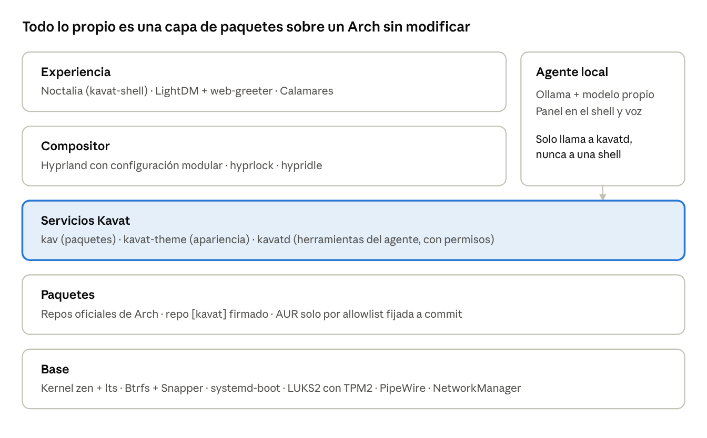
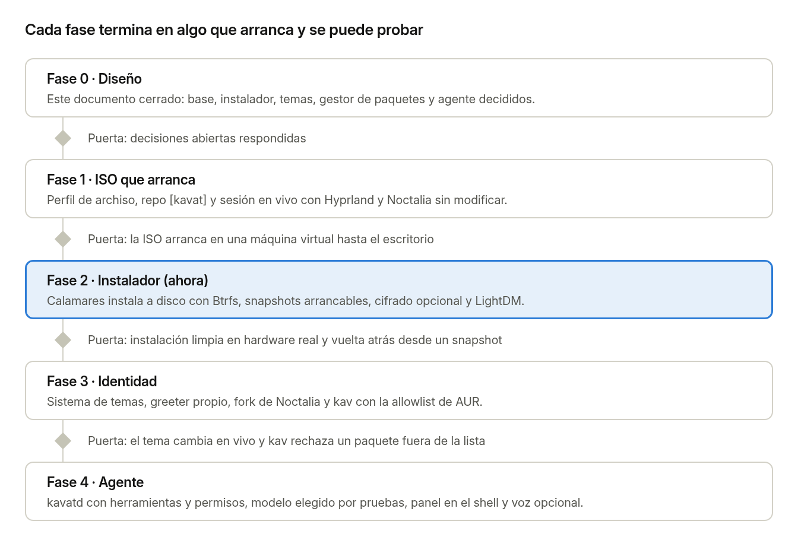

# Willwitcher-OS Kavat Edition — Documento de diseño

Actualizado el 11 de noviembre de 2026 · [Mockup interactivo](mockup/index.html) · [Capturas](screenshots/) · [README](../README.md)

## Visión

Willwitcher-OS Kavat Edition es un Arch con opinión: se instala en 10 minutos, arranca ya configurado como tú trabajas, y se maneja hablando con un agente local que conoce el sistema por dentro.

Cinco principios deciden cada propuesta de este documento:

1. **Arch por debajo, sin magia.** Todo es un paquete de pacman. Nada de scripts que parchean `~/.config` a ciegas; lo que el sistema instala, pacman lo puede quitar.
2. **Curado, no abierto.** Los repos oficiales son libres; el AUR solo entra por una lista revisada y fijada a un commit.
3. **Una sola fuente de verdad para la apariencia.** Un tema son tokens; cada app recibe su config generada. Cambiar de claro a oscuro tarda menos de 1 segundo y no reinicia nada.
4. **Reversible siempre.** Cada cambio de paquetes crea un snapshot arrancable. Romper el sistema cuesta un reinicio, no una reinstalación.
5. **El agente es parte del sistema, no una app.** Corre local, sin red, con permisos por niveles y registro de todo lo que hace.

El nombre de trabajo para las piezas propias es `kavat`: el repo de paquetes `[kavat]`, el gestor `kav` y los paquetes `kavat-*`.



La capa resaltada es la única que es código nuestro desde cero; lo de arriba son forks y configuración, lo de abajo es Arch.

## Base del sistema

La ISO se construye con `archiso` a partir del perfil `releng`, y todo lo propio llega como paquetes firmados desde un repo pacman `[kavat]`. Arch solo existe para x86\_64, así que ese es el objetivo.

| Pieza | Propuesta | Alternativa | Por qué |
| --- | --- | --- | --- |
| Construcción de la ISO | `archiso` con perfil propio en `iso/` | Partir de EndeavourOS o CachyOS | Control total y sin heredar decisiones ajenas; se compila en tu PC de escritorio con Arch |
| Kernel | `linux-zen` + `linux-lts` de respaldo | `linux` estándar | Zen responde mejor en escritorio; LTS salva un arranque roto |
| Gestor de arranque | GRUB con menú propio (decidido) | systemd-boot | Admite tema gráfico y submenús: fondo, entradas propias, modo seguro y lista de snapshots, cada uno con su kernel |
| Sistema de archivos | Btrfs con subvolúmenes `@`, `@home`, `@log`, `@pkg`, `@snapshots` | ext4 | Snapshots baratos y compresión zstd |
| Snapshots | Snapper + hook de pacman antes y después de cada transacción | Timeshift | Se integra con el arranque y con `kav` |
| Cifrado | LUKS2 opcional, desbloqueo por TPM2 | Solo contraseña | Disco cifrado sin teclear dos contraseñas |
| Memoria | zram con zstd, sin partición swap | Swapfile | Menos escrituras a disco; la hibernación queda como opción del instalador |
| Audio y red | PipeWire + WirePlumber; NetworkManager con iwd | wpa\_supplicant | Es lo que Noctalia y Hyprland esperan |
| Arranque visual | Plymouth con tema generado por el sistema de temas | Texto | Misma identidad desde el primer fotograma |

El repositorio es un monorepo con una carpeta por pieza:

- `iso/`: perfil de archiso, lista de paquetes y overlay del sistema vivo.
- `installer/`: configuración, módulos y branding de Calamares.
- `packages/`: un PKGBUILD por paquete `kavat-*`, incluidos los forks.
- `kav/`: el gestor de paquetes y su allowlist.
- `themes/`: tokens, plantillas y temas incluidos.
- `greeter/`: tema de web-greeter.
- `agent/`: daemon, herramientas y Modelfile del agente.
- `docs/`: decisiones de diseño.

Los forks (Hyprland, Noctalia) viven en repos aparte y aquí solo está su PKGBUILD apuntando a un tag.

## Instalador

Calamares con branding propio hace una instalación sin red en 7 pantallas. Calamares no está en los repos oficiales de Arch, así que se empaqueta como `kavat-calamares` en `[kavat]`.

El idioma por defecto es inglés, con español como segunda opción del selector. Los dos vienen ya instalados en la ISO y en el sistema, con teclado US por defecto. Todo lo propio (instalador, greeter, shell, `kav` y agente) trae sus textos en ambos idiomas.

1. **Bienvenida**: idioma, teclado y comprobación de requisitos (UEFI, RAM, disco).
2. **Disco**: borrar todo, junto a otro sistema, o manual. Btrfs y subvolúmenes ya decididos; cifrado como un interruptor.
3. **Usuario**: nombre, contraseña, nombre del equipo.
4. **Hardware**: detecta GPU y propone controladores (NVIDIA, AMD, Intel) en vez de preguntar a ciegas. En tu equipo, AMD con los controladores libres de Mesa, que ya vienen en la ISO.
5. **Perfil**: conjuntos de software opcionales (desarrollo, creación, juegos) y si se instala el agente con su modelo.
6. **Apariencia**: tema, modo claro u oscuro y tono de acento, con vista previa en vivo del propio instalador.
7. **Resumen e instalación**: lista exacta de lo que se va a hacer y barra de progreso con diapositivas.

Ideas propias sobre el Calamares de serie:

- **Módulo `kavat-theme`**: lo elegido en la pantalla 6 queda aplicado al greeter, a Plymouth y al escritorio antes del primer arranque.
- **Módulo `kavat-hardware`**: escribe la configuración de Hyprland según monitores y GPU detectados.
- **Instalación sin red**: la ISO lleva los paquetes; con red solo se actualiza al final.
- **Archivo de respuestas**: un `kavat-install.toml` en el USB reinstala tu máquina sin tocar nada.
- **Primer arranque**: un asistente dentro de Noctalia termina lo que no pertenece al instalador (cuentas, llaves SSH, descarga del modelo).

## Arranque

Del botón de encendido al escritorio hay tres pantallas con la misma identidad: el menú de GRUB, la pantalla de carga de Plymouth y el login. Las dos primeras se configuran desde la página Boot del panel de Noctalia.

**Menú de arranque (GRUB).**

| Entrada | Qué hace |
| --- | --- |
| Willwitcher-OS Kavat Edition | Arranque normal; es la entrada por defecto |
| Kernel de respaldo | El mismo sistema con `linux-lts` |
| Modo seguro | Arranca con la configuración de fábrica: tus archivos se ignoran, no se borran; sin agente, sin apps de inicio automático y sin fondo animado |
| Snapshots | Submenú con los últimos 10 estados arrancables y los fijados |
| Recuperación | Consola de rescate con `kavat-rescue` |
| Ajustes del firmware | Entra a la UEFI |
| Otros sistemas | Solo aparece si hay otro sistema instalado |

- **Tema propio**: fondo, tipografía, colores y logo salen del tema del sistema. El fondo es el fondo de pantalla actual; si es un vídeo, su fotograma fijo.
- **Modo seguro**: es la red de seguridad de que los archivos de configuración manden. Si un archivo editado a mano deja el escritorio sin arrancar, esta entrada entra sin leerlo.
- **Arranque fallido**: si el arranque anterior no llegó al escritorio, el menú aparece solo y con Modo seguro ya seleccionado.
- **Reiniciar hacia**: desde el menú de energía del shell se reinicia directamente al modo seguro, a un snapshot o al firmware, sin pasar por el menú. También son skills del agente.
- **Configurable**: tiempo de espera, entrada por defecto, qué entradas se muestran, resolución y aspecto. Modo seguro no se puede ocultar.

**Pantalla de carga (Plymouth).**

- **Cuatro estilos**: logo con pulso, anillo giratorio, barra de progreso, o texto con los mensajes de arranque.
- **Sigue al tema**, con la misma imagen de fondo que el menú y el login, para que no haya salto entre las tres pantallas.
- **`Esc` muestra los mensajes de arranque.** La pantalla aparece también al apagar y al reiniciar.
- **Disco cifrado**: la petición de contraseña sale en esta pantalla, con el mismo tema.

**Cómo se aplican los cambios.** El menú y la pantalla de carga son archivos del sistema, y cambiar la pantalla de carga obliga a regenerar la imagen de arranque, que tarda. Por eso el cambio de tema del escritorio sigue siendo instantáneo y el arranque se actualiza después, en segundo plano, con una sola petición de contraseña. Si la regeneración falla, se queda la versión anterior.

Dos límites: GRUB muestra una imagen fija, no reproduce vídeo ni desenfoca; y sus fuentes hay que convertirlas a su propio formato, cosa que hace el generador de temas. GRUB, grub-btrfs (la base del submenú de snapshots) y Plymouth están en los repos oficiales de Arch.

## Login

LightDM con web-greeter muestra un tema propio en HTML/CSS/JS que lee los mismos tokens que el escritorio, así el login cambia de color cuando cambias de tema.

- **Diseño**: reloj grande, avatar, campo de contraseña y nada más a la vista. Sesión, energía y teclado aparecen al mover el ratón a una esquina.
- **Fondo vivo**: el fondo del greeter es el mismo fondo del escritorio, desenfocado, para que el paso a Hyprland no tenga corte visual.
- **Estado del sistema**: batería, red y una línea con actualizaciones pendientes.
- **Varios usuarios**: selector por avatar; cada usuario ve el login con su propio tema.
- **Bloqueo de pantalla**: mismo diseño que el login, hecho con hyprlock, para que bloquear y entrar se vean iguales.

Decidido: LightDM + web-greeter con tema propio. Riesgo a vigilar: web-greeter vive en el AUR, depende de Qt WebEngine y su mantenimiento es irregular. La propuesta es hacer fork y empaquetarlo como `kavat-greeter`. El plan B es greetd con un greeter en Quickshell, que reutiliza el código de Noctalia y corre en Wayland nativo.

## Escritorio

Hyprland compone las ventanas y un fork de Noctalia (hecho sobre Quickshell) pone la barra, el lanzador, las notificaciones, el centro de control y el panel del agente.

**Hyprland.** Decidido: no tocar el código del compositor al principio. La identidad va en un paquete `kavat-hyprland` con configuración modular y plugins; si la versión actual de Hyprland impide algo que queramos hacer, el fork del código se abre desde el día 1.

- Configuración partida en archivos: `binds`, `rules`, `monitors`, `look`, `autostart`. Los del sistema viven en `/usr/share/kavat/hypr/`; los tuyos en `~/.config/hypr/` y siempre ganan.
- Versión fijada en `[kavat]`: Hyprland cambia sintaxis con frecuencia, así que solo sube cuando la configuración ya está probada contra esa versión.
- Los atajos parten de los de tu Willwitcher-OS Endgame, sin cambiar ninguno; lo nuevo solo ocupa teclas que tenías libres. Una hoja de atajos se genera desde la configuración.
- Animaciones, bordes, radio y desenfoque salen de los tokens del tema, no de valores escritos a mano. Los valores iniciales son los de Endgame: radio 10, borde 2, separación 5 entre ventanas y 20 al borde, animaciones cortas.

Desde Hyprland 0.55 la configuración es Lua, y así se usa. El panel de ajustes y el agente no generan Lua: escriben una tabla de valores, que son datos, y el Lua del sistema la carga. Así ningún texto que venga de fuera llega a ejecutarse.

Atajos: 19 heredados de Endgame tal cual y 9 nuevos para lo que antes no existía.

| Acción | Atajo | Origen |
| --- | --- | --- |
| Terminal (Kitty) | `Super+Enter` | Endgame |
| Cerrar ventana | `Super+Q` | Endgame |
| Lanzador de apps | `Super+D` | Endgame |
| Archivos (Yazi) | `Super+E` | Endgame |
| Flotante | `Super+V` | Endgame |
| Pseudomosaico | `Super+P` | Endgame |
| Cambiar la división | `Super+J` | Endgame |
| Mover el foco | `Super` + flechas | Endgame |
| Ir al espacio 1 a 10 | `Super` + `1`…`0` | Endgame |
| Enviar la ventana al espacio 1 a 10 | `Super+Shift` + `1`…`0` | Endgame |
| Espacio siguiente o anterior | `Super` + rueda del ratón | Endgame |
| Scratchpad: mostrar / enviar ventana | `Super+S` / `Super+Shift+S` | Endgame |
| Cambiar de ventana | `Alt+Tab` | Endgame |
| Historial del portapapeles | `Super+Shift+V` | Endgame |
| Selector de color | `Super+Shift+P` | Endgame |
| Captura de región al portapapeles | `Print` | Endgame |
| Bloquear | `Super+Shift+L` | Endgame |
| Salir de la sesión | `Super+M` | Endgame |
| Mover / redimensionar con ratón | `Super` + arrastrar con botón izquierdo / derecho | Endgame |
| Agente | `Super+Space` | Nuevo |
| Navegador | `Super+B` | Nuevo |
| Pantalla completa | `Super+F` | Nuevo |
| Mover la ventana | `Super+Shift` + flechas | Nuevo |
| Redimensionar | `Super+Ctrl` + flechas | Nuevo |
| Selector de temas | `Super+T` | Nuevo |
| Panel de `kav` | `Super+U` | Nuevo |
| Menú de energía | `Super+Escape` | Nuevo |
| Hoja de atajos | `Super+/` | Nuevo |

**Noctalia.** Aquí sí hay fork de código, empaquetado como `kavat-shell`.

- Parches chicos sobre cada tag de upstream, reaplicados en cada versión; lo que sea útil para todos se propone upstream para cargar menos diferencia.
- Añadidos propios: panel del agente, selector de temas con vista previa, panel de `kav` (actualizaciones, snapshots, solicitudes de AUR) y el asistente de primer arranque.
- El motor de colores de Noctalia se sustituye o se alimenta desde los tokens del sistema, para que haya una sola fuente de verdad.

**Paleta de comandos.** `Super+D` abre una sola paleta para todo el sistema: apps, archivos, ajustes, skills, paquetes, ventanas abiertas y pestañas del navegador. Usa la misma gramática y los mismos nombres de comando que la consola del navegador y la paleta de Neovim, y lo que no encuentra se lo puede pasar al agente.

- **Proyectos.** Un proyecto guarda un espacio de trabajo entero: carpeta, terminales, editor, perfil del navegador y disposición de ventanas. Se abre desde la paleta o desde la barra, y vuelve tal como lo dejaste.
- **Un comando `kavat` para todo.** `kavat theme`, `mode`, `wallpaper`, `project`, `ask` y `doctor` comparten verbos y autocompletado; todo lo que hace el panel se puede hacer desde la terminal.
- **Hoja de atajos según contexto.** `Super+/` muestra los atajos de la app que tiene el foco, además de los del sistema.
- **Captura con texto.** Al capturar una zona de la pantalla se puede copiar su texto, con reconocimiento local.

**Regla para todos los forks.** Cada fork lleva un `PATCHES.md` con qué cambia y por qué, y una tarea automática que avisa cuando upstream publica versión y si los parches aplican limpio.

## Modos del sistema

Un selector en la barra de Noctalia cambia el equipo entero entre tres modos; se parece a elegir un perfil de energía, pero cada modo decide qué corre, por dónde sale la red y qué se recuerda.

|  | Coder (por defecto) | Gamer | Incognito |
| --- | --- | --- | --- |
| Agente | Activo | Apagado; modelo y voz fuera de memoria | Activo, sin guardar historial |
| GPU y memoria | Uso normal | Todo liberado para el juego | Uso normal |
| Procesos de fondo | Todos | Se detienen los que no hacen falta: contenedores, indexado, actualizaciones y snapshots programados; el fondo animado se pausa | Todos |
| Red | Directa | Directa | Todo por VPN (OpenVPN o Proton VPN) |
| Navegador | Normal | Normal | Las ventanas nuevas se abren en incógnito |
| Notificaciones | Normales | No molestar | Normales, sin vista previa del contenido |
| Rendimiento | Equilibrado | Máximo rendimiento de CPU | Equilibrado |

Cómo funciona:

- Cada modo es un archivo TOML en `/usr/share/kavat/modes/` que declara qué servicios para o arranca, qué perfil de red usa y qué ajustes cambia. Un modo propio es un archivo más.
- `kavatd` aplica el cambio y lo deshace al salir: lo que el modo Gamer detuvo vuelve a arrancar al volver a Coder.
- Se cambia desde la barra, con `Super+Shift+M`, con `kavat mode gamer` o pidiéndoselo al agente.
- La barra muestra siempre el modo activo; en Incognito, también el estado de la VPN.

Ideas añadidas sobre lo que pediste:

- **Gamer automático**: entrar al modo al lanzar un juego desde Steam y salir al cerrarlo.
- **Las animaciones y los efectos se quedan en Gamer**: el modo libera recursos apagando procesos, no la apariencia.
- **Corte de red en Incognito**: si la VPN cae, no sale tráfico hasta que vuelve. Sin esto, una caída te deja navegando con tu IP real sin avisar.
- **Incognito también fuera del navegador**: el historial del portapapeles, el de la terminal y los archivos recientes dejan de guardarse; al salir se vacía el portapapeles.
- **No entra en Incognito hasta que la VPN conecta**: el modo solo se marca activo con el túnel arriba.

Límite a tener claro: la VPN oculta tu IP a los sitios y tu tráfico a tu proveedor, pero no te hace anónimo frente a cuentas en las que inicies sesión.

Al entrar en Incognito, las ventanas normales del navegador ya abiertas se ocultan en un espacio aparte y vuelven al salir.

## Juego y hardware

El equipo es un escritorio con una Radeon RX 6800, y el sistema lo trata como tal.

- **Perfil por juego**: en modo Gamer, cada juego puede tener su monitor de rendimiento, su límite de fotogramas y su perfil de GPU.
- **Página de GPU**: curvas de ventilador, límites de potencia y sensores en la barra.
- **Las luces siguen al tema**: con OpenRGB, teclado y torre toman el color de acento y cambian con el modo.
- **Supresión de ruido del micrófono**: activa de serie, para la voz del agente y para directos.

## Ajustes desde Noctalia

Un panel de Ajustes dentro de Noctalia configura todo el núcleo del sistema desde un solo sitio, y cada pieza nueva que entre al núcleo llega con su página de ajustes.

| Página del panel | Qué se ajusta | Fork necesario |
| --- | --- | --- |
| Appearance | Todo el sistema de temas: paleta, modo, acento, tono, tipografía, perfiles; luces que siguen al acento | Propio |
| Wallpaper | Imagen o vídeo, carpetas, ajustes del vídeo, reglas de pausa, fondo por pantalla | No: mpvpaper para el vídeo |
| Accessibility | Reducir movimiento, escala de texto, contraste alto | Propio |
| Windows (Hyprland) | Separación, bordes, animaciones, disposición, ratón y teclado, reglas de ventana | No previsto: admite cambios en vivo |
| Keybindings | Todos los atajos, con detección de conflictos y hoja de atajos | No |
| Displays | Resolución, frecuencia, escala, rotación, sincronización adaptativa, luz nocturna, reparto de espacios de trabajo | No: lo aplica Hyprland |
| GPU | Curvas de ventilador, límite de potencia, sensores en la barra, perfiles por juego | No |
| Sound | Salida, entrada, volumen por app, supresión de ruido del micrófono | No |
| Terminal (Kitty) | Fuente, tamaño, cursor, opacidad, márgenes, pestañas, historial | No previsto: admite recarga en vivo |
| Editor (Neovim) | Preset de atajos, numeración, tabulación, formateo y guardado automáticos, paquetes de lenguaje, plugins, paneles laterales | No: es configuración propia (`kavat-nvim`) |
| Files (Yazi) | Preset de atajos, arrastrar y soltar, copiador con pop-up, selector de archivos del sistema, qué hace pulsar una descarga, vistas previas, abrir con | No previsto: plugins; fork solo si un plugin no llega |
| Shell (zsh) | Prompt, plugins, historial, alias, apps por defecto | No |
| Browser | Bloqueador, apariencia, perfil por modo, comandos de la consola | El fork de Chromium ya previsto |
| Bar & widgets | Posición y densidad de la barra, widgets y su orden, lanzador, notificaciones | El fork de Noctalia ya previsto |
| Modes | Qué hace cada modo, automatización con Steam, VPN de Incognito, modos nuevos | Propio |
| Projects | Proyectos guardados: carpeta, terminales, editor, perfil del navegador y ventanas de cada uno | Propio |
| Agent & voice | Presupuesto de memoria, modelo, permisos por nivel, voz y cómo se activa, avisos, registro de actividad | Propio |
| Skills | Skills de serie y propias, sus pasos, atajo, frase de voz, dónde se fijan y cuándo se lanzan solas | Propio |
| Packages (kav) | Fuentes, actualizaciones y su comprobación, snapshots, allowlist del AUR y solicitudes | Propio |
| Backup & sync | Snapshots de `/home`, copias externas, historial de la configuración y su sincronización | Propio |
| Privacy & network | Qué app usó micrófono, cámara o pantalla; reglas del cortafuegos por aplicación | No |
| Boot | Menú de GRUB (espera, entrada por defecto, entradas visibles, aspecto) y pantalla de carga (estilo, mensajes) | No: temas generados para GRUB y Plymouth |
| Login & lock | Fondo, reloj, usuarios, idioma del login, tiempos de bloqueo | El fork de web-greeter ya previsto |
| Language & region | Idioma del sistema (inglés o español), distribuciones de teclado, formatos | Propio |

En Neovim, como en el resto, tus archivos en \~/.config/nvim/ ganan sobre lo que el panel genera.

Cómo funciona:

- **El archivo de configuración es la verdad.** Cada ajuste vive en un solo sitio: el archivo de configuración de su app, o `~/.config/kavat/` para lo propio del sistema. Lo que hay en el archivo es lo que vale.
- **Calle de doble sentido.** Si cambias un valor a mano, el panel lo muestra al momento. Si lo cambias en el panel, el panel edita esa línea en el archivo, sin tocar el resto ni los comentarios. No hay una segunda copia que pueda quedar desfasada.
- **Validar antes de aplicar.** Cada cambio de configuración, venga del panel o de tu editor, se comprueba antes de cargarse. Si el escritorio no recarga bien, vuelve solo a la última versión buena y te dice qué línea falló. Si aun así no arranca, queda el modo seguro del menú de arranque.
- **Lo que el panel no tiene vive solo en el archivo.** El panel no lo toca, no lo oculta y no lo borra.
- **Límite en archivos que son código.** En `la configuración de Hyprland, que es Lua, en el init.lua de Neovim y en .zshrc, el panel solo edita su tabla de valores o su bloque de ajustes`; el resto lo deja como está y lo abre en Neovim.
- **Abrir la configuración en Neovim, en todas partes.** Cada página del panel y cada pieza del sistema (el panel del agente, el selector de temas, `kav`, Yazi, el navegador, el marketplace) tiene un botón que abre su archivo de configuración en Neovim, en la sección que corresponde.
- **En vivo y reversible**: cada cambio, venga del panel o del archivo, se aplica al instante; tiene deshacer y queda en un historial para volver a cualquier estado anterior.
- **Editor de atajos**: muestra todos, detecta conflictos al asignar y regenera la hoja de atajos.
- **Buscador**: escribir «gaps» o «fuente» lleva al ajuste, esté en la app que esté.
- **El agente usa lo mismo**: «sube la separación a 10» cambia el mismo valor que el panel, con el mismo deshacer.
- **Exportar e importar**: todo tu estado cabe en un archivo; reinstalar es restaurarlo.

**Dependencias garantizadas.** Ninguna opción del panel queda activa sin el software que necesita: si eliges mpvpaper como motor de fondos, `kav` se asegura de que está instalado antes de aplicar el ajuste.

- **Cada opción declara lo que necesita.** El motor de fondos, el proveedor de VPN, un paquete de lenguaje del editor o un motor de voz llevan su lista de paquetes.
- **Se instala al elegir.** Al marcar una opción, el panel pide a `kav` que instale lo que falte, con las reglas de siempre (repos oficiales, `[kavat]` o allowlist) y su snapshot. El ajuste solo se da por aplicado cuando `kav` confirma; si la instalación falla, se queda el valor anterior.
- **Lo que viene por defecto ya está instalado.** Las opciones por defecto de cada página van en la ISO, así que el sistema recién instalado funciona tal como viene sin red.
- **No se quita por accidente.** `kav remove` avisa de qué ajuste depende del paquete y pide cambiar el ajuste primero; la limpieza de huérfanos no lo toca.
- **Se vigila.** `kav doctor` comprueba que todo lo que los ajustes necesitan sigue instalado, y lo repara.
- **Vale para todo lo que declare dependencias**: las skills del agente, los plugins del marketplace que necesitan un programa del sistema, y los modos.

Regla para los forks: una app se bifurca cuando no deja cambiar su configuración en vivo o no deja incluir un archivo generado. Hyprland y Kitty permiten las dos cosas, así que hoy no hace falta ningún fork más; se confirma al implementarlo en la fase 3.

## Navegador

`kavat-browser` es un fork de Chromium con seis cambios: sigue los modos del sistema, cambia de tema con el sistema, bloquea anuncios de serie, habla con el agente, tiene una consola de comandos y usa Yazi como explorador de archivos.

| Cambio | Qué hace |
| --- | --- |
| Modos del sistema | En Incognito las ventanas nuevas se abren en incógnito; en Gamer suspende las pestañas para soltar memoria; cada modo puede tener su propio perfil de navegador |
| Tema automático | Colores, modo claro u oscuro y radio de esquinas salen de los tokens del sistema y cambian en vivo, también en la página de inicio y las páginas internas |
| Bloqueador por defecto | Anuncios y rastreadores bloqueados desde el primer arranque, con listas actualizables e interruptor por sitio |
| Agente integrado | Panel lateral de Kavat: resume la página, responde sobre ella, busca entre pestañas y actúa en el navegador con los mismos niveles de permiso que en el sistema |
| Consola de comandos | Una paleta con comandos propios que cambian el navegador: ocultar o mostrar paneles, barra de pestañas, modo zen, y los que definas tú |
| Yazi como explorador | Subir un archivo y «guardar como» abren Yazi; pulsar una descarga abre Yazi en la carpeta de descargas con el archivo seleccionado |

Cómo mantenerlo barato:

- **Capa 1, sin tocar C++**: políticas de Chromium y extensiones incluidas de fábrica cubren el tema, el bloqueador, el panel del agente y buena parte de la consola.
- **Capa 2, parches**: solo para lo que una extensión no puede hacer, como ocultar paneles nativos de la interfaz o reaccionar a los modos del sistema.
- Los parches se reaplican sobre cada versión estable de Chromium. Tu PC compila cada versión; conviene automatizarlo porque los parches de seguridad salen muy seguido.

Ideas añadidas:

- **Los comandos de la consola son también herramientas del agente**: lo que puedes escribir en la consola, se lo puedes pedir a Kavat, y `kavatd` puede dispararlo desde fuera (por ejemplo, al cambiar de modo).
- **Comandos en un archivo**: los comandos propios se definen en un TOML en `~/.config/kavat/browser/`, con nombre, atajo y acción.
- **En Incognito el agente no guarda** nada de lo que lee en el navegador.
- **Bloqueador**: empezar con uBlock Origin incluido de fábrica y pasar a un bloqueador nativo solo si hace falta, porque Chromium limita cada vez más lo que las extensiones de bloqueo pueden hacer.

## Editor

Neovim es el editor del núcleo y llega como `kavat-nvim`: útil nada más abrirlo, con atajos estilo VS Code, plugins preinstalados, un marketplace de plugins dentro del editor y su página en el panel de ajustes.

**Atajos estilo VS Code.** Decidido el híbrido: los modos de Vim se quedan, y lo que cambia es la navegación y los atajos, que son los de VS Code en cualquier modo. El editor abre listo para escribir y `Esc` lleva al modo normal.

| Acción | Atajo |
| --- | --- |
| Moverse | Flechas, `Home` / `End`, `Ctrl` + flechas por palabras, `Ctrl+Home` / `Ctrl+End` |
| Seleccionar | `Shift` + flechas, `Ctrl+Shift` + flechas por palabras, `Ctrl+L` línea entera |
| Ir a una línea / volver atrás y adelante | `Ctrl+G` / `Alt` + flechas izquierda y derecha |
| Buscar archivo | `Ctrl+P` |
| Paleta de comandos | `Ctrl+Shift+P` |
| Guardar / cerrar pestaña | `Ctrl+S` / `Ctrl+W` |
| Copiar, cortar, pegar, deshacer, rehacer | `Ctrl+C`, `Ctrl+X`, `Ctrl+V`, `Ctrl+Z`, `Ctrl+Y` |
| Buscar / reemplazar / buscar en el proyecto | `Ctrl+F` / `Ctrl+H` / `Ctrl+Shift+F` |
| Comentar línea | `Ctrl+/` |
| Mover línea / duplicar línea | `Alt` + flechas arriba y abajo / `Shift+Alt` + flechas arriba y abajo |
| Seleccionar la siguiente coincidencia (multicursor) | `Ctrl+D` |
| Explorador / terminal | `Ctrl+B` / `Ctrl` + acento grave, la tecla sobre `Tab` |
| Cambiar de pestaña | `Ctrl+Tab` |
| Ir a definición / renombrar / acción rápida | `F12` / `F2` / `Ctrl+.` |
| Formatear | `Shift+Alt+F` |
| Marketplace | `Ctrl+Shift+X` |

- Es viable porque el terminal es Kitty: su protocolo de teclado deja que Neovim distinga `Ctrl+Shift+P` de `Ctrl+P` y reciba `Ctrl+Tab`, cosa que un terminal clásico no permite. Se confirma al implementarlo.
- Dos límites: el multicursor va por plugin (multicursor.nvim) y no es idéntico al de VS Code, y las ventanas internas de algunos plugins siguen usando teclas de Vim (`j`, `k`, `q`).
- Tus atajos de `<leader>` de Endgame siguen disponibles en modo normal.

**Preinstalado.** Con lazy.nvim como gestor: explorador de archivos, buscador difuso, paleta de comandos, pestañas de buffers, barra de estado, resaltado con treesitter, LSP con autocompletado, formateo al guardar, integración con git, terminal flotante, ayuda de atajos y multicursor. El tema sigue al del sistema.

**Marketplace.** `Ctrl+Shift+X` abre una TUI dentro de Neovim para buscar, ver e instalar plugins por categorías, como la pestaña de extensiones de VS Code.

- **Base**: ya existe un plugin parecido, store.nvim, con un índice de más de 6.000 plugins e instalación automática. Decidido: se parte de él y se le añade lo que sigue.
- **Lo que añadimos, el catálogo verificado**: en Neovim instalar un plugin no basta, casi todos necesitan configuración y atajos. Cada plugin del catálogo trae un preset probado con atajos estilo VS Code, así que instalar es un solo paso.
- **Dos niveles, como en `kav`**: «Verified» (revisado, fijado a un commit, con preset) y «Community» (el resto del índice; se instala sin preset y con aviso). Un plugin es código que corre con tus permisos, igual que un paquete del AUR.
- **Paquetes de lenguaje**: «Rust», «TypeScript» o «Python» instalan de una vez servidor LSP, formateador, linter, parser y depurador.
- **Sigue siendo lazy.nvim**: el marketplace escribe un archivo por plugin en tu configuración, que puedes editar a mano, y las versiones quedan fijadas en el lockfile.

**Ajustes.** La página Editor del panel de Noctalia cambia el preset de atajos (VS Code, Vim o propio), numeración, tabulación, formateo y guardado automáticos y paquetes de lenguaje, y abre el marketplace. Los cambios llegan en vivo a las ventanas de Neovim abiertas.

**Paneles.** Neovim trae paneles laterales de serie, y el primero es Claude: un panel a la derecha con Claude Code, conectado al editor.

- **Quién hace la división**: Kitty, no Neovim. El panel es una ventana real de Kitty junto a la de Neovim, que el editor abre y cierra por control remoto. Claude Code es un programa de terminal completo, con sus propias teclas; en el terminal embebido de Neovim esas teclas chocan, y en una ventana de Kitty se comporta como en cualquier terminal.
- **Conectado al editor**: con claudecode.nvim, que habla el mismo protocolo que la extensión oficial de VS Code y admite que Claude corra en un terminal externo. Claude ve el archivo y la selección actuales, y lo que propone cambiar se abre como un diff nativo de Neovim que aceptas o rechazas con una tecla.
- **Teclas**: `Ctrl+Alt+B` abre y cierra el panel, como la barra lateral secundaria de VS Code, y `Ctrl+Alt+K` le manda la selección. Moverse entre editor y panel usa las mismas teclas que entre divisiones de Neovim.
- **Más de un panel**: el mismo sistema sirve para el agente local Kavat, un terminal inferior, Lazygit o las pruebas. Cada panel es un archivo que dice qué programa abre y dónde.
- **Sacar y esconder**: una tecla saca el panel a su propia ventana, para que Hyprland la coloque donde quieras, y otra lo oculta sin cerrar la conversación.
- **Por proyecto**: cada proyecto recuerda sus paneles y retoma su conversación al abrirse.
- **Fuera de Kitty**: por SSH o en otro terminal, el panel cae a una división normal de Neovim.

Dos cosas a tener claras. Claude Code es un servicio en la nube que usa tu cuenta: es una herramienta tuya de desarrollo, aparte de Kavat, que sigue siendo local. Y el control remoto de Kitty se limita con contraseña a las acciones que los paneles necesitan: abrir, enfocar, redimensionar y cerrar ventanas.

## Archivos

Yazi es el gestor de archivos del núcleo y llega como `kavat-files`: sigue el tema, arrastra y suelta, y es el explorador de archivos de todo el sistema, incluido el navegador.

| Integración | Cómo se consigue |
| --- | --- |
| Tema | El generador de temas escribe el tema de Yazi desde los tokens, como para el resto de apps |
| Arrastrar y soltar | Con ripdrag, como ya hacías en Endgame: `Alt+D` saca la selección para arrastrarla a cualquier app, y lo que sueltes ahí se copia a la carpeta actual |
| Selector de archivos del sistema | Un backend de portal (xdg-desktop-portal-termfilechooser) abre Yazi cada vez que una app pide «abrir» o «guardar como» |
| Navegador | `kavat-browser` usa siempre ese portal: subir un archivo o elegir dónde guardar abre Yazi |
| Descargas | Pulsar una descarga en el navegador abre Yazi en la carpeta de descargas, con el archivo seleccionado |
| «Mostrar en carpeta» | Un servicio propio responde a la interfaz estándar de gestores de archivos, así que cualquier app que lo pida abre Yazi en esa ruta |
| Abrir con | Las reglas de apertura de Yazi salen de las apps por defecto del panel de ajustes |
| Agente | Skills «abrir archivos» y «buscar un archivo»; desde Yazi, una tecla pregunta a Kavat por lo seleccionado |

**Copiar y mover con ventana propia.** Pegar abre un pop-up que dice qué se copia y a dónde, con el progreso por archivo y el total, la velocidad y el tiempo que falta. Sustituye al comportamiento de serie de Yazi, donde el progreso apenas se ve y un conflicto de nombres se resuelve sin preguntar.

- **Conflictos a la vista**: si un archivo ya existe en el destino, el pop-up pregunta si reemplazar, omitir o conservar los dos, con la opción de aplicarlo a todos.
- **Segundo plano**: `Esc` deja la copia trabajando con un indicador en la barra de estado; al terminar, avisa con una notificación si Yazi no está a la vista.
- **Recordatorio**: tras `Ctrl+C`, una línea dice cuántos elementos hay listos para pegar.
- **Portapapeles del sistema**: lo copiado en Yazi queda también en el portapapeles, así que se puede pegar como archivo en otra app.
- **Cómo se hace**: como plugin. Yazi deja que un plugin dibuje su propia ventana, que es como funciona su gestor de discos. Si un plugin no puede seguir el progreso real de la copia, se bifurca.

Ideas añadidas:

- **Navegación sin teclas de Vim**: un preset con flechas, `Enter`, `Retroceso`, `Ctrl+C` / `Ctrl+X` / `Ctrl+V`, `Supr` a la papelera y `F2` para renombrar, con la misma lógica que el editor. Las de Vim siguen disponibles, y tus teclas de Endgame se conservan: `Alt+D` para arrastrar y `M` para los discos.
- **Ratón**: clic, doble clic y rueda funcionan.
- **Vistas previas en la terminal**: imágenes, miniaturas de vídeo, PDF, archivos comprimidos y código con resaltado. Los programas que hacen falta los garantiza `kav`.
- **Acciones del sistema desde Yazi**: poner como fondo (imagen o vídeo), abrir una terminal aquí, abrir en el editor, comprimir y extraer.
- **Papelera y discos**: borrar manda a la papelera; USB y discos se montan desde el gestor de montaje, como en Endgame.
- **Flotante cuando es selector**: al hacer de selector de archivos, Yazi se abre como ventana flotante centrada con un aviso de para quién elige; como app normal, va en mosaico.
- **En Incognito** no guarda carpetas recientes.
- **Bandeja de arrastre en el shell**, a futuro: la selección aparece en una bandeja de Noctalia en el borde de la pantalla, desde la que se arrastra, sin ventana aparte.

Fork: hoy no hace falta, porque Yazi se configura y se amplía con plugins. Hay dos candidatos a parche si un plugin no llega: aceptar archivos soltados directamente sobre su ventana, sin pasar por ripdrag, y recargar el tema en vivo sin reabrirlo. Si hacen falta, se bifurca.

Yazi está en los repos oficiales de Arch. ripdrag y el backend del portal están en el AUR, así que entran por `[kavat]` ya compilados. Se ajusta todo en la página Files del panel.

## Gestor de paquetes

`kav` es un solo comando sobre pacman que resuelve cada paquete en tres niveles y rechaza todo AUR que no esté en la lista revisada.

| Nivel | Origen | Qué pasa al pedir el paquete |
| --- | --- | --- |
| 1 | Repos oficiales de Arch | Se instala con pacman, sin restricción |
| 2 | Repo `[kavat]` | Binario ya compilado y firmado por nosotros: forks, paquetes propios y los AUR más usados |
| 3 | AUR en la allowlist | Se compila en local desde el commit exacto que fue revisado |
| — | AUR fuera de la lista | Se rechaza, explica por qué y ofrece `kav request` |

La allowlist es un archivo en git, firmado, con una entrada por paquete:

```toml
[packages.visual-studio-code-bin]
commit   = "3f9c2ab"          # commit del PKGBUILD revisado
reviewed = "2026-11-11"
sources  = ["update.code.visualstudio.com"]
notes    = "Binario oficial de Microsoft, sin scripts de instalación"
```

Lo que hace distinta la capa de un `yay` con filtro:

- **Fijado por commit, no por nombre.** Un paquete permitido que cambia de PKGBUILD no se actualiza hasta que la nueva versión se revisa. Esto cubre el caso real de paquetes AUR secuestrados.
- **Revisión asistida.** `kav review <paquete>` muestra el diff del PKGBUILD contra el commit aprobado y marca lo sospechoso: dominios nuevos, `curl | sh`, scripts `.install`, binarios sin checksum. El agente puede resumir el diff, pero aprueba una persona.
- **Compilación aislada.** El nivel 3 compila en un chroot limpio sin acceso a tu `$HOME`.
- **Snapshot en cada transacción.** `kav undo` devuelve el sistema al estado anterior.
- **Sin escape accidental.** `yay` y `paru` no vienen instalados; pacman sigue ahí y funciona normal.

Comandos previstos: `kav install`, `remove`, `update`, `search`, `info`, `review`, `request`, `undo`, `list --aur`, `doctor`. Lenguaje propuesto: Rust o Go, un binario sin dependencias.

**Interfaz de terminal.** `kav` sin argumentos abre una TUI de pantalla completa. Los comandos siguen existiendo para scripts y para el agente; TUI y comandos comparten el mismo núcleo en Rust (la TUI con ratatui).

| Pestaña | Qué muestra | Qué se puede hacer |
| --- | --- | --- |
| Dashboard | Actualizaciones pendientes, revisiones del AUR en espera, último snapshot, noticias de Arch, salud del sistema, actividad reciente | Saltar a cada cosa |
| Browse | Búsqueda unificada en Arch, `[kavat]` y la allowlist, con filtros: instalados, explícitos, huérfanos, AUR | Ver la ficha completa (versión, tamaños, licencia, dependencias, quién lo requiere, archivos, motivo y fecha de instalación); instalar o quitar |
| Updates | Lista agrupada por origen con versión actual y nueva, tamaño de descarga, cambio neto en disco y si pide reinicio | Actualizar todo; retener un paquete del AUR |
| AUR | La allowlist con su commit fijado y su estado; solicitudes pendientes | Revisar el diff del PKGBUILD con las líneas sospechosas marcadas, aprobar y fijar, rechazar, pedir un resumen al agente |
| Snapshots | Línea de tiempo con qué paquetes cambió cada uno y cuánto ocupa | Comparar con el estado actual, volver atrás, arrancar desde uno, fijarlo o borrarlo |
| Doctor | Servicios fallidos, `.pacnew` sin fusionar, huérfanos, caché, llavero, mirrors | Arreglar cada punto desde ahí, con diff para los `.pacnew` |
| Settings | Mirrors y descargas paralelas, frecuencia de actualización, compilación del AUR, retención de snapshots y de caché, qué puede hacer el agente | Cambiar cada ajuste; los que protegen el sistema aparecen bloqueados |

Tres reglas de la TUI:

- Los paquetes oficiales se actualizan todos juntos: Arch no soporta actualizaciones parciales, así que la TUI no ofrece elegir uno suelto.
- Teclado primero, con ratón opcional: los números cambian de pestaña, `/` busca y `?` muestra la ayuda.
- Usa los colores del tema del sistema y comparte ajustes con la página Packages del panel de Noctalia.

**Actualizaciones que no te dejan a medias.** Cuatro mecanismos tomados de otras distros, aprobados tras el análisis:

- **Migraciones** (de Omarchy): cuando una versión nueva necesita cambiar algo que pacman no gestiona, como tu configuración o un servicio de usuario, lo hace un script que corre una sola vez, después de pacman y en orden. Si uno falla, la cola se detiene y te avisa; nunca migra en silencio. Su estado se guarda dentro de la raíz, así que volver a un snapshot también deshace las migraciones.
- **Intervenciones guiadas** (de Garuda y EndeavourOS): cada «intervención manual» que publica Arch se convierte en un paso de `kav update` que explica qué pasa, enseña el comando, pide confirmación y anota que ya se aplicó. El primer caso es volver a inscribir el TPM2 tras mkinitcpio 42.
- **Dos guardas de transacción** (de Omarchy): si un archivo sin dueño choca con un paquete, se aparta, se reintenta una vez y se devuelve lo que el paquete no reclamó; y Hyprland no recarga su configuración mientras pacman la está cambiando, sino una sola vez al final.
- **Comprobación de salud con memoria** (de openSUSE): tras cada actualización y en cada arranque se comprueba que el sistema está sano, y se guarda cuál fue la última instantánea buena. Si falla justo después de actualizar, vuelve a esa instantánea; si falla un sistema que ya funcionaba, reinicia una vez y, si sigue mal, se queda encendido con los servicios parados. Es también el mecanismo del modo seguro automático.

## Sistema de temas

Un tema es un archivo de tokens y el sistema genera la configuración de cada app desde plantillas, así que modo, paleta y acento se cambian por separado y en vivo.

La diferencia con Omarchy: allí un tema es un archivo de colores más plantillas, como aquí, pero cada tema es una sola variante, sin par claro y oscuro. Aquí la apariencia tiene ejes independientes que se combinan:

| Eje | Valores | Ejemplo |
| --- | --- | --- |
| Paleta | Familia de color del tema | Kavat, Catppuccin, Gruvbox, Tokyo Night, Nord, Rosé Pine, Everforest |
| Modo | Claro, oscuro, automático por hora o por amanecer | Oscuro de 19:00 a 07:00 |
| Acento | Cualquier color de la paleta o uno libre | Acento ámbar sobre Nord |
| Tono | Temperatura y saturación del fondo | Neutro, cálido, frío, OLED negro puro |
| Contraste | Normal, alto | Alto para pantallas al sol |
| Forma | Radio de esquinas, grosor de borde, separación entre ventanas | Recto y compacto, o redondo y amplio |
| Efectos | Desenfoque, transparencia, sombras, velocidad de animación | Todo apagado en batería |
| Tipografía | Fuente de interfaz, fuente mono, escala | Inter + JetBrains Mono al 110% |

Cómo funciona:

1. `~/.config/kavat/theme.toml` guarda la combinación activa. Es lo único que editas.
2. `kavat-theme apply` resuelve los tokens (unos 40 colores semánticos: `surface`, `text`, `accent`, `danger`, etc.) y rellena las plantillas.
3. Cada app recibe su archivo y una señal de recarga: Hyprland, Noctalia, terminal, GTK, Qt, Neovim, btop, el greeter, hyprlock, Plymouth, el instalador y las apps Electron que lo permitan.
4. El cambio es atómico: se genera todo en un directorio nuevo y se cambia un enlace. Si una plantilla falla, no se aplica nada.

Ideas propias:

- **Tema insignia Kavat** con dos variantes hechas a mano, una oscura y una clara, que definen la identidad del sistema.
- **Tema desde el fondo de pantalla**: extrae una paleta de la imagen y la ajusta para cumplir contraste mínimo, cosa que los generadores automáticos suelen fallar en modo claro.
- **Modo claro de verdad**: cada paleta incluida se revisa en claro, con contraste comprobado, no solo los colores invertidos.
- **Perfiles**: guardar combinaciones con nombre (`trabajo`, `noche`, `presentación`) y cambiarlas con un atajo o desde el agente.
- **Reglas**: cambiar de perfil según hora, batería o monitor conectado.
- **Sobrescritura por app**: fijar una paleta distinta solo para el terminal o el editor.
- **Un tema de terceros es un solo archivo TOML**, fácil de compartir e instalar con `kavat-theme add <url>`.
- **Plantillas añadibles**: soportar una app nueva es añadir una plantilla, sin tocar los temas existentes.

## Fondos de pantalla

El fondo puede ser una imagen, que es lo normal, o un vídeo en bucle, y se elige desde la página Wallpaper del panel de Noctalia. Es la misma idea que ya tenías en Endgame, con sus carpetas `images` y `live`.

|  | Imagen (por defecto) | Vídeo |
| --- | --- | --- |
| Quién lo pinta | El shell (Noctalia) | mpvpaper |
| Formatos | PNG, JPG, WebP | MP4, WebM, MKV, GIF |
| Coste | Ninguno una vez puesto | Decodifica vídeo de forma continua; con decodificación por GPU es bajo, pero no cero |
| Carpeta | `~/Pictures/Wallpapers/images` | `~/Pictures/Wallpapers/live` |

Cómo funciona:

- **Selector único**: imágenes y vídeos salen en la misma cuadrícula, los vídeos con una marca y una vista previa en movimiento. Se filtra por tipo.
- **Fotograma fijo**: de cada vídeo se guarda un fotograma. Es lo que se ve en las miniaturas, en el login, en la pantalla de bloqueo y cuando el vídeo está en pausa.
- **Pausa automática**: el vídeo se detiene cuando una ventana está a pantalla completa, cuando el fondo queda tapado del todo, con la pantalla bloqueada o apagada, y en modo Gamer.
- **Ajustes del vídeo**: sonido (apagado por defecto), bucle, encaje, límite de fotogramas y decodificación por GPU.
- **Tema desde el fondo**: la paleta «desde fondo» funciona también con vídeos, usando el fotograma fijo.
- **Por pantalla**: cada monitor puede tener su fondo; también hay presentación de imágenes por tiempo.
- **Fuera del panel**: `kavat wallpaper set <archivo>` y el agente hacen lo mismo.

mpvpaper está en el AUR y no en los repos oficiales, así que entra por `[kavat]` ya compilado. Si diera problemas, sirve cualquier otro reproductor de fondos: el panel habla con una capa propia, no con mpvpaper directamente.

## Agente local

El agente es un modelo pequeño servido por Ollama que no toca el sistema directamente: llama a un daemon con herramientas tipadas, y cada herramienta tiene un nivel de permiso. Va después de la base, pero la base se diseña ya pensando en él.

| Nivel | Qué puede hacer | Confirmación |
| --- | --- | --- |
| Leer | Estado del sistema, ventanas, paquetes, logs, búsqueda de archivos | Ninguna |
| Reversible | Cambiar tema, mover ventanas, volumen, brillo, abrir apps, crear notas | Ninguna; queda en el registro |
| Con snapshot | Instalar o quitar paquetes con `kav`, cambiar configuración del sistema | Una confirmación; snapshot antes |
| Privilegiado | Discos, usuarios, red, servicios, borrar archivos | Confirmación con contraseña por polkit |

Piezas:

- **`kavatd`**: daemon que expone las herramientas (por D-Bus o MCP). `kav`, `kavat-theme` y `hyprctl` son las primeras. El modelo nunca recibe una shell libre.
- **Modelo**: un Modelfile sobre un modelo base de Ollama elegido por pruebas, no por nombre. Se mide contra un conjunto de tareas reales del sistema («pon modo oscuro», «qué está usando la RAM», «instala X») y gana el más pequeño que las acierta. El ajuste fino queda para una segunda vuelta. No tiene que programar ni hacer tareas pesadas: para eso está Claude en el editor. Su trabajo es manejar el sistema. El modelo es configurable: se puede cambiar por otro desde el panel.
- **Límite de 4 GB**: el modelo de lenguaje y los modelos de voz ocupan juntos 4 GB como máximo cargados en memoria, para que el agente conviva con un juego sin tener que cerrarlo. El reparto entre ambos se decide midiendo; los modelos de voz solo se cargan cuando la voz está activa. Se descarga de memoria tras unos minutos sin uso.
- **Voz con VoiceStudio**: el agente escucha y habla a través de VoiceStudio, que corre en local y ofrece dictado, transcripción, síntesis y clonación de voz por una API local y por MCP. kavatd lo usa como servicio: lo que dices se transcribe, pasa al modelo y la respuesta se sintetiza con una voz propia de Kavat. Se empaqueta como kavat-voice; su licencia es AGPL-3.0, sin problema para uso personal. Sus modelos cuentan dentro del límite de 4 GB, así que se eligen los motores de voz más ligeros que den buena calidad.
- **Interfaz**: panel en Noctalia con `Super+Space`, y `kavat ask "..."` en el terminal.
- **Contexto del sistema**: el agente conoce la documentación de Willwitcher-OS, tus atajos y tu configuración, así que contesta sobre tu máquina, no sobre Linux en general.
- **Registro**: cada llamada a una herramienta queda en un log legible con qué pidió, qué hizo y cómo deshacerlo.
- **Sin red**: el agente funciona sin conexión y no envía nada fuera. Cualquier herramienta que use red se activa aparte.

Límite deliberado: el agente puede resumir un diff de `kav review`, pero no puede aprobar un paquete AUR ni ampliar sus propios permisos.

**Lo que el agente lee nunca es una orden.** El contenido de una página web, de un archivo o de la salida de un comando es solo información: no puede hacer que el agente ejecute herramientas. Solo cuentan tus mensajes, tus clics y las skills que tú lanzas. Si una acción se propone a raíz de algo leído, pide confirmación aunque su nivel normalmente no la pida.

- **Pulsar para hablar**: por defecto la voz se activa manteniendo una tecla, no escuchando siempre; la palabra de activación queda como opción.
- **Ayuda en la terminal**: una tecla en Kitty explica el último error o propone el comando correcto, sin salir de la terminal.
- **Avisos discretos**: el agente avisa de lo que importa (disco casi lleno, una revisión del AUR pendiente, una copia que falló) y propone la skill que lo arregla. No interrumpe en modo Gamer.

**Skills.** Una skill es una acción ya definida que el agente sabe hacer, como abrir el navegador. Aparece como un botón en su panel y se puede pulsar, pedir por voz o escribir.

| Parte de una skill | Qué lleva |
| --- | --- |
| Nombre y descripción | Lo que ves en el botón y lo que el modelo lee para elegirla |
| Pasos | Una o varias herramientas de `kavatd`, con sus parámetros |
| Nivel de permiso | El más alto de sus pasos; decide si pide confirmación |
| Dependencias | Los paquetes que necesita, garantizados por `kav` |
| Atajo y frase | Opcionales: una tecla y una frase de voz que la lanzan directamente |

- **Catálogo de serie**: abrir navegador, terminal, editor o archivos; cambiar de modo; cambiar tema o fondo; actualizar el sistema; captura y grabación de pantalla; volumen, brillo, Wi-Fi y Bluetooth; bloquear, suspender y apagar. Los scripts `ww-*` de Endgame pasan a ser skills.
- **Pulsar no usa el modelo**: un clic ejecuta la skill directamente, así que responde al instante y funciona también en modo Gamer, con el modelo descargado.
- **Tres formas de lanzarla**: el botón, una frase exacta por voz (sin pasar por el modelo) o lenguaje libre, donde el modelo elige la skill y rellena los parámetros.
- **Skills propias**: una skill es un archivo TOML en `~/.config/kavat/skills/`. Se crean desde el panel encadenando pasos; por ejemplo, «empezar directo» = abrir OBS + modo Gamer + no molestar.
- **Guardar como skill**: cuando el agente resuelve algo en varios pasos, un botón lo guarda como skill para repetirlo igual la próxima vez.
- **Fijar donde quieras**: las favoritas se fijan en el panel del agente, en la barra o en el lanzador, y admiten atajo de teclado.
- **Sugeridas por contexto**: el panel propone las que tienen sentido en cada momento, como «salir de Incognito» cuando estás en ese modo.
- **Disparadores**: una skill puede lanzarse sola a una hora, al entrar en un modo o al iniciar sesión.
- **Antes y después**: cada skill muestra qué va a hacer antes de ejecutarse y queda en el registro con su deshacer.
- **Límite**: una skill no puede superar su nivel de permiso, y el agente no puede crear ni editar skills sin tu confirmación.

Las skills se gestionan en la página Skills del panel de ajustes.

## Software preinstalado

Terminal, shell, editor y navegador ya están decididos; el resto son valores habituales en Hyprland que puedes corregir.

| Categoría | Propuesta inicial | Paquete propio |
| --- | --- | --- |
| Compositor | Hyprland + hyprlock + hypridle | `kavat-hyprland` (configuración) |
| Shell de escritorio | Noctalia | `kavat-shell` (fork) |
| Login | LightDM + web-greeter | `kavat-greeter` (fork + tema) |
| Terminal | Kitty | Solo plantilla de tema |
| Shell de terminal | zsh, con starship | `kavat-shell-config` |
| Editor | Neovim con configuración propia | `kavat-nvim` |
| Archivos | Yazi | `kavat-files` (configuración, plugins y portal) |
| Navegador | Chromium | kavat-browser (fork) |
| Capturas y grabación | grim + slurp, grabador integrado en el shell | Integrado en `kavat-shell` |
| Portapapeles | cliphist con historial en el lanzador | Integrado en `kavat-shell` |
| Desarrollo | git, docker o podman, mise para versiones de lenguajes | Perfil opcional del instalador |
| Fuentes | Inter, JetBrains Mono Nerd Font, Noto para emoji y CJK | `kavat-fonts` |
| Agente | Ollama + `kavatd` + modelo | `kavat-agent` |

Un metapaquete `kavat-desktop` depende de todo lo anterior, de modo que una instalación de Arch existente se convierte en Willwitcher-OS con un solo `pacman -S`.

**Shell rápido.** zsh usa starship con un preset mínimo que reproduce tu prompt de Endgame: usuario, carpeta, rama de git y un `❯` que cambia de color según el resultado del último comando.

- Quedan apagados los módulos de starship que lanzan procesos en cada prompt: versiones de lenguajes y estado detallado de git. Se pueden encender uno a uno desde el panel, que avisa de cuáles ralentizan.
- Los plugins de zsh se cargan directamente, sin framework, y las completaciones usan caché.
- Abrir una terminal tiene un presupuesto de tiempo que se mide en cada cambio de configuración. Propuesta: menos de 100 ms.

## Heredado de Willwitcher-OS Endgame

De tu repo anterior se conservan tal cual los atajos de Hyprland y tus preferencias de Neovim; lo demás sirve de referencia y se rehace mejor.

**Neovim (`kavat-nvim`).** Se conservan tus preferencias, con un cambio: los atajos por defecto pasan a ser estilo VS Code (sección Editor).

- Líder en `Space`, números de línea relativos, colores de 24 bits, plugins con lazy.nvim.
- `Ctrl+C` y `Ctrl+V` con el portapapeles del sistema, `Ctrl+A` para seleccionar todo y `Ctrl+Space` para autocompletar ya eran atajos estilo VS Code y pasan a formar parte del preset.
- Tus atajos de `<leader>` siguen funcionando en modo normal: buffers (`<leader>b` + `c` `p` `o` `l` `r`), búsqueda (`<leader>ff`, `fg`, `fb`, `fr`), `<leader>e` explorador, `<leader>gg` Lazygit, `<leader>z` modo zen, `<leader>?` ayuda.
- `Tab` y `Shift+Tab` cambian de buffer en modo normal; `Ctrl+Tab` lo hace en cualquier modo.
- Plugins que ya usas: treesitter, gitsigns, neogit, diffview, fugitive, neo-tree, telescope, fzf-lua, render-markdown, which-key, bufferline, snacks.
- Cambio: el esquema de color deja de ser Catppuccin fijo y sigue al tema del sistema.

| De Endgame | En Kavat Edition |
| --- | --- |
| Scripts `ww-*` sueltos en `~/.local/bin` (volumen, wifi, bluetooth, energía) | Funciones del shell y herramientas de `kavatd`, que el agente también puede usar |
| Waybar + rofi + swaync + wlogout | Todo dentro de `kavat-shell` (Noctalia), con un solo estilo |
| Grabación de pantalla con gpu-screen-recorder y menús de rofi | Grabador integrado en el shell, con indicador en la barra |
| Menú de energía que cierra Steam antes de apagar | Se conserva la idea: cierre limpio de las apps antes de apagar o reiniciar |
| Asistentes de primer inicio (git y gh, tema GTK, fondo, apps por defecto) | Un solo asistente de primer arranque; tema, fondo y apps por defecto ya vienen puestos |
| Catppuccin Mocha con acento azul, fijo | Una paleta más del sistema de temas, con ese azul como acento inicial |
| Wi-Fi y Bluetooth apagados al iniciar | Se conserva como ajuste por defecto en escritorio |
| Steam y Vesktop al iniciar; Yazi, zathura, btop, cliphist, hyprpicker | Se conservan; Steam y Vesktop entran en el perfil de juegos del instalador |
| WezTerm | Kitty |
| NixOS con flake | Arch con paquetes `kavat-*` |

## Seguridad y recuperación

El sistema asume que algo se va a romper y que algún paquete será malicioso, y limita el daño en ambos casos.

- **Cadena de paquetes**: `[kavat]` firmado con una llave propia guardada fuera de la máquina de compilación; el AUR solo por allowlist fijada a commit.
- **Secure Boot**: llaves propias con `sbctl`, activable desde el instalador.
- **Disco**: LUKS2 con desbloqueo TPM2 y contraseña de recuperación.
- **Red**: cortafuegos nftables activo por defecto, todo lo entrante cerrado; DNS cifrado opcional.
- **Aislamiento**: perfiles de sandbox para navegador y apps Electron; Flatpak disponible para software que no quieres en el sistema base.
- **Snapshots arrancables**: los últimos 10 estados del sistema aparecen en el menú de arranque.
- **Actualizaciones con freno**: `kav update` lee las noticias de Arch y se detiene si alguna pide intervención manual.
- **Modo rescate**: la ISO incluye `kavat-rescue`, que monta la instalación, entra por chroot y restaura un snapshot.
- **`kav doctor`**: comprueba servicios fallidos, paquetes huérfanos, archivos `.pacnew` sin resolver, espacio en disco y estado de los snapshots.
- **Permisos del agente**: los cuatro niveles de la sección anterior, aplicados por `kavatd` y polkit, no por el modelo.

* **Comprobación tras actualizar**: después de `kav update`, una prueba automática comprueba el arranque gráfico, la GPU y los servicios; si algo falla, ofrece volver al snapshot anterior.
* **Snapshots de `/home`**: cada hora, ligeros; desde Yazi se ven las versiones anteriores de una carpeta y se recupera un archivo borrado.
* **Copias fuera del equipo**: copia cifrada a un disco externo o a otra máquina, programada desde el panel.
* **Historial de configuración**: cada cambio de configuración, del panel o a mano, queda como un commit en un repo local; el botón History del panel es ese historial, con diff.
* **Configuración sincronizada**: ese repo se puede enviar a un remoto privado; reinstalar o montar otra máquina es clonarlo.
* **Privacidad a la vista**: la barra muestra cuándo una app usa el micrófono, la cámara o la pantalla, y el panel guarda quién accedió a qué.
* **Cortafuegos por aplicación**: la primera vez que una app quiere salir a la red, el sistema pregunta; las reglas se ven y se cambian en el panel.

## Accesibilidad

El panel tiene una página Accessibility con los ajustes que hacen el sistema más cómodo de ver.

- **Reducir movimiento**: deja las animaciones al mínimo en todo el sistema y detiene el fondo animado.
- **Escala de texto**: agranda el texto de todas las apps sin cambiar la resolución.
- **Contraste alto**: el eje de contraste del sistema de temas, accesible también desde aquí.

## Roadmap

Son cinco fases en orden, y ninguna empieza hasta que la anterior pasa su puerta. No hay fechas todavía: dependen de cuántas horas por semana le dediquemos.



La fase 1 usa Hyprland y Noctalia tal como vienen; los forks y la identidad entran en la fase 3, cuando ya hay un sistema instalable sobre el que probarlos.

**Pruebas automáticas.** Cada compilación de la ISO se arranca en una máquina virtual, se instala y ejecuta el diagnóstico del sistema. Las puertas de cada fase son esas pruebas: una fase no se da por cerrada hasta que pasan.

**Versiones fijadas por fecha.** Cada ISO se construye contra los repos de Arch de un día concreto, así que instalar sin red da siempre el mismo sistema.

**Presupuestos de rendimiento.** El tiempo de arranque y el de abrir la terminal, el editor y Yazi se miden en cada compilación; si alguno empeora, la compilación avisa.

**Nombre.** «Kavat» viene de un videojuego. Mientras el sistema sea solo para ti no importa; si algún día se publica, hay que revisarlo.

## Decisiones en revisión

El análisis de Omarchy y de otras distros encontró ocho hechos de 2026 que tocan decisiones ya escritas en este documento. Todos tienen ya respuesta; del shell solo queda decidir dónde vive el panel de ajustes. La columna Estado lo resume. El informe completo, con sus fuentes, está en [`reports/Ideas de otras distros Linux.md`](../reports/Ideas%20de%20otras%20distros%20Linux.md).

| # | Decisión que toca | Qué se encontró | Estado |
| --- | --- | --- | --- |
| 1 | Shell: fork de Noctalia sobre Quickshell | Noctalia congeló su versión en Quickshell (v4) en abril de 2026, y la v5 es una reescritura en C++ sin Qt, con plugins en Luau | Evaluado: Noctalia 5 permite lo que queremos sin fork, con plugins propios, salvo el panel de ajustes, que no cabe en su ventana de ajustes. Falta decidir dónde vive ese panel; el detalle está debajo de la tabla |
| 2 | Configuración de Hyprland en archivos que el panel edita línea a línea | Desde Hyprland 0.55 la configuración es Lua y el formato anterior está obsoleto | Decidido: se usa Lua; el panel escribe una tabla de valores que el Lua del sistema carga |
| 3 | LUKS2 con desbloqueo por TPM2, arrancando con GRUB | mkinitcpio 42 (septiembre de 2026) cambia las mediciones del TPM y obliga a reinscribirlo. Además, según documenta CachyOS, GRUB solo descifra `/boot` con LUKS1 o PBKDF2 | En parte: la reinscripción será una intervención guiada de `kav update`. Dónde vive el kernel de cada snapshot se ve en la fase 2 |
| 4 | Secure Boot con llaves propias | El nuevo anti-cheat de Epic para Linux (EAC v2, anunciado en octubre de 2026) pediría un arranque firmado con llaves que Epic reconozca. Es fuente secundaria y aún no está desplegado | Cerrado sin cambios: se mantienen las llaves propias y no se añade nada. Un juego que exija ese anti-cheat no funcionará |
| 5 | Modo seguro automático tras un arranque fallido | GRUB no cuenta arranques fallidos por sí solo | Resuelto con la comprobación de salud con memoria. Un kernel que no llega a arrancar sigue sin detectarse |
| 6 | `kav review` marca lo sospechoso por patrones de texto | Dos oleadas de malware en el AUR en 2026 burlaron justo ese tipo de detección. La allowlist fijada a commit sí las habría parado | Cerrado sin cambios: no se añaden señales. La protección es la allowlist fijada a commit y tu lectura del diff; las marcas automáticas son una ayuda, no una garantía |
| 7 | Snapshots de `/home` cada hora | Omarchy los retiró en su versión 3.6 por uso de disco y por el coste de CPU de las cuotas de Btrfs | Cerrado sin cambios: se quedan como estaban. Si en la fase 3 pesan en disco o CPU, se quitan |
| 8 | Perfiles de sandbox para el navegador | secureblue advierte de que envolver Chromium en un segundo sandbox puede restar seguridad | Cerrado sin cambios: se queda como estaba. Si en la fase 3 se ve que debilita el sandbox de Chromium, el perfil del navegador se quita |

Los dos ajustes menores que señalaba el informe tampoco se aplican: la VPN de Incognito sigue siendo OpenVPN o Proton VPN, y el modo Gamer sigue poniendo la CPU en máximo rendimiento.

**Evaluación de Noctalia 5.** El 11 de noviembre de 2026 se leyeron el código y la documentación de Noctalia 5.4.1 contra lo que el diseño le pide al shell. No se ejecutó nada: es lo que el proyecto documenta y lo que ya hacen sus plugins. Está en el repositorio oficial de Arch y su licencia es MIT.

| Lo que el diseño pide | Resultado |
| --- | --- |
| Widgets en la barra alimentados por nuestros programas: selector de modo, estado, contador de actualizaciones | Con plugin propio. Los de VPN y sensores de GPU ya vienen |
| Panel del agente: chat que se va escribiendo, botones de skills, abrirlo con una tecla | Con plugin propio. Ya hay plugins de la comunidad con chats así |
| Selector de temas | Con plugin propio |
| Lanzador con resultados nuestros: archivos, ajustes, skills, paquetes | Con plugin propio. Las ventanas abiertas ya vienen |
| Notificaciones con acciones, historial y no molestar | Ya viene, y se controla desde fuera |
| Colores, modo claro u oscuro, radio, fuentes y opacidad puestos desde fuera | Sí, con un archivo de paleta y comandos. Sus plantillas para otras apps se apagan, así que nuestros tokens quedan como única fuente |
| Fondo de vídeo con mpvpaper | Hay un plugin oficial que hace justo eso, y su fondo de imagen se apaga por monitor |
| hyprlock e hypridle en lugar de su bloqueo | Sí; su bloqueo se desactiva |
| Hyprland con configuración en Lua y barra distinta por monitor | Sí |
| Indicador de micrófono, cámara y captura; historial del portapapeles | Ya vienen |
| OCR, cuentagotas y chuleta de atajos | Solo existen como plugins de la comunidad; se hacen propios |
| Panel de ajustes de 24 páginas | No cabe en su ventana de ajustes: ahí un plugin solo tiene una página sencilla. Como panel propio queda corto: tamaño fijo, 22 tipos de control, sin tablas ni pestañas, y no puede capturar atajos con Super |

Lo que se desprende:

- **No hace falta fork.** Lo que el diseño llama `kavat-shell` puede ser Noctalia tal como viene más un conjunto de plugins y configuración nuestros. El fork serían unas 360 000 líneas de C++ que sacan versión casi cada semana, y el propio proyecto manda los paneles extra a plugins.
- **Pendiente: dónde vive el panel de ajustes.** Hay tres caminos. Una aplicación propia que se abre desde la barra, el lanzador o un atajo y usa el mismo tema; es la recomendación. Un panel hecho como plugin, con los límites de la tabla; la página Keybindings sería la más afectada. O el fork, para tener páginas nativas dentro de su ventana.
- **Versión fijada.** La interfaz de plugins cambió trece veces en ocho semanas y el proyecto no promete estabilidad. El repositorio `[kavat]` fija la versión de Noctalia y solo la sube cuando nuestros plugins pasan las pruebas.
- **Un solo dueño de los ajustes.** La ventana de ajustes de Noctalia sigue existiendo y escribe su propio archivo. En la fase 3 se decide si se oculta o si nuestro panel la refleja.

## Ideas de otras distros

De las 20 ideas que el informe recomendaba, se aprobaron las cuatro de `kav` y se descartó el resto para no complicar el sistema. El catálogo completo sigue en el informe por si alguna vuelve a interesar.

| Código | Idea aprobada | De dónde viene |
| --- | --- | --- |
| A1 | Migraciones que corren una vez tras cada actualización | Omarchy |
| A2 | Intervenciones manuales de Arch como pasos guiados | Garuda, EndeavourOS |
| A8 | Dos guardas durante la actualización | Omarchy |
| R10 | Comprobación de salud que recuerda la última instantánea buena | openSUSE |

Están descritas en «Gestor de paquetes».

Lo que el informe recomienda no copiar: los repos binarios de CachyOS, porque su política lo prohíbe; el modelo de imagen inmutable; meter el bloqueo de pantalla dentro del shell; los demonios globales de rendimiento; y el endurecimiento que rompe Steam.

## Decisiones

Las decisiones de esta tabla están tomadas; las que el análisis de otras distros dejó en revisión están en «Decisiones en revisión», con su estado.

| Decidido | Decisión |
| --- | --- |
| Compilación de la ISO | En tu PC de escritorio con Arch |
| Máquina objetivo | Escritorio con AMD Radeon RX 6800 de 16 GB de VRAM |
| Límite del agente | Agente y voz, 4 GB en total; quedan 12 GB de VRAM para juegos aun con el agente cargado |
| Alcance | Solo para ti |
| Idioma | Inglés por defecto; español preinstalado como segunda opción |
| Menú de arranque | GRUB con menú propio y tema del sistema, configurable desde Noctalia |
| Pantalla de carga | Plymouth con tema propio y cuatro estilos, configurable desde Noctalia |
| Modo seguro | Entrada del menú de arranque que ignora tu configuración y usa la de fábrica; se selecciona sola tras un arranque fallido |
| Login | LightDM + web-greeter con tema propio |
| Hyprland | Sin fork, con configuración propia en Lua; el panel solo escribe datos. Fork desde el día 1 solo si la versión actual impide algo |
| Paleta de comandos | Una sola para todo el sistema, con la gramática de la consola del navegador y de Neovim |
| Coherencia | Proyectos, un comando `kavat` para todo, hoja de atajos según contexto y captura con texto |
| Lenguaje de `kav` y `kavatd` | Rust |
| Gestor de paquetes | `kav` con comandos y con TUI completa sobre el mismo núcleo; migraciones, intervenciones guiadas, guardas de transacción y comprobación de salud con memoria |
| Dependencias | Lo que un ajuste, una skill o un plugin necesita lo instala y lo protege `kav` |
| Software diario | Kitty, zsh, Neovim, Yazi y un fork de Chromium |
| Prompt de zsh | starship con preset mínimo, sin módulos que lancen procesos |
| Editor | Neovim en el núcleo, híbrido: modos de Vim con navegación y atajos de VS Code; panel lateral de Claude y otros paneles, abiertos como divisiones de Kitty |
| Marketplace de plugins | Partiendo de store.nvim, con catálogo verificado y presets encima |
| Gestor de archivos | Yazi integrado: tema, arrastrar y soltar, copiar y mover con pop-up de progreso, y explorador de archivos del sistema y del navegador |
| Fork de Chromium | Modos, tema automático, bloqueador, agente integrado, consola de comandos y Yazi como explorador |
| Perfiles del navegador | Uno por modo, por ahora |
| Modos del sistema | Coder, Gamer e Incognito, seleccionables desde Noctalia |
| Ventanas al entrar en Incognito | Las normales se ocultan y vuelven al salir |
| Juego y hardware | Perfil por juego, página de GPU, luces que siguen al tema y supresión de ruido del micrófono |
| Ajustes | Todo el núcleo se configura desde un panel en Noctalia |
| Configuración | El archivo de configuración es la verdad y la calle es de doble sentido: el panel lo lee y lo edita, y un botón lo abre en Neovim desde cualquier parte |
| Validación | Todo cambio de configuración se comprueba antes de aplicarse y vuelve atrás solo si falla |
| Robustez | Comprobación tras actualizar, snapshots de `/home`, copias externas, e historial y sincronización de la configuración |
| Privacidad | Indicadores de micrófono, cámara y pantalla, y cortafuegos por aplicación |
| Accesibilidad | Reducir movimiento y escala de texto |
| Skills del agente | Acciones predefinidas, pulsables desde su panel, que no pasan por el modelo |
| Seguridad del agente | Lo que el agente lee nunca es una orden; solo cuentan tus mensajes |
| Agente, además | Pulsar para hablar, ayuda en la terminal y avisos discretos |
| Fondos de pantalla | Imagen por defecto o vídeo con mpvpaper, elegibles desde Noctalia |
| Pruebas | Cada ISO se arranca e instala en una máquina virtual; las puertas del roadmap son esas pruebas |
| Compilación reproducible | ISO con versiones fijadas por fecha y presupuestos de rendimiento medidos |
| Atajos de Hyprland | Los de Willwitcher-OS Endgame |
| Referencia a omarchy | El selector de temas global y los mecanismos que apruebes del análisis de otras distros; sus atajos y sus valores por defecto, no |

Estos supuestos del diseño no son decisiones: se confirman al implementar, y si alguno falla se revisa la parte que depende de él.

| Supuesto por comprobar | Fase |
| --- | --- |
| GRUB arranca cada snapshot con su kernel, con y sin cifrado de disco, y firmado para Secure Boot | 2 |
| Con el disco cifrado, GRUB no pide la contraseña dos veces | 2 |
| El desbloqueo por TPM2 sobrevive a una actualización de mkinitcpio, o `kav` guía la reinscripción | 2 |
| El modo seguro arranca el escritorio sin leer la configuración del usuario | 2 |
| El modo seguro automático tras un arranque fallido tiene un mecanismo real con GRUB sobre Btrfs | 2 |
| GRUB, Plymouth y el login enlazan sin parpadeo en la RX 6800 | 2 |
| La prueba tras actualizar detecta un arranque gráfico roto y ofrece volver atrás | 2 |
| Regenerar la pantalla de carga en segundo plano no bloquea ni rompe el arranque | 3 |
| Kitty y Neovim distinguen los atajos con `Ctrl+Shift` y `Ctrl+Tab`, y el panel de Claude sigue conectado al editor cuando lo abre Kitty en una división | 3 |
| Hyprland y Kitty aceptan en vivo todos los cambios del panel de ajustes; en Hyprland, cargando la tabla de valores desde su configuración en Lua | 3 |
| El panel puede leer la configuración de cada app y editar una línea suya sin romper el formato ni los comentarios | 3 |
| La configuración de cada app se puede validar antes de cargarla | 3 |
| zsh con starship abre dentro del presupuesto de tiempo | 3 |
| store.nvim admite añadirle el catálogo verificado sin reescribirlo | 3 |
| Noctalia y mpvpaper conviven: uno pinta la imagen, el otro el vídeo, y la pausa automática funciona | 3 |
| El portal con Yazi sirve de selector de archivos para Chromium y para las apps GTK y Qt | 3 |
| El navegador abre Yazi al pulsar una descarga, con el archivo seleccionado | 3 |
| Yazi acepta archivos soltados sobre su ventana, recarga el tema en vivo y muestra el progreso real de una copia en un pop-up, por plugin o por fork | 3 |
| Un proyecto restaura ventanas, terminales y editor tal como estaban | 3 |
| OpenRGB controla las luces de tu teclado y de tu torre | 3 |
| Las curvas de ventilador y el límite de potencia de la RX 6800 se pueden fijar desde el panel | 3 |
| El cortafuegos por aplicación no estorba a Steam ni a los juegos | 3 |
| Los snapshots horarios de `/home` no degradan el disco ni la CPU | 3 |
| El perfil de sandbox del navegador no debilita el sandbox propio de Chromium | 3 |
| Ollama y los motores de voz aceleran bien en la RX 6800 | 4 |
| Modelo y voz caben juntos en 4 GB con calidad aceptable | 4 |
| El agente distingue de forma fiable lo que lee de lo que tú le pides | 4 |

En la RX 6800, si la aceleración va por ROCm o por Vulkan sale de esa misma prueba.

De Omarchy se tomó la idea del selector de temas que cambia todo el sistema. Sus atajos y sus valores por defecto no se siguen; sus mecanismos se evalúan uno a uno en «Ideas por evaluar».
